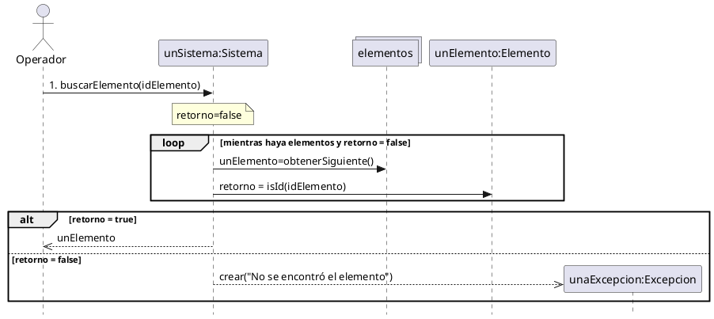
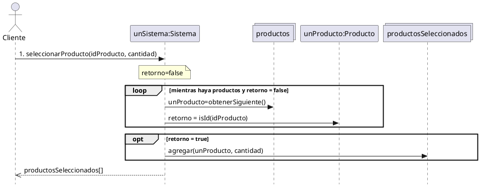
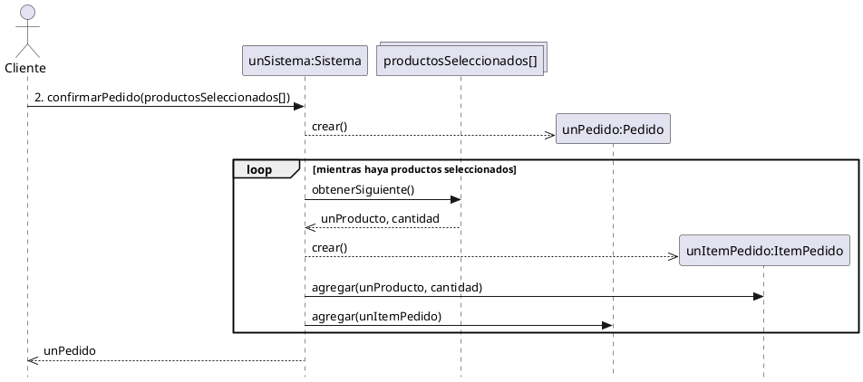
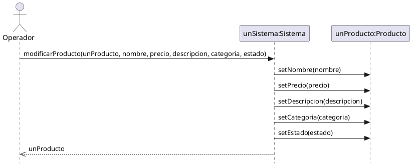
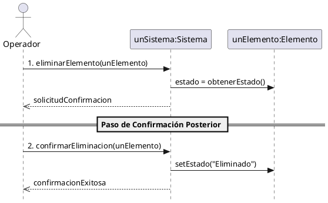

# Reglas y Estándares para Diagramas de Secuencia de Diseño (DSD)

Este documento establece las normativas metodológicas y convenciones gráficas obligatorias para la elaboración de los **Diagramas de Secuencia de Diseño (DSD)** dentro de la documentación de ingeniería de software, respetando estrictamente los lineamientos de la cátedra y las realizaciones de casos de uso según Craig Larman (Proceso Unificado).

---

## 1. Estructura Documental y Jerarquía Obligatoria

Los DSD no se agrupan de forma libre ni se diseña un único diagrama monolítico por caso de uso. La documentación debe seguir una jerarquía formal de **1 DSD por cada Operación de Sistema** definida en los Diagramas de Secuencia del Sistema (DSS) y especificada en los Contratos de Operación.

### Plantilla de Organización por Sección:

```markdown
### 3.4.X. DSD del CU-[NN] [Nombre del Caso de Uso]
[Link al DSS](ruta_o_ancla_al_dss)

#### DSD - operacionUno(parametro1, parametro2, ...)
[Link al contrato](ruta_o_ancla_al_contrato)

```plantuml
... diagrama PlantUML de operacionUno ...
```
*Figura N° 3.4.X.Y: DSD operacionUno*

#### DSD - operacionDos(unObjeto, ...)
[Link al contrato](ruta_o_ancla_al_contrato)

```plantuml
... diagrama PlantUML de operacionDos ...
```
*Figura N° 3.4.X.Z: DSD operacionDos*
```

---

## 2. Nomenclatura y Convenciones de Participantes (Líneas de Vida)

1. **Actor Externo:**
   - Se ubica en el extremo izquierdo. Representa el rol humano (ej. `Cliente`, `Operador`, `Cajero`, `Administrador`).
2. **Controlador Fachada (Patrón Controlador de Larman):**
   - La primera línea de vida del software que recibe el mensaje del actor es **siempre la instancia raíz del dominio** (Fachada del Negocio).
   - Formato camelCase con prefijo `un`/`una`: `unOwens:Owens`, `unRestaurante:Restaurante`, `unAutocine:Autocine` o `unSistema:Sistema`.
   - **Prohibido:** Usar controladores técnicos de frameworks (`VentaController`, `SpringRestController`), DAOs, servicios de persistencia o tablas de base de datos.
3. **Instancias de Clases del Dominio:**
   - Formato camelCase con prefijo descriptivo de género: `unProducto:Producto`, `unaPelicula:Pelicula`, `unPedido:Pedido`, `unItemPedido:ItemPedido`, `unaExcepcion:Excepcion`.
4. **Colecciones y Multiobjetos (Multiobjects):**
   - Cuando se representa un conjunto/lista de entidades en memoria, se utiliza la caja apilada de UML (`collections` en PlantUML).
   - Formato en plural o con corchetes: `productos`, `peliculas`, `productosSeleccionados[]`.
5. **Creación Dinámica de Objetos (`create`):**
   - Si una instancia se crea durante la ejecución del método, su caja no debe figurar al tope del diagrama; nace a la altura de la flecha de creación discontinua `crear()` o `crear(...)`.

---

## 3. Patrones Canónicos de Interacción de la Cátedra

### Patrón A: Búsqueda y Validación en Colección (Query / Search Pattern)
Aplica a operaciones de búsqueda como `buscarPelicula(idPelicula)`, `buscarProducto(idProducto)`, `buscarVenta(nroTicket)`.

**Lógica canónica:**
1. Nota adherida al controlador: `retorno=false`.
2. Bloque `loop` con la condición exacta: `[mientras haya <coleccion> y retorno = false]`.
3. El controlador pide el elemento a la colección: `unElemento=obtenerSiguiente()`.
4. El controlador consulta a la entidad si coincide con el identificador: `retorno = isId(idBuscado)`.
5. Bloque `alt`:
   - `[retorno = true]`: Retorno sincrónico (flecha punteada) de la instancia `unElemento` al Actor.
   - `[retorno = false]`: Instanciación de una excepción `crear("Mensaje descriptivo")` hacia `unaExcepcion:Excepcion`.



---

### Patrón B: Selección e Incorporación a Lista Temporal (Carrito / Filtro)
Aplica a operaciones como `seleccionarProducto(idProducto, cantidad)` o `seleccionarInsumo(idInsumo, cantidad)`.

**Lógica canónica:**
1. Nota `retorno=false`.
2. Búsqueda en la colección general mediante `Loop` (`obtenerSiguiente()` e `isId(...)`).
3. Bloque condicional `opt` con guarda `[retorno = true]`:
   - El controlador envía el mensaje `agregar(unElemento, cantidad)` a la colección de seleccionados `elementosSeleccionados`.
4. Retorno al actor de la lista resultante con flecha punteada: `elementosSeleccionados[]`.



---

### Patrón C: Creación y Desglose Maestro-Detalle (Itemización)
Aplica a operaciones de alta transaccional como `confirmarPedido(productosSeleccionados[])` o `confirmarReceta(insumosSeleccionados[])`.

**Lógica canónica:**
1. El actor invoca la operación pasando la lista de selección temporal acumulada.
2. El controlador crea la entidad cabecera mediante `crear()` dirigida a `unPedido:Pedido` (o `unaComanda:Comanda`).
3. Bloque `loop` con guarda `[mientras haya productos seleccionados]`:
   - El controlador extrae el ítem de la lista: `obtenerSiguiente()` a `productosSeleccionados[]`.
   - La lista retorna los datos: flecha punteada `unProducto, cantidad`.
   - El controlador crea la línea de detalle: `crear()` dirigida a `unItemPedido:ItemPedido`.
   - El controlador configura los datos: `agregar(unProducto, cantidad)` en `unItemPedido`.
   - El controlador vincula el detalle al maestro: `agregar(unItemPedido)` en `unPedido`.
4. Retorno final de la entidad creada `unPedido` hacia el actor (flecha punteada).



---

### Patrón D: Modificación y Actualización de Atributos (Setters Secuenciales)
Aplica a operaciones de edición como `modificarPelicula(unaPelicula, titulo, ...)` o `modificarProducto(unProducto, nombre, precio, ...)`.

**Lógica canónica:**
1. El actor envía la operación con la referencia al objeto a editar y todos sus nuevos valores.
2. El controlador invoca secuencialmente los métodos setter sobre la instancia del objeto.
3. El controlador retorna la instancia actualizada al actor con flecha punteada.



---

### Patrón E: Baja Lógica / Consulta de Estado y Confirmación
Aplica a operaciones de eliminación o anulación como `eliminarPelicula(unaPelicula)` o `solicitarBajaProducto(unProducto)`.

**Lógica canónica:**
1. El actor invoca la intención de eliminar: `eliminarElemento(unElemento)`.
2. El controlador consulta el estado actual del objeto: `estado = obtenerEstado()` a `unElemento:Elemento`.
3. El controlador retorna una solicitud de confirmación al actor: `solicitudConfirmacion` (flecha punteada).
4. En la operación subsiguiente `confirmarEliminacion(unElemento)`, el controlador invoca `setEstado("Inactivo")` o remueve el objeto de la colección del sistema.



---

## 4. Checklist de Validación y Conformidad para Corrección de Cátedra

Antes de dar por finalizado un DSD, verificar los siguientes puntos:

- [ ] **Granularidad:** ¿Hay un diagrama separado para cada operación de sistema del DSS? (No juntar operaciones en un solo diagrama).
- [ ] **Trazabilidad:** ¿Cada diagrama incluye arriba `[Link al contrato]` y la sección del caso de uso incluye `[Link al DSS]`?
- [ ] **Epígrafe:** ¿Figura `Figura N° xxxx` (o numeración correlativa) al pie de cada diagrama?
- [ ] **Controlador:** ¿La primera línea de vida es la fachada del dominio (`unSistema:Sistema` / `unOwens:Owens`) y no un controlador técnico web?
- [ ] **Búsquedas:** ¿Las búsquedas usan `retorno=false`, `loop mientras haya X y retorno=false`, `obtenerSiguiente()` y `isId()`?
- [ ] **Multiobjetos:** ¿Las listas de objetos usan notación `collections` (cajas apiladas)?
- [ ] **Creaciones:** ¿Las creaciones usan `crear()` con flecha discontinua apuntando al encabezado de la nueva línea de vida?
- [ ] **Retornos:** ¿Los retornos hacia el actor se realizan con flecha discontinua (`-->>`)?
