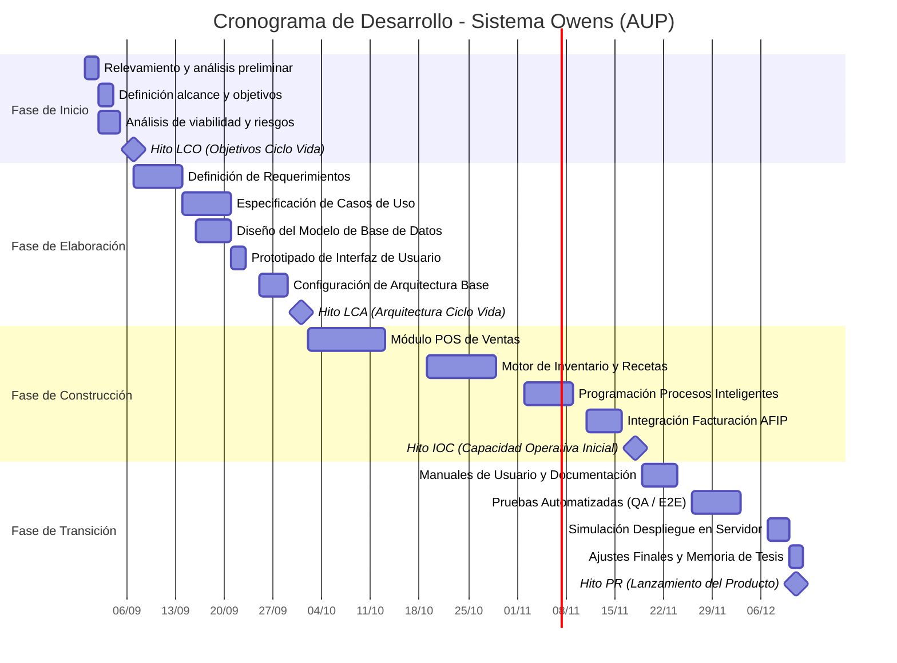

# 1.4 Calendario del Proyecto

A continuación se presenta el calendario de las principales tareas del proyecto. El proceso iterativo e incremental del Proceso Unificado Ágil (AUP) está caracterizado por la realización en paralelo de las distintas disciplinas de ingeniería, haciendo énfasis progresivo en cada área conforme avanza el ciclo de vida.

El cronograma sigue rigurosamente las cuatro fases de UP (Inicio, Elaboración, Construcción y Transición), alineado a las pautas de planificación de proyectos de software (Sommerville, 2011).

### Tabla 12
**Calendario del Proyecto**

| ID | Nombre de Tarea / Fase | Inicio | Fin | Duración (días) | Predecesores |
| :---: | :--- | :---: | :---: | :---: | :---: |
| **-** | **Fase de Inicio** | **31/08/2026** | **04/09/2026** | **5** | **-** |
| 1 | Relevamiento de datos y análisis preliminar | 31/08/2026 | 01/09/2026 | 2 | - |
| 2 | Definición del alcance, objetivos y limitaciones | 02/09/2026 | 03/09/2026 | 2 | 1 |
| 3 | Análisis de viabilidad y Gestión de Riesgos | 02/09/2026 | 04/09/2026 | 3 | 1 |
| 4 | **Hito de Objetivos del Ciclo de Vida (LCO)** | 07/09/2026 | 07/09/2026 | 0 | 2, 3 |
| **-** | **Fase de Elaboración** | **07/09/2026** | **30/09/2026** | **18** | **-** |
| 5 | Análisis de Requerimientos: Definición | 07/09/2026 | 15/09/2026 | 7 | 4 |
| 6 | Especificación y diseño: Definición de Casos de Uso | 16/09/2026 | 24/09/2026 | 7 | 5 |
| 7 | Diseño del Modelo de Base de Datos | 16/09/2026 | 22/09/2026 | 5 | 5 |
| 8 | Diseño de Interfaz de Usuario (Prototipado) | 23/09/2026 | 24/09/2026 | 2 | 7 |
| 9 | Configuración de la arquitectura base | 25/09/2026 | 30/09/2026 | 4 | 6, 8 |
| 10 | **Hito de Arquitectura del Ciclo de Vida (LCA)** | 01/10/2026 | 01/10/2026 | 0 | 9 |
| **-** | **Fase de Construcción** | **02/10/2026** | **17/11/2026** | **33** | **-** |
| 11 | Implementación del módulo POS de Ventas | 02/10/2026 | 16/10/2026 | 11 | 10 |
| 12 | Desarrollo del motor de inventario y recetas | 19/10/2026 | 30/10/2026 | 10 | 11 |
| 13 | Programación de Procesos Inteligentes | 02/11/2026 | 10/11/2026 | 7 | 12 |
| 14 | Integración de Facturación Electrónica (AFIP) | 11/11/2026 | 17/11/2026 | 5 | 13 |
| 15 | **Hito de Capacidad Operativa Inicial (IOC)** | 18/11/2026 | 18/11/2026 | 0 | 14 |
| **-** | **Fase de Transición** | **19/11/2026** | **11/12/2026** | **17** | **-** |
| 16 | Diseño de manuales de usuario y documentación | 19/11/2026 | 25/11/2026 | 5 | 15 |
| 17 | Verificación y Validación: Pruebas Automatizadas (QA) | 26/11/2026 | 04/12/2026 | 7 | 16 |
| 18 | Simulación de despliegue y configuración en entorno real | 07/12/2026 | 09/12/2026 | 3 | 17 |
| 19 | Puesta a punto y redacción de Memoria Final | 10/12/2026 | 11/12/2026 | 2 | 18 |
| 20 | **Hito de Lanzamiento del Producto (PR)** | 11/12/2026 | 11/12/2026 | 0 | 19 |

---

### Figura 1
**Diagrama de Gantt del Proyecto**

*Nota.* Elaboración propia mediante el software GanttProject y representación gráfica en Proceso Unificado. El diagrama detalla las dependencias de las tareas y los hitos correspondientes a la metodología UP.
