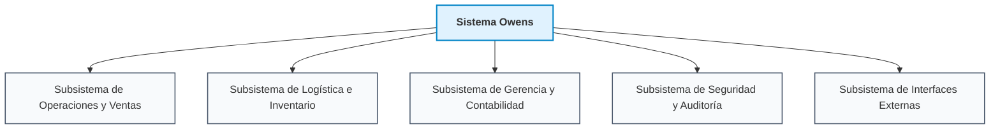

# 1.5.2 Subsistemas del Proyecto

Para gestionar la complejidad operativa del Sistema Owens y establecer límites funcionales claros, el sistema se estructura en subsistemas principales organizados por paquetes lógicos. Esta división modular asegura un bajo acoplamiento y una alta cohesión entre los procesos de negocio.

## 1.5.2.1 Diagrama de Subsistemas

### Figura 2
**Subsistemas del Sistema Owens**

*Nota.* Elaboración propia. Arquitectura de descomposición modular por subsistemas funcionales.

---

## 1.5.2.2 Descripción de Subsistemas

* **Subsistema de Operaciones y Ventas:** Este módulo permite la apertura de la sesión comercial diaria. Soporta una alta concurrencia para el cobro rápido en mostrador. Incluye los casos de uso críticos: Registrar Venta, Modificar Cliente, y Visualizar Comandas para la preparación inmediata.
* **Subsistema de Logística e Inventario:** Centraliza el abastecimiento y trazabilidad física de los productos. Gestiona el catálogo de artículos, costeo de recetas, control de proveedores, recepción de compras mediante remitos, declaración de producción interna y ajustes ante desvíos de stock.
* **Subsistema de Gerencia y Contabilidad:** Se enfoca en el análisis financiero. Procesa los datos brutos de ventas para renderizar gráficos de rentabilidad e histórico de demanda para la toma de decisiones gerenciales, permitiendo además imputar gastos operativos fijos.
* **Subsistema de Seguridad y Auditoría:** Garantiza que ninguna transacción financiera pueda ser vulnerada. Centraliza la administración de usuarios, asigna credenciales y asegura el rastro inmutable de todas las operaciones críticas mediante la pista de auditoría.
* **Subsistema de Interfaces Externas:** Gestiona la interoperabilidad. Actúa como adaptador (*Adapter Pattern*) para consumir APIs RESTful o servicios SOAP (como el de AFIP) mediante conexiones seguras HTTPS. Asimismo, alberga el planificador de tareas para los módulos inteligentes, garantizando que el sistema trabaje de manera asíncrona.
