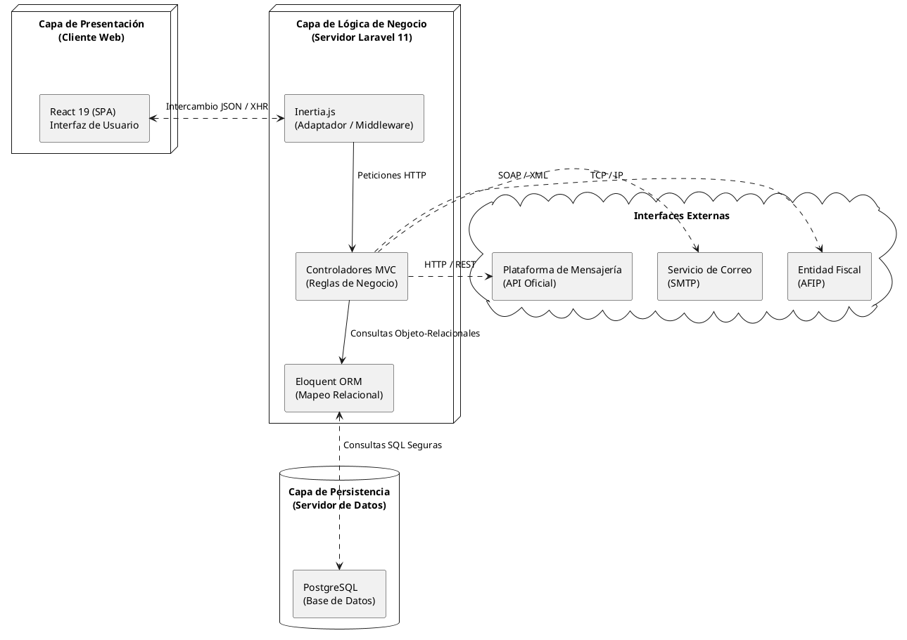

### 2.2 Arquitectura del Sistema (Monolito Moderno de 3-Capas)

Para garantizar la escalabilidad, el mantenimiento y la seguridad del sistema "Owens", se adoptó un estilo arquitectónico de **Monolito Moderno de 3-Capas**. Esta arquitectura impulsada por Inertia.js permite un acoplamiento ágil entre el frontend y el backend sin necesidad de construir una API REST tradicional, separando claramente las responsabilidades del sistema en tres capas lógicas distintas, tal como se ilustra a continuación:

### Figura 9
**Diagrama de Arquitectura de Software (Monolito Moderno de 3-Capas)**

#### Descripción de las Capas

1. **Capa de Presentación (Frontend):** 
   Construida como una Single Page Application (SPA) utilizando **React 19**. Esta capa se encarga exclusivamente de la interfaz de usuario, la captura de eventos (clics, ingresos por teclado) y la renderización dinámica de los datos sin recargar la página. Para la comunicación fluida entre el servidor y el cliente sin necesidad de construir una API REST tradicional compleja, se emplea **Inertia.js**, lo que permite construir componentes de React como si fueran vistas del servidor.

2. **Capa de Lógica de Negocio (Backend):** 
   Soportada por el framework **Laravel 11** (PHP). Esta capa actúa como el "cerebro" del sistema. Aquí se implementa el patrón MVC (Modelo-Vista-Controlador). Los controladores procesan las peticiones HTTP entrantes, validan las credenciales (Middlewares), aplican las reglas de negocio (como el descuento recursivo de inventario en recetas) y se comunican con los servicios externos (Web Services de AFIP).

3. **Capa de Persistencia de Datos:** 
   Implementada sobre **PostgreSQL**, un motor de base de datos relacional robusto. Se encarga de almacenar de forma segura y consistente la información operativa (ventas, stock, auditorías). La interacción con la base de datos se realiza a través de *Eloquent ORM*, el mapeador objeto-relacional nativo de Laravel, que previene ataques de inyección SQL y facilita las transacciones atómicas.

**Patrón de Comunicación (Interoperabilidad):**
La arquitectura subyacente sigue un patrón de **Monolito Moderno**. Las funcionalidades críticas y las reglas de negocio están encapsuladas en controladores independientes bajo el patrón MVC. Esto permite una comunicación fluida y veloz con las vistas de React mediante Inertia.js, y a la vez deja abierta la posibilidad de refactorizar y exponer endpoints API REST en el futuro si se requiriera conectar aplicaciones móviles nativas.

#### Protocolos y Formatos de Intercambio (Análisis de Flujos)
El diagrama de arquitectura define flujos de comunicación precisos entre los componentes. A continuación se justifica técnicamente cada tecnología de intercambio, reflejando el funcionamiento **real y actual** del código en el sistema:

*   **React 19 ↔ Inertia.js (JSON / XHR):** La comunicación *sí* ocurre a través del protocolo HTTP, pero de forma asíncrona mediante peticiones XHR (Fetch). La clave es que el backend de Laravel no devuelve vistas HTML renderizadas, sino un payload en formato `JSON` que contiene los datos puros y el nombre del componente de React que debe actualizarse. Esto da la velocidad de una SPA sin obligarte a construir una API REST pesada para el frontend.
*   **Eloquent ORM ↔ PostgreSQL (Consultas SQL):** El ORM (Capa de Lógica) no habla con la base de datos en código PHP. Traduce dinámicamente tus objetos de código a sentencias `SQL` puras que el motor PostgreSQL puede entender. Esto se hace de forma automática usando *Prepared Statements* de PDO para brindar máxima seguridad contra Inyecciones SQL.
*   **Controladores ↔ Entidad Fiscal AFIP (SOAP / XML):** A diferencia de las APIs modernas, el gobierno argentino (AFIP) expone sus servicios (WSFEv1) mediante tecnología legacy `SOAP`. El sistema debe generar estrictamente "sobres" en formato `XML`, firmarlos con tu certificado criptográfico y enviarlos a los servidores de AFIP para autorizar comprobantes.
*   **Controladores ↔ Servicio de Correo SMTP (TCP / IP):** El despacho de emails (alertas, envío de comprobantes PDF al cliente) ocurre directamente contactando al servidor de correo mediante el protocolo estándar SMTP, el cual se apoya en una conexión de socket pura a nivel de red (`TCP/IP`), garantizando la entrega del paquete de datos.
*   **Controladores ↔ Plataforma de Mensajería Externa (HTTP / REST):** Para la automatización del menú digital o fidelización (UC-48 y UC-49), el sistema se conecta a la API Oficial de Mensajería Corporativa consumiendo endpoints de arquitectura `RESTful` estándar, enviando comandos a través del protocolo seguro `HTTPS`.
