# 2.3 Modelo de Datos (Esquema Relacional)

La persistencia de la información en el sistema Owens está sustentada por una base de datos relacional implementada en PostgreSQL. El diseño del modelo de datos fue concebido bajo estrictos criterios de integridad referencial y normalización, garantizando la consistencia de las operaciones comerciales críticas a lo largo del tiempo.

Para estructurar la base de datos, se aplicaron las reglas de la Tercera Forma Normal (3FN), eliminando la redundancia de datos y las anomalías de actualización. A nivel arquitectónico, el modelo destaca por la implementación de tres estrategias de diseño fundamentales para el dominio gastronómico.

En primer lugar, respecto a la ingeniería de menú e inventario, el modelo diferencia explícitamente los **Insumos** (materia prima que se compra, se acopia y tiene atributos de trazabilidad como lote y vencimiento) de los **Productos** (ítems elaborados que se venden y tienen precio). La tabla `recetas` actúa como puente de una relación uno a muchos (1:N) resolviendo la lista de materiales (BOM) donde un Producto se compone de múltiples Insumos. Esta estructura relacional constituye el motor lógico para el descuento de inventario.

En segundo lugar, para garantizar la trazabilidad y auditoría global, el sistema se apoya en dos pilares: el patrón de borrado lógico (*Soft Deletes*) y una tabla centralizada de Auditoría del Sistema (*Audit Trail*). El borrado lógico previene la destrucción del historial contable marcando los registros con un sello de tiempo (`fecha_eliminacion`) en lugar de borrarlos físicamente (Codd, 1970). Simultáneamente, la tabla polimórfica `logs_auditoria_sistema` actúa como un log inmutable que registra quién modificó una tabla, cuándo, y qué valores existían antes y después de la operación (en formato JSON), respondiendo a los más altos estándares de seguridad y rendición de cuentas.

Finalmente, el diseño garantiza el control de concurrencia y la trazabilidad temporal de los flujos monetarios. Por un lado, las transacciones de ventas y ajustes de stock se ejecutan atómicamente bajo propiedades ACID. Por otro lado, la entidad `sesiones_caja` almacena los sellos de tiempo y montos de cierre (`monto_cierre`, `fecha_apertura`, `fecha_cierre`) para resolver matemáticamente el arqueo de caja (UC-03 y UC-29) y detectar discrepancias en gaveta física. De forma complementaria, la tabla `compras` incorpora `fecha_compra` para habilitar el cálculo de balances y rentabilidad periódica (UC-30 y UC-31) al contrastarse contra las ventas devengadas.

A continuación, la Figura 10 presenta el Diagrama Entidad-Relación (DER) que modela los flujos principales del sistema (Ventas, Compras, Caja y Recetas).

### Figura 10
**Diagrama Entidad-Relación (Modelo Físico de Datos)**

```plantuml
@startuml
skinparam linetype ortho
skinparam nodesep 40
skinparam ranksep 40
skinparam class {
    BackgroundColor white
    ArrowColor #2C3E50
    BorderColor #2C3E50
}

' --- Entidades Maestras ---
entity "usuarios" as usuarios {
  * id : bigInt
  --
  nombre : varchar(255)
  correo : varchar(255) <<UK>>
  rol : varchar(255)
  fecha_eliminacion : timestamp <<N>>
}

entity "clientes" as clientes {
  * id : bigInt
  --
  nombre : varchar(255)
  documento : varchar(255) <<UK>> <<N>>
  telefono : varchar(255) <<UK>> <<N>>
  correo : varchar(255) <<UK>> <<N>>
  fecha_eliminacion : timestamp <<N>>
}

entity "proveedores" as proveedores {
  * id : bigInt
  --
  nombre : varchar(255)
  info_contacto : varchar(255) <<N>>
  fecha_eliminacion : timestamp <<N>>
}

entity "productos" as productos {
  * id : bigInt
  --
  nombre : varchar(255)
  descripcion : text <<N>>
  precio : decimal(10,2)
  imagen_url : varchar(255) <<N>>
  id_alicuota_iva : bigInt <<FK>> <<N>>
  categoria : varchar(255) <<N>>
  id_usuario : bigInt <<FK>> <<N>>
  fecha_eliminacion : timestamp <<N>>
}

entity "insumos" as insumos {
  * id : bigInt
  --
  nombre : varchar(255)
  costo : decimal(10,2)
  id_alicuota_iva : bigInt <<FK>> <<N>>
  stock : int
  stock_minimo : int
  categoria : varchar(255) <<N>>
  lote : varchar(255) <<N>>
  fecha_vencimiento : date <<N>>
  id_usuario : bigInt <<FK>> <<N>>
  fecha_eliminacion : timestamp <<N>>
}

' --- Impuestos y Cotizaciones ---
entity "alicuotas_iva" as alicuotas_iva {
  * id : bigInt
  --
  porcentaje : decimal(5,2)
  descripcion : varchar(255)
}

entity "proveedor_insumo_precios" as proveedor_insumo_precios {
  * id : bigInt
  --
  id_proveedor : bigInt <<FK>>
  id_insumo : bigInt <<FK>>
  precio_ultima_compra : decimal(10,2)
  fecha_actualizacion : date
}

' --- Recetas e Inventario ---
entity "recetas" as recetas {
  * id : bigInt
  --
  id_producto : bigInt <<FK>>
  id_insumo : bigInt <<FK>>
  cantidad : decimal(10,4)
}

entity "movimientos_inventario" as movimientos_inventario {
  * id : bigInt
  --
  id_insumo : bigInt <<FK>>
  cantidad : int
  tipo_movimiento : varchar(255)
  id_usuario : bigInt <<FK>> <<N>>
}

' --- Auditoría Global de Sistema (Audit Trail) ---
entity "logs_auditoria_sistema" as logs_auditoria_sistema {
  * id : bigInt
  --
  id_usuario : bigInt <<FK>> <<N>>
  accion : varchar(50)
  tabla_afectada : varchar(255)
  registro_id : bigInt
  valores_anteriores : json <<N>>
  valores_nuevos : json <<N>>
  fecha_hora : timestamp
  ip_origen : varchar(45) <<N>>
}

' --- Ventas e Impuestos ---
entity "ventas" as ventas {
  * id : bigInt
  --
  fecha_venta : datetime
  precio_total : decimal(10,2)
  estado_comanda : varchar(255)
  id_cliente : bigInt <<FK>> <<N>>
  id_usuario : bigInt <<FK>> <<N>>
  afip_cae : varchar(20) <<N>>
  afip_vencimiento : date <<N>>
  fecha_eliminacion : timestamp <<N>>
}

entity "detalle_ventas" as detalle_ventas {
  * id : bigInt
  --
  id_venta : bigInt <<FK>>
  id_producto : bigInt <<FK>> <<N>>
  cantidad : int
  subtotal : decimal(10,2)
}

entity "metodos_pago" as metodos_pago {
  * id : bigInt
  --
  nombre : varchar(255)
  activo : boolean
}

entity "pagos_ventas" as pagos_ventas {
  * id : bigInt
  --
  id_venta : bigInt <<FK>>
  id_metodo_pago : bigInt <<FK>>
  monto : decimal(10,2)
}

' --- Mensajería Externa ---
entity "mensajeria_externa" as mensajeria_externa {
  * id : bigInt
  --
  id_cliente : bigInt <<FK>> <<N>>
  numero_remitente : varchar(255)
  cuerpo_mensaje : text <<N>>
  estado : varchar(255)
}

' --- Compras ---
entity "compras" as compras {
  * id : bigInt
  --
  id_proveedor : bigInt <<FK>> <<N>>
  costo_total : decimal(10,2)
  fecha_compra : timestamp
  id_usuario : bigInt <<FK>> <<N>>
}

entity "detalle_compras" as detalle_compras {
  * id : bigInt
  --
  id_compra : bigInt <<FK>>
  id_insumo : bigInt <<FK>> <<N>>
  cantidad : int
  costo_total : decimal(10,2)
}

' --- Gastos ---
entity "categorias_gastos" as categorias_gastos {
  * id : bigInt
  --
  nombre : varchar(255)
}

entity "gastos" as gastos {
  * id : bigInt
  --
  id_categoria : bigInt <<FK>> <<N>>
  monto : decimal(10,2)
  id_usuario : bigInt <<FK>> <<N>>
}

' --- Caja ---
entity "sesiones_caja" as sesiones_caja {
  * id : bigInt
  --
  id_usuario : bigInt <<FK>>
  monto_apertura : decimal(10,2)
  monto_cierre : decimal(10,2) <<N>>
  fecha_apertura : timestamp
  fecha_cierre : timestamp <<N>>
  estado : varchar(255)
}

entity "transacciones_caja" as transacciones_caja {
  * id : bigInt
  --
  id_sesion_caja : bigInt <<FK>>
  monto : decimal(10,2)
  tipo : varchar(255)
  justificacion : varchar(255) <<N>>
  fecha_hora : timestamp
}

entity "cupones_descuento" as cupones_descuento {
  * id : bigInt
  --
  id_cliente : bigInt <<FK>>
  codigo : varchar(50) <<UK>>
  porcentaje_descuento : decimal(5,2)
  fecha_vencimiento : date
  estado : varchar(50)
}

' --- Configuraciones ---
entity "configuraciones" as configuraciones {
  * id : bigInt
  --
  clave : varchar(255) <<UK>>
  valor : text <<N>>
}

' --- Relaciones ---
usuarios "1" -- "0..*" productos : "gestiona >"
usuarios "1" -- "0..*" insumos : "gestiona >"
usuarios "1" -- "0..*" ventas : "registra >"
usuarios "1" -- "0..*" compras : "carga >"
usuarios "1" -- "0..*" gastos : "asienta >"
usuarios "1" -- "0..*" sesiones_caja : "opera >"
usuarios "1" -- "0..*" movimientos_inventario : "ejecuta >"
usuarios "1" -- "0..*" logs_auditoria_sistema : "genera traza en >"

clientes "1" -- "0..*" ventas : "realiza >"
clientes "1" -- "0..*" mensajeria_externa : "recibe >"
clientes "1" -- "0..*" cupones_descuento : "obtiene >"

productos "1" -- "0..*" recetas : "es producto final >"
insumos "1" -- "0..*" recetas : "es ingrediente >"
insumos "1" -- "0..*" movimientos_inventario : "posee >"

ventas "1" -- "1..*" detalle_ventas : "contiene >"
ventas "1" -- "1..*" pagos_ventas : "se abona con >"
metodos_pago "1" -- "0..*" pagos_ventas : "define >"
productos "1" -- "0..*" detalle_ventas : "se incluye en >"

proveedores "1" -- "0..*" compras : "abastece >"
compras "1" -- "1..*" detalle_compras : "contiene >"
insumos "1" -- "0..*" detalle_compras : "se incluye en >"

alicuotas_iva "1" -- "0..*" productos : "grava >"
alicuotas_iva "1" -- "0..*" insumos : "grava >"

proveedores "1" -- "0..*" proveedor_insumo_precios : "oferta >"
insumos "1" -- "0..*" proveedor_insumo_precios : "cotiza >"

categorias_gastos "1" -- "0..*" gastos : "clasifica >"

sesiones_caja "1" -- "0..*" transacciones_caja : "registra >"
@enduml
```

*Nota.* Elaboración propia. El modelo representa el esquema físico implementado en el gestor de bases de datos relacional.
