# 2.3 Modelo de Datos (Esquema Relacional)

La persistencia de la información en el sistema Owens está sustentada por una base de datos relacional implementada en PostgreSQL. El diseño del modelo de datos fue concebido bajo estrictos criterios de integridad referencial y normalización, garantizando la consistencia de las operaciones comerciales críticas a lo largo del tiempo.

Para estructurar la base de datos, se aplicaron las reglas de la Tercera Forma Normal (3FN), eliminando la redundancia de datos y las anomalías de actualización. A nivel arquitectónico, el modelo destaca por la implementación de tres estrategias de diseño fundamentales para el dominio gastronómico.

En primer lugar, respecto a la ingeniería de menú (productos y recetas), se implementó una relación de muchos a muchos (M:N) resuelta mediante tablas intermedias. Esto permite que un producto final (e.g., hamburguesa) esté compuesto por múltiples materias primas (pan, medallón, queso), y simultáneamente, que una misma materia prima pertenezca a múltiples recetas. Esta estructura relacional constituye el motor lógico para el descuento recursivo de inventario.

En segundo lugar, para garantizar la trazabilidad y auditoría, se incorporó el patrón de borrado lógico (*Soft Deletes*). En lugar de eliminar registros físicamente de la base de datos, acción que destruiría el historial contable, el registro permanece inalterado pero se marca con un sello de tiempo (`fecha_eliminacion`). Este mecanismo garantiza que los reportes estadísticos históricos mantengan su precisión y valor legal ante eventuales auditorías (Codd, 1970).

Finalmente, el diseño garantiza el control de concurrencia. La estructura relacional definida permite que las transacciones de ventas y los ajustes de stock se ejecuten de manera atómica bajo las propiedades ACID, evitando problemas de lecturas sucias o sobreescritura de datos cuando múltiples cajeros operan simultáneamente durante los picos de demanda.

A continuación, la Figura 2 presenta el Diagrama Entidad-Relación (DER) que modela los flujos principales del sistema (Ventas, Compras, Caja y Recetas).

**Figura 2**
*Diagrama Entidad-Relación (Modelo Físico de Datos)*

```plantuml
@startuml
skinparam linetype ortho
skinparam nodesep 40
skinparam ranksep 40
skinparam class {
    BackgroundColor white
    ArrowColor #2C3E50
    BorderColor #2C3E50
}

' --- Entidades Maestras ---
entity "usuarios" as usuarios {
  * id : bigInt
  --
  nombre : varchar(255)
  correo : varchar(255) <<UK>>
  rol : varchar(255)
  fecha_eliminacion : timestamp <<N>>
}

entity "clientes" as clientes {
  * id : bigInt
  --
  nombre : varchar(255)
  documento : varchar(255) <<UK>> <<N>>
  telefono : varchar(255) <<UK>> <<N>>
  correo : varchar(255) <<UK>> <<N>>
  fecha_eliminacion : timestamp <<N>>
}

entity "proveedores" as proveedores {
  * id : bigInt
  --
  nombre : varchar(255)
  info_contacto : varchar(255) <<N>>
  fecha_eliminacion : timestamp <<N>>
}

entity "productos" as productos {
  * id : bigInt
  --
  nombre : varchar(255)
  precio : decimal(10,2)
  costo : decimal(10,2)
  stock : int
  stock_minimo : int
  categoria : varchar(255) <<N>>
  id_usuario : bigInt <<FK>> <<N>>
  fecha_eliminacion : timestamp <<N>>
}

' --- Recetas e Inventario ---
entity "recetas" as recetas {
  * id : bigInt
  --
  id_producto_padre : bigInt <<FK>>
  id_producto_hijo : bigInt <<FK>>
  cantidad : decimal(10,4)
}

entity "auditoria_stock" as auditoria_stock {
  * id : bigInt
  --
  id_producto : bigInt <<FK>>
  cantidad : int
  tipo_movimiento : varchar(255)
  id_usuario : bigInt <<FK>> <<N>>
}

' --- Ventas e Impuestos ---
entity "ventas" as ventas {
  * id : bigInt
  --
  fecha_venta : datetime
  precio_total : decimal(10,2)
  estado_comanda : varchar(255)
  id_cliente : bigInt <<FK>> <<N>>
  id_usuario : bigInt <<FK>> <<N>>
  afip_cae : varchar(20) <<N>>
  afip_vencimiento : date <<N>>
  fecha_eliminacion : timestamp <<N>>
}

entity "detalle_ventas" as detalle_ventas {
  * id : bigInt
  --
  id_venta : bigInt <<FK>>
  id_producto : bigInt <<FK>> <<N>>
  cantidad : int
  subtotal : decimal(10,2)
}

entity "metodos_pago" as metodos_pago {
  * id : bigInt
  --
  nombre : varchar(255)
  activo : boolean
}

entity "pagos_ventas" as pagos_ventas {
  * id : bigInt
  --
  id_venta : bigInt <<FK>>
  id_metodo_pago : bigInt <<FK>>
  monto : decimal(10,2)
}

' --- Mensajería Externa ---
entity "mensajeria_externa" as mensajeria_externa {
  * id : bigInt
  --
  id_cliente : bigInt <<FK>> <<N>>
  numero_remitente : varchar(255)
  cuerpo_mensaje : text <<N>>
  estado : varchar(255)
}

' --- Compras ---
entity "compras" as compras {
  * id : bigInt
  --
  id_proveedor : bigInt <<FK>> <<N>>
  costo_total : decimal(10,2)
  id_usuario : bigInt <<FK>> <<N>>
}

entity "detalle_compras" as detalle_compras {
  * id : bigInt
  --
  id_compra : bigInt <<FK>>
  id_producto : bigInt <<FK>> <<N>>
  cantidad : int
  costo_total : decimal(10,2)
}

' --- Gastos ---
entity "categorias_gastos" as categorias_gastos {
  * id : bigInt
  --
  nombre : varchar(255)
}

entity "gastos" as gastos {
  * id : bigInt
  --
  id_categoria : bigInt <<FK>> <<N>>
  monto : decimal(10,2)
  id_usuario : bigInt <<FK>> <<N>>
}

' --- Caja ---
entity "sesiones_caja" as sesiones_caja {
  * id : bigInt
  --
  id_usuario : bigInt <<FK>>
  monto_apertura : decimal(10,2)
  estado : varchar(255)
}

entity "transacciones_caja" as transacciones_caja {
  * id : bigInt
  --
  id_sesion_caja : bigInt <<FK>>
  monto : decimal(10,2)
  tipo : varchar(255)
}

' --- Configuraciones ---
entity "configuraciones" as configuraciones {
  * id : bigInt
  --
  clave : varchar(255) <<UK>>
  valor : text <<N>>
}

' --- Relaciones ---
usuarios "1" -- "0..*" productos : "gestiona >"
usuarios "1" -- "0..*" ventas : "registra >"
usuarios "1" -- "0..*" compras : "carga >"
usuarios "1" -- "0..*" gastos : "asienta >"
usuarios "1" -- "0..*" sesiones_caja : "opera >"
usuarios "1" -- "0..*" auditoria_stock : "ejecuta >"

clientes "1" -- "0..*" ventas : "realiza >"
clientes "1" -- "0..*" mensajeria_externa : "recibe >"

productos "1" -- "0..*" recetas : "es producto final >"
productos "1" -- "0..*" recetas : "es ingrediente >"
productos "1" -- "0..*" auditoria_stock : "posee >"

ventas "1" -- "1..*" detalle_ventas : "contiene >"
ventas "1" -- "1..*" pagos_ventas : "se abona con >"
metodos_pago "1" -- "0..*" pagos_ventas : "define >"
productos "1" -- "0..*" detalle_ventas : "se incluye en >"

proveedores "1" -- "0..*" compras : "abastece >"
compras "1" -- "1..*" detalle_compras : "contiene >"
productos "1" -- "0..*" detalle_compras : "se incluye en >"

categorias_gastos "1" -- "0..*" gastos : "clasifica >"

sesiones_caja "1" -- "0..*" transacciones_caja : "registra >"
@enduml
```

*Nota.* Elaboración propia. El modelo representa el esquema físico implementado en el gestor de bases de datos relacional.
