# 2.3 Modelo de Datos (Esquema Relacional)

La persistencia de la información en el sistema Owens está sustentada por una base de datos relacional implementada en PostgreSQL. El diseño del modelo de datos fue concebido bajo estrictos criterios de integridad referencial y normalización en Tercera Forma Normal (3FN), garantizando la consistencia de las operaciones comerciales críticas y la trazabilidad bromatológica a lo largo del tiempo.

A nivel arquitectónico, el modelo implementa una solución formal para el dominio gastronómico articulada en torno a los siguientes pilares de diseño:

1. **Unificación Ontológica de Catálogo ("Todo es Insumo"):**  
   A diferencia de los modelos planos comerciales que bifurcan artificialmente la realidad entre "Productos" e "Insumos", el sistema adopta la premisa industrial de que **todo ítem físico es un insumo**. La *Hamburguesa Completa* (producto final), el *Medallón de Carne Casero* (semielaborado intermedio de cocina) y la *Carne Molida* (materia prima adquirida a granel) residen en la entidad maestra `insumos`. Aquellos insumos destinados a la venta al público cuentan con bandera comercial (`es_comercializable = true`), precio de venta y alícuota de IVA.

2. **Capa de Configuración: Recetas como Plantillas Abiertas y Versionadas:**  
   La composición gastronómica se modela como un grafo dirigido acíclico (DAG / Patrón Composite). La tabla `recetas` define la fórmula teórica asociada al insumo elaborado resultante. Dado que las fórmulas culinarias varían en el tiempo por razones de estacionalidad o estructura de costos, la tabla `receta_versiones` parametriza la vigencia temporal mediante sellos de intervalo (`fecha_desde`, `fecha_hasta`). La tabla asociativa `receta_insumos` vincula la versión con los insumos componentes mediante rangos operativos (`cantidad_minima`, `cantidad_maxima`), permitiendo parametrizar componentes opcionales (donde la cantidad mínima es cero) o sustitutos.

3. **Capa de Existencia Física y Trazabilidad Bromatológica:**  
   El sistema disocia tajantemente la **definición teórica (plano)** de la **existencia física real (instanciación en stock)**. No se recurre a un contador numérico estático de stock:
   * Cada lote físico acopiado o lote elaborado se materializa en la entidad `insumo_existencias`, registrando su `fecha_origen`, `fecha_vencimiento` (calculada dinámicamente según `duracion_cerrado` y `duracion_abierto`), cantidad física y versión de receta aplicada (si fue elaborado internamente).
   * La entidad recursiva `insumo_insumos` preserva el árbol genealógico completo de manufactura (`id_existencia_padre`, `id_existencia_hijo`, `cantidad`). Esto garantiza auditoría bromatológica bidireccional estricta: ante cualquier eventualidad sanitaria, es posible reconstruir retrospectivamente con qué lote específico de carne molida del 01/11 se elaboró el medallón incorporado a la hamburguesa servida al comensal el 04/11.

4. **Trazabilidad de Ventas, Compras y Auditoría Global:**  
   * **Ventas y Facturación:** La entidad `detalle_ventas` se vincula a los insumos comercializables despachados, mientras que la cobranza se normaliza en 3FN a través de `pagos_ventas` y `metodos_pago` (soportando cobros fraccionados o mixtos).
   * **Compras y Proveedores:** Las órdenes de abastecimiento (`compras` y `detalle_compras`) registran las adquisiciones de insumos a proveedores con fecha explícita (`fecha_compra`) para balance contable periódico.
   * **Auditoría Inmutable (Audit Trail) y Soft Deletes:** Todas las tablas maestras incorporan `fecha_eliminacion` para borrado lógico preservando el historial contable (Codd, 1970). Paralelamente, la tabla polimórfica `logs_auditoria_sistema` registra quién modificó qué entidad, cuándo, y qué valores existían antes y después en formato JSON.
   * **Turnos de Caja y Cierre Ciego:** La entidad `sesiones_caja` almacena sellos de tiempo de apertura y cierre (`fecha_apertura`, `fecha_cierre`) junto con el `monto_cierre` declarado a ciegas, resolviendo matemáticamente las diferencias de gaveta física en `transacciones_caja`.

A continuación, la Figura 10 presenta el Diagrama Entidad-Relación (DER) Físico que consolida la totalidad del modelo.

### Figura 10
**Diagrama Entidad-Relación (Modelo Físico de Datos con Trazabilidad Bromatológica)**

```plantuml
@startuml
skinparam linetype ortho
skinparam nodesep 35
skinparam ranksep 35
skinparam class {
    BackgroundColor white
    ArrowColor #2C3E50
    BorderColor #2C3E50
}

' --- SEGURIDAD Y USUARIOS ---
entity "usuarios" as usuarios {
  * id : bigInt
  --
  nombre : varchar(255)
  correo : varchar(255) <<UK>>
  rol : varchar(255)
  fecha_eliminacion : timestamp <<N>>
}

' --- UNIDADES DE MEDIDA E IMPUESTOS ---
entity "unidades_medida" as unidades_medida {
  * id : bigInt
  --
  nombre : varchar(50)
  simbolo : varchar(10)
}

entity "alicuotas_iva" as alicuotas_iva {
  * id : bigInt
  --
  porcentaje : decimal(5,2)
  descripcion : varchar(255)
}

' --- CAPA DE CONFIGURACIÓN: INSUMOS Y RECETAS ---
entity "insumos" as insumos {
  * id : bigInt
  --
  nombre : varchar(255)
  descripcion : text <<N>>
  id_unidad_medida : bigInt <<FK>>
  duracion_cerrado : int <<N>>
  duracion_abierto : int <<N>>
  precio_venta : decimal(10,2) <<N>>
  es_comercializable : boolean
  imagen_url : varchar(255) <<N>>
  categoria : varchar(255) <<N>>
  id_alicuota_iva : bigInt <<FK>> <<N>>
  id_usuario : bigInt <<FK>> <<N>>
  fecha_eliminacion : timestamp <<N>>
}

entity "recetas" as recetas {
  * id : bigInt
  --
  nombre : varchar(255)
  descripcion : text <<N>>
  id_insumo_producido : bigInt <<FK>>
}

entity "receta_versiones" as receta_versiones {
  * id : bigInt
  --
  id_receta : bigInt <<FK>>
  version_numero : int
  fecha_desde : date
  fecha_hasta : date <<N>>
}

entity "receta_insumos" as receta_insumos {
  * id : bigInt
  --
  id_receta_version : bigInt <<FK>>
  id_insumo : bigInt <<FK>>
  cantidad_minima : decimal(10,4)
  cantidad_maxima : decimal(10,4)
}

' --- CAPA DE EXISTENCIA FÍSICA Y TRAZABILIDAD (LOTES) ---
entity "insumo_existencias" as insumo_existencias {
  * id : bigInt
  --
  id_insumo : bigInt <<FK>>
  id_receta_version : bigInt <<FK>> <<N>>
  fecha_origen : timestamp
  cantidad : decimal(10,4)
  fecha_vencimiento : date <<N>>
  id_usuario : bigInt <<FK>> <<N>>
}

entity "insumo_insumos" as insumo_insumos {
  * id : bigInt
  --
  id_existencia_padre : bigInt <<FK>>
  id_existencia_hijo : bigInt <<FK>>
  cantidad : decimal(10,4)
}

' --- PROVEEDORES Y COMPRAS ---
entity "proveedores" as proveedores {
  * id : bigInt
  --
  nombre : varchar(255)
  info_contacto : varchar(255) <<N>>
  fecha_eliminacion : timestamp <<N>>
}

entity "proveedor_insumos_precios" as proveedor_insumos_precios {
  * id : bigInt
  --
  id_proveedor : bigInt <<FK>>
  id_insumo : bigInt <<FK>>
  precio_ultima_compra : decimal(10,2)
  fecha_actualizacion : date
}

entity "compras" as compras {
  * id : bigInt
  --
  id_proveedor : bigInt <<FK>> <<N>>
  costo_total : decimal(10,2)
  fecha_compra : timestamp
  id_usuario : bigInt <<FK>> <<N>>
}

entity "detalle_compras" as detalle_compras {
  * id : bigInt
  --
  id_compra : bigInt <<FK>>
  id_insumo : bigInt <<FK>> <<N>>
  cantidad : decimal(10,4)
  costo_total : decimal(10,2)
}

' --- CLIENTES Y FIDELIZACIÓN ---
entity "clientes" as clientes {
  * id : bigInt
  --
  nombre : varchar(255)
  documento : varchar(255) <<UK>> <<N>>
  telefono : varchar(255) <<UK>> <<N>>
  correo : varchar(255) <<UK>> <<N>>
  fecha_eliminacion : timestamp <<N>>
}

entity "cupones_descuento" as cupones_descuento {
  * id : bigInt
  --
  id_cliente : bigInt <<FK>>
  codigo : varchar(50) <<UK>>
  porcentaje_descuento : decimal(5,2)
  fecha_vencimiento : date
  estado : varchar(50)
}

entity "mensajeria_externa" as mensajeria_externa {
  * id : bigInt
  --
  id_cliente : bigInt <<FK>> <<N>>
  numero_remitente : varchar(255)
  cuerpo_mensaje : text <<N>>
  estado : varchar(255)
}

' --- VENTAS, FACTURACIÓN Y PAGOS ---
entity "ventas" as ventas {
  * id : bigInt
  --
  fecha_venta : datetime
  precio_total : decimal(10,2)
  estado_comanda : varchar(255)
  id_cliente : bigInt <<FK>> <<N>>
  id_usuario : bigInt <<FK>> <<N>>
  afip_cae : varchar(20) <<N>>
  afip_vencimiento : date <<N>>
  fecha_eliminacion : timestamp <<N>>
}

entity "detalle_ventas" as detalle_ventas {
  * id : bigInt
  --
  id_venta : bigInt <<FK>>
  id_insumo : bigInt <<FK>> <<N>>
  cantidad : int
  subtotal : decimal(10,2)
}

entity "metodos_pago" as metodos_pago {
  * id : bigInt
  --
  nombre : varchar(255)
  activo : boolean
}

entity "pago_ventas" as pago_ventas {
  * id : bigInt
  --
  id_venta : bigInt <<FK>>
  id_metodo_pago : bigInt <<FK>>
  monto : decimal(10,2)
}

' --- FINANZAS Y GASTOS ---
entity "categorias_gastos" as categorias_gastos {
  * id : bigInt
  --
  nombre : varchar(255)
}

entity "gastos" as gastos {
  * id : bigInt
  --
  id_categoria : bigInt <<FK>> <<N>>
  monto : decimal(10,2)
  id_usuario : bigInt <<FK>> <<N>>
}

' --- CONTROL DE CAJA Y ARQUEOS ---
entity "sesiones_caja" as sesiones_caja {
  * id : bigInt
  --
  id_usuario : bigInt <<FK>>
  monto_apertura : decimal(10,2)
  monto_cierre : decimal(10,2) <<N>>
  fecha_apertura : timestamp
  fecha_cierre : timestamp <<N>>
  estado : varchar(255)
}

entity "transacciones_caja" as transacciones_caja {
  * id : bigInt
  --
  id_sesion_caja : bigInt <<FK>>
  monto : decimal(10,2)
  tipo : varchar(255)
  justificacion : varchar(255) <<N>>
  fecha_hora : timestamp
}

' --- AUDITORÍA Y CONFIGURACIÓN ---
entity "logs_auditoria_sistema" as logs_auditoria_sistema {
  * id : bigInt
  --
  id_usuario : bigInt <<FK>> <<N>>
  accion : varchar(50)
  tabla_afectada : varchar(255)
  registro_id : bigInt
  valores_anteriores : json <<N>>
  valores_nuevos : json <<N>>
  fecha_hora : timestamp
  ip_origen : varchar(45) <<N>>
}

entity "configuraciones" as configuraciones {
  * id : bigInt
  --
  clave : varchar(255) <<UK>>
  valor : text <<N>>
}

' --- RELACIONES ---
usuarios "1" -- "0..*" insumos : "administra >"
usuarios "1" -- "0..*" insumo_existencias : "asienta lote >"
usuarios "1" -- "0..*" ventas : "registra >"
usuarios "1" -- "0..*" compras : "carga >"
usuarios "1" -- "0..*" gastos : "asienta >"
usuarios "1" -- "0..*" sesiones_caja : "opera >"
usuarios "1" -- "0..*" logs_auditoria_sistema : "genera traza en >"

unidades_medida "1" -- "0..*" insumos : "dimensiona >"
alicuotas_iva "1" -- "0..*" insumos : "grava >"

insumos "1" -- "0..*" recetas : "es insumo elaborado >"
recetas "1" -- "1..*" receta_versiones : "posee versiones >"
receta_versiones "1" -- "1..*" receta_insumos : "especifica componentes >"
insumos "1" -- "0..*" receta_insumos : "actúa como ingrediente >"

insumos "1" -- "0..*" insumo_existencias : "instancia existencias de >"
receta_versiones "1" -- "0..*" insumo_existencias : "respalda fórmula de >"
insumo_existencias "1" -- "0..*" insumo_insumos : "es lote padre >"
insumo_existencias "1" -- "0..*" insumo_insumos : "es lote componente hijo >"

proveedores "1" -- "0..*" compras : "abastece >"
compras "1" -- "1..*" detalle_compras : "contiene >"
insumos "1" -- "0..*" detalle_compras : "se adquiere en >"
proveedores "1" -- "0..*" proveedor_insumos_precios : "oferta >"
insumos "1" -- "0..*" proveedor_insumos_precios : "cotiza >"

clientes "1" -- "0..*" ventas : "realiza >"
clientes "1" -- "0..*" mensajeria_externa : "recibe >"
clientes "1" -- "0..*" cupones_descuento : "obtiene >"

ventas "1" -- "1..*" detalle_ventas : "contiene >"
insumos "1" -- "0..*" detalle_ventas : "se comercializa en >"
ventas "1" -- "1..*" pago_ventas : "se abona con >"
metodos_pago "1" -- "0..*" pago_ventas : "define >"

categorias_gastos "1" -- "0..*" gastos : "clasifica >"
sesiones_caja "1" -- "0..*" transacciones_caja : "registra >"
@enduml
```

*Nota.* Elaboración propia conforme al modelo de producción gastronómica por capas (Configuración de Fórmulas y Existencia Física de Lotes) consensuado con la cátedra. Integra la trazabilidad bromatológica completa con las normativas relacionales 3FN.
