# 2.4 Diagrama de Clases del Dominio (Comportamiento y Taxonomía)

A diferencia del Modelo de Datos (orientado a la persistencia), este diagrama expone la lógica de negocio mediante Programación Orientada a Objetos (POO). 

Aplicando los principios de Modelado Ágil, el diseño se enfoca exclusivamente en el comportamiento y la taxonomía, omitiendo atributos de base de datos y métodos de acceso (*getters/setters*) para priorizar la lectura arquitectónica. Destacan los siguientes patrones:

  * **Polimorfismo y Herencia:** Los roles (`Cajero`, `Administrador`) heredan de la clase abstracta `Usuario`. El inventario se bifurca en `Insumo` y `MenuElaborado`.
  * **Asociaciones Directas:** Se omiten los rombos de agregación/composición por generar ambigüedad semántica (Fowler, 2003). Se utilizan asociaciones simples con flechas de navegabilidad y multiplicidad explícita.
  * **Desacoplamiento:** La `Venta` depende de una interfaz abstracta (`IServicioFiscal`), aislando al sistema de la tecnología interna de entes externos como AFIP.

**Figura 1**
*Diagrama de Clases del Dominio Orientado al Comportamiento*

```plantuml
@startuml
left to right direction
skinparam nodesep 50
skinparam ranksep 50
skinparam class {
    BackgroundColor white
    ArrowColor #2C3E50
    BorderColor #2C3E50
}

' --- TAXONOMÍA DE USUARIOS (HERENCIA) ---
abstract class Usuario {
  - nombre: String
  - correo: String
  - activo: Boolean
  --
  + autenticarCredenciales()
  + cerrarSesion()
}

class Rol {
  - nombre: String
  - permisos: Lista
  --
  + validarAcceso()
}

class Administrador {
  --
  + anularTransaccion()
  + auditarAcciones()
}

class Cajero {
  --
  + iniciarTurnoCaja()
  + generarCierreCaja()
}

class EncargadoLogistica {
  --
  + registrarIngresoStock()
  + dispararOrdenCompra()
}

Usuario <|-- Administrador
Usuario <|-- Cajero
Usuario <|-- EncargadoLogistica
Usuario --> "1" Rol : - rolAsignado

' --- INGENIERÍA DE MENÚ E INVENTARIO ---
abstract class Articulo {
  - nombre: String
  - precio: Decimal
  --
  + consultarStockDisponible()
  + aplicarBajaLogica()
}

class Insumo {
  - costoUnitario: Decimal
  --
  + actualizarCostoUnitario()
  + verificarNivelReabastecimiento()
}

class Producto {
  --
  + calcularCostoProduccion()
  + ensamblarExplosionMateriales()
}

class Receta {
  - proporcion: Decimal
  --
  + calcularProporcion()
}

Articulo <|-- Insumo
Articulo <|-- Producto

Producto --> "*" Receta : - recetas
Receta --> "1" Insumo : - ingrediente

' --- OPERACIONES DE VENTA Y CAJA ---
class SesionCaja {
  - estado: String
  - montoApertura: Decimal
  --
  + abrirSesion()
  + cerrarSesion()
  + calcularArqueo()
}

class Venta {
  - total: Decimal
  - estado: String
  --
  + agregarLineaPedido()
  + aplicarReglaDescuento()
  + emitirComprobanteFinal()
}

class LineaVenta {
  - cantidad: Entero
  - subtotal: Decimal
  --
  + calcularSubtotal()
}

Cajero --> "0..1" SesionCaja : - sesionActiva
SesionCaja --> "*" Venta : - transacciones
Venta --> "*" LineaVenta : - lineas
LineaVenta --> "1" Articulo : - articuloReferencia

' --- LOGÍSTICA (COMPRAS) ---
class Proveedor {
  - cuit: String
  --
  + evaluarReputacion()
}

class OrdenCompra {
  - estado: String
  --
  + aprobarOrden()
  + registrarRecepcion()
}

EncargadoLogistica --> "*" OrdenCompra : - ordenesEmitidas
OrdenCompra --> "1" Proveedor : - proveedorDestino
OrdenCompra --> "*" Insumo : - insumosSolicitados

' --- FIDELIZACIÓN (PROCESO INTELIGENTE) ---
class Cliente {
  - ultimaFechaCompra: Fecha
  - telefonoContacto: String
  --
  + calcularDiasInactividad()
}

class CuponDescuento {
  - porcentaje: Decimal
  - fechaVencimiento: Fecha
  --
  + generarCodigoUnico()
  + dispararEnvioMensajeria()
}

Venta --> "0..1" Cliente : - clienteFidelizado
Cliente --> "*" CuponDescuento : - cuponesRecibidos

' --- GERENCIA Y REPORTES ---
class Reporte {
  - tipo: String
  --
  + exportarPDF()
}

Administrador --> "*" Reporte : - reportesGenerados

class GastoOperativo {
  - monto: Decimal
  - fechaHora: Fecha
  --
  + registrarEgreso()
  + anularGasto()
}

class CategoriaGasto {
  - nombre: String
  --
  + modificarCategoria()
}

Administrador --> "*" GastoOperativo : - gastosRegistrados
GastoOperativo --> "1" CategoriaGasto : - categoria
SesionCaja --> "*" GastoOperativo : - retirosCaja

' --- INTERFACES EXTERNAS ---
interface IServicioFiscal <<interface>> {
  + solicitarAutorizacion()
}

class ClienteAFIP {
  --
  + enviarLoteDatos()
  + recibirCAE()
}

IServicioFiscal <|.. ClienteAFIP
Venta ..> IServicioFiscal : usa >

@enduml
```

*Nota.* Elaboración propia. El modelo ilustra la estructura de la lógica de negocio omitiendo detalles de implementación conforme a las prácticas de esbozo arquitectónico (Fowler, 2003).
