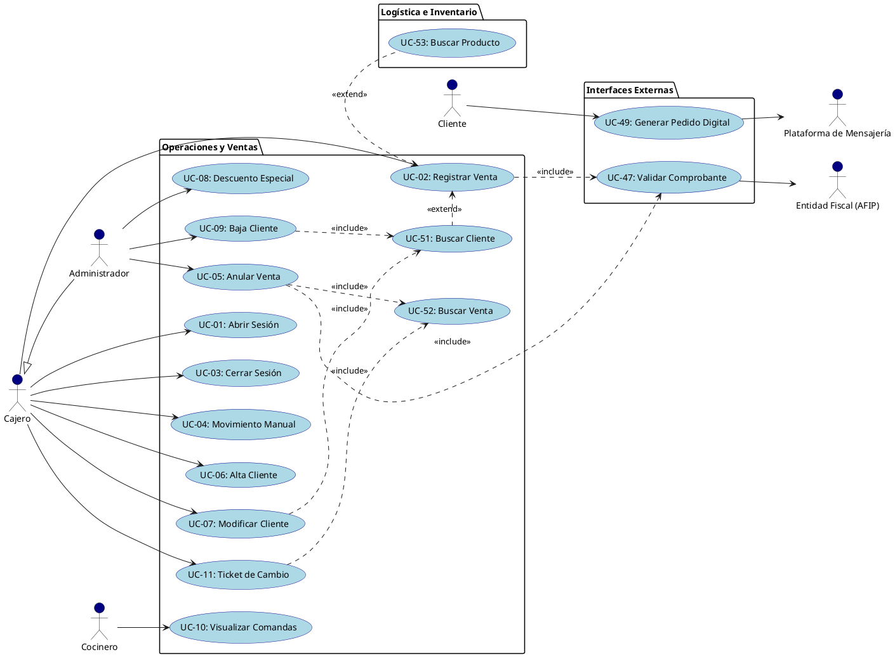
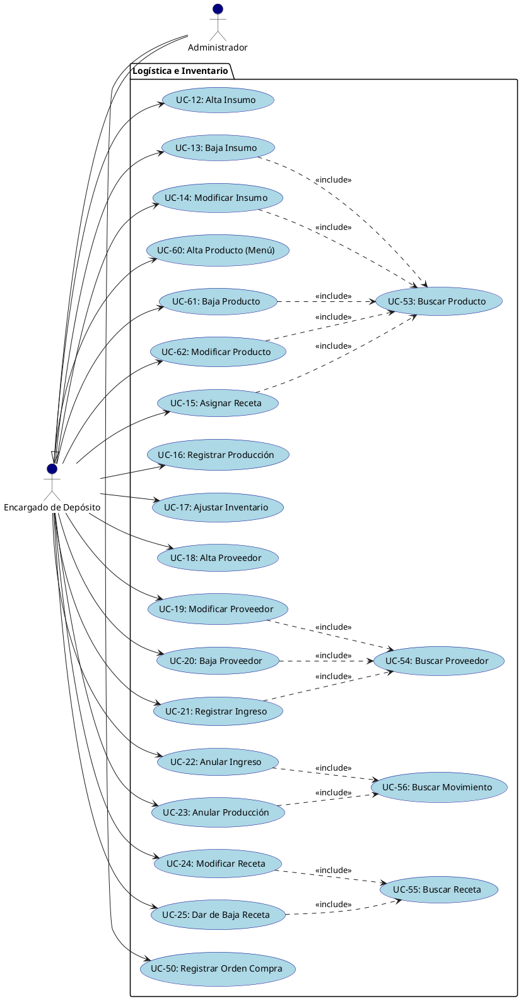
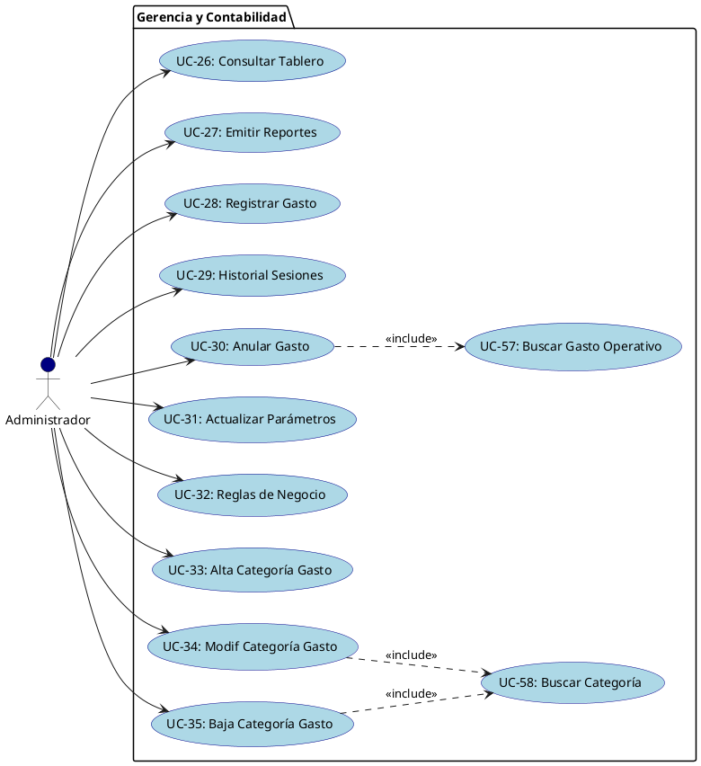
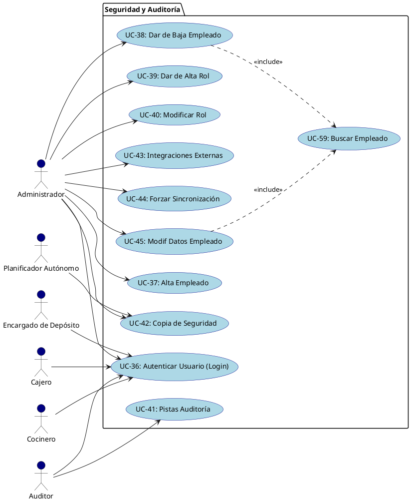
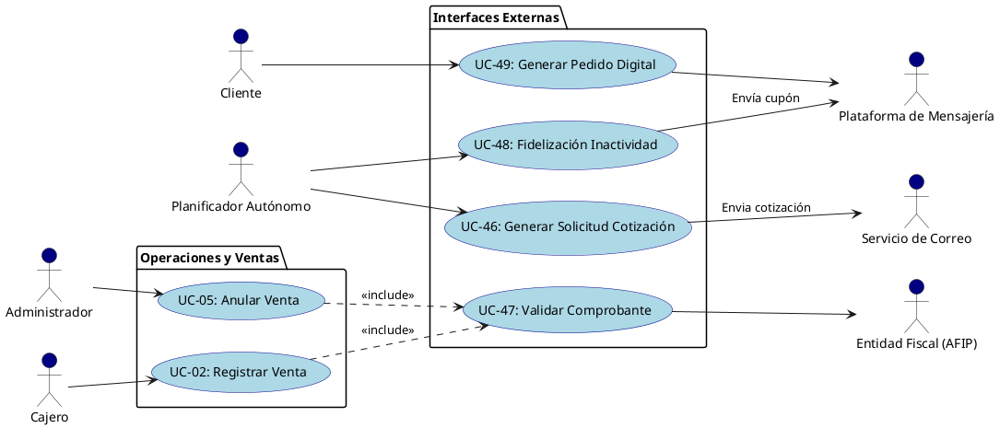

# Códigos PlantUML del Sistema Owens (Estructura de 5 Subsistemas)

Estos códigos reflejan el diseño final del sistema respetando la estructura de **5 Subsistemas y 48 Casos de Uso**, aplicando herencia (Administrador hereda de Cajero y Encargado) y mapeando la Autenticación de forma explícita a cada empleado.

## 1. Diagrama Global MASIVO (Todo el Sistema - 48 Casos de Uso)

```plantuml
@startuml
left to right direction

' Estilos Profesionales
skinparam actorBackgroundColor Navy
skinparam actorBorderColor Navy
skinparam actorFontColor Black
skinparam usecaseBackgroundColor LightBlue
skinparam usecaseBorderColor DarkBlue
skinparam usecaseFontColor Black
skinparam packageBackgroundColor White
skinparam packageBorderColor Gray
skinparam packageFontColor Black
skinparam nodesep 10
skinparam ranksep 40
skinparam ArrowColor #555555

' ACTORES HUMANOS
actor "Administrador" as Administrador
actor "Encargado de Depósito" as Encargado
actor "Cajero" as Cajero
actor "Cocinero" as Cocinero
actor "Auditor" as Auditor
actor "Cliente" as Cliente

' ACTORES EXTERNOS Y AUTÓNOMOS
actor "Entidad Fiscal (AFIP)" as AFIP
actor "Servicio de Correo" as Correo
actor "Plataforma Mensajería" as Mensajeria
actor "Planificador Autónomo" as Planificador

' HERENCIA DE ACTORES
' El Administrador engloba las capacidades operativas
Encargado <|-- Administrador
Cajero <|-- Administrador

' ==========================================
' SUBSISTEMA 1: OPERACIONES Y VENTAS
' ==========================================
package "Operaciones y Ventas" {
    usecase "UC-01: Abrir Sesión" as UC01
    usecase "UC-02: Registrar Venta" as UC02
    usecase "UC-03: Cerrar Sesión" as UC03
    usecase "UC-04: Movimiento Manual" as UC04
    usecase "UC-05: Anular Venta" as UC05
    usecase "UC-06: Alta Cliente" as UC06
    usecase "UC-07: Modificar Cliente" as UC07
    usecase "UC-08: Descuento Especial" as UC08
    usecase "UC-09: Baja Cliente" as UC09
    usecase "UC-10: Visualizar Comandas" as UC10
    usecase "UC-11: Ticket de Cambio" as UC11
    usecase "UC-51: Buscar Cliente" as UC51
    usecase "UC-52: Buscar Venta" as UC52
}

Cajero --> UC01
Cajero --> UC02
Cajero --> UC03
Cajero --> UC04
Administrador --> UC05
Cajero --> UC06
Cajero --> UC07
Administrador --> UC08
Administrador --> UC09
Cocinero --> UC10
Cajero --> UC11

' ==========================================
' SUBSISTEMA 2: LOGÍSTICA E INVENTARIO
' ==========================================
package "Logística e Inventario" {
    usecase "UC-12: Alta Insumo" as UC12
    usecase "UC-13: Baja Insumo" as UC13
    usecase "UC-14: Modificar Insumo" as UC14
    usecase "UC-60: Alta Producto (Menú)" as UC60
    usecase "UC-61: Baja Producto" as UC61
    usecase "UC-62: Modificar Producto" as UC62
    usecase "UC-15: Asignar Receta" as UC15
    usecase "UC-16: Registrar Producción" as UC16
    usecase "UC-17: Ajustar Inventario" as UC17
    usecase "UC-18: Alta Proveedor" as UC18
    usecase "UC-19: Modificar Proveedor" as UC19
    usecase "UC-20: Baja Proveedor" as UC20
    usecase "UC-21: Ingreso Mercadería" as UC21
    usecase "UC-22: Anular Ingreso" as UC22
    usecase "UC-23: Anular Producción" as UC23
    usecase "UC-24: Modificar Receta" as UC24
    usecase "UC-25: Dar de Baja Receta" as UC25
    usecase "UC-53: Buscar Producto" as UC53
    usecase "UC-54: Buscar Proveedor" as UC54
    usecase "UC-55: Buscar Receta" as UC55
    usecase "UC-56: Buscar Movimiento" as UC56
    usecase "UC-50: Registrar Orden Compra" as UC50
}

Encargado --> UC12
Encargado --> UC13
Encargado --> UC14
Encargado --> UC60
Encargado --> UC61
Encargado --> UC62
Encargado --> UC15
Encargado --> UC16
Encargado --> UC17
Encargado --> UC18
Encargado --> UC19
Encargado --> UC20
Encargado --> UC21
Encargado --> UC22
Encargado --> UC23
Encargado --> UC24
Encargado --> UC25
Administrador --> UC50

' ==========================================
' SUBSISTEMA 3: GERENCIA Y CONTABILIDAD
' ==========================================
package "Gerencia y Contabilidad" {
    usecase "UC-26: Consultar Tablero" as UC26
    usecase "UC-27: Emitir Reportes" as UC27
    usecase "UC-28: Registrar Gasto" as UC28
    usecase "UC-29: Historial Sesiones" as UC29
    usecase "UC-30: Anular Gasto" as UC30
    usecase "UC-31: Actualizar Parámetros" as UC31
    usecase "UC-32: Reglas de Negocio" as UC32
    usecase "UC-33: Alta Categoría Gasto" as UC33
    usecase "UC-34: Modif Categoría Gasto" as UC34
    usecase "UC-35: Baja Categoría Gasto" as UC35
    usecase "UC-57: Buscar Gasto Operativo" as UC57
    usecase "UC-58: Buscar Categoría" as UC58
}

Administrador --> UC26
Administrador --> UC27
Administrador --> UC28
Administrador --> UC29
Administrador --> UC30
Administrador --> UC31
Administrador --> UC32
Administrador --> UC33
Administrador --> UC34
Administrador --> UC35

' ==========================================
' SUBSISTEMA 4: SEGURIDAD Y AUDITORÍA
' ==========================================
package "Seguridad y Auditoría" {
    usecase "UC-36: Autenticar Usuario (Login)" as UC36
    usecase "UC-37: Alta Empleado" as UC37
    usecase "UC-38: Dar de Baja Empleado" as UC38
    usecase "UC-39: Dar de Alta Rol" as UC39
    usecase "UC-40: Modificar Rol" as UC40
    usecase "UC-41: Pistas Auditoría" as UC41
    usecase "UC-42: Copia de Seguridad" as UC42
    usecase "UC-43: Integraciones Externas" as UC43
    usecase "UC-44: Forzar Sincronización" as UC44
    usecase "UC-45: Modif Datos Empleado" as UC45
    usecase "UC-59: Buscar Empleado" as UC59
}

Administrador --> UC37
Administrador --> UC38
Administrador --> UC39
Administrador --> UC40
Auditor --> UC41
Planificador --> UC42
Administrador --> UC42
Administrador --> UC43
Administrador --> UC44
Administrador --> UC45

' Login explícito por empleado
Administrador --> UC36
Cajero --> UC36
Encargado --> UC36
Cocinero --> UC36
Auditor --> UC36

' ==========================================
' SUBSISTEMA 5: INTERFACES EXTERNAS
' ==========================================
package "Interfaces Externas" {
    usecase "UC-46: Generar Solicitud Cotización" as UC46
    usecase "UC-47: Validar Comprobante" as UC47
    usecase "UC-48: Fidelización Inactividad" as UC48
    usecase "UC-49: Generar Pedido Digital" as UC49
}

UC02 ..> UC47 : <<include>>
UC05 ..> UC47 : <<include>>
UC47 --> AFIP

Planificador --> UC46
UC46 --> Correo : "Envía cotización"

Planificador --> UC48
UC48 --> Mensajeria : "Envía cupón"

Cliente --> UC49 : "Arma carrito web"
UC49 --> Mensajeria : "Envía Notificación"

UC51 .left.> UC02 : <<extend>>
UC07 ..> UC51 : <<include>>
UC09 ..> UC51 : <<include>>
UC05 ..> UC52 : <<include>>
UC11 ..> UC52 : <<include>>
UC53 .left.> UC02 : <<extend>>
UC14 ..> UC53 : <<include>>
UC13 ..> UC53 : <<include>>
UC62 ..> UC53 : <<include>>
UC61 ..> UC53 : <<include>>
UC15 ..> UC53 : <<include>>
UC19 ..> UC54 : <<include>>
UC20 ..> UC54 : <<include>>
UC21 ..> UC54 : <<include>>
UC24 ..> UC55 : <<include>>
UC25 ..> UC55 : <<include>>
UC22 ..> UC56 : <<include>>
UC23 ..> UC56 : <<include>>
UC30 ..> UC57 : <<include>>
UC34 ..> UC58 : <<include>>
UC35 ..> UC58 : <<include>>
UC38 ..> UC59 : <<include>>
UC45 ..> UC59 : <<include>>

@enduml
```

---

## 2. Diagramas Modulares (Desglosados para Tesis)

### Subsistema 1: Operaciones y Ventas

### Subsistema 2: Logística e Inventario

### Subsistema 3: Gerencia y Contabilidad

### Subsistema 4: Seguridad y Auditoría

### Subsistema 5: Interfaces Externas

