# 3.2 Diagramas de Secuencia del Sistema (DSS)

En esta sección se presentan los Diagramas de Secuencia del Sistema (DSS) correspondientes a los **18 Casos de Uso Críticos y Extendidos** del Sistema Owens, detallados formalmente en la sección 3.1.

Siguiendo estrictamente los lineamientos de Craig Larman en el Proceso Unificado (AUP / UP) y las normativas de la cátedra (Guía de Consulta Práctica TP 08):
1. **Alcance Metodológico:** En el Proceso Unificado, el modelado dinámico de caja negra (DSS) se focaliza exclusivamente en los casos de uso arquitectónicamente significativos (los 18 casos de uso extendidos), evitando la sobredocumentación en operaciones CRUD elementales o consultas triviales del catálogo general.
2. **Enfoque de Caja Negra:** El sistema se modela como un único objeto (`:Sistema`), prescindiendo de detalles internos de controladores o base de datos.
3. **Eventos Significativos:** Se omiten las acciones internas del actor (como tipear datos pasivamente en pantalla) y se modelan exclusivamente las operaciones con impacto operativo enviadas hacia el sistema.
4. **Notación de Asignación:** Se utiliza la notación estándar de asignación sobre la misma flecha de invocación: `[nro]: [salida] = [operacion]([entradas])`, prescindiendo de retornos punteados redundantes.
5. **Trazabilidad 1 a 1:** Cobertura estricta e integral con los 18 Casos de Uso Extendidos (UC-01 al UC-49).

---

### 3.2.1 DSS UC-01: Abrir Sesión de Caja

*Análisis de eventos:*
*   **Entrada:** Monto base en efectivo para fondo de cambio (`montoBase`).
*   **Salida:** Confirmación de la sesión abierta y asignada al usuario (`unaSesion`).
*   **Operación:** `abrirSesionCaja(montoBase)`.

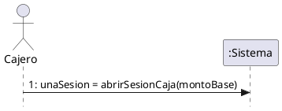

---

### 3.2.2 DSS UC-02: Registrar Venta

*Análisis de eventos:*
*   **Entrada:** Solicitud de orden, producto y cantidad (`idProducto, cantidad`), medio de pago e importe recibido (`metodoPago, montoRecibido`).
*   **Salida:** Comanda en preparación, subtotal acumulado, total general y comprobante fiscal emitido.
*   **Operaciones:** `iniciarNuevaOrden()`, `agregarItem(idProducto, cantidad)`, `finalizarSeleccion()`, `registrarPago(metodoPago, montoRecibido)`.

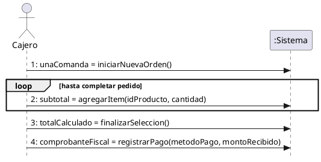

---

### 3.2.3 DSS UC-03: Cerrar Sesión de Caja

*Análisis de eventos:*
*   **Entrada:** Conteo físico final de efectivo declarado por el cajero (`montoFisicoEfectivo`).
*   **Salida:** Reporte de arqueo de caja con desglose de diferencias calculadas (`reporteArqueo`).
*   **Operación:** `cerrarSesionCaja(montoFisicoEfectivo)`.

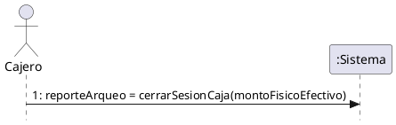

---

### 3.2.4 DSS UC-04: Registrar Movimiento Manual de Caja

*Análisis de eventos:*
*   **Entrada:** Tipo de flujo (Ingreso o Retiro), importe monetario y motivo descriptivo (`tipoMovimiento, monto, motivo`).
*   **Salida:** Comprobante digital del movimiento y nuevo saldo teórico (`comprobanteMovimiento`).
*   **Operación:** `registrarMovimientoCaja(tipoMovimiento, monto, motivo)`.

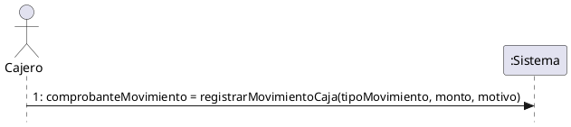

---

### 3.2.5 DSS UC-05: Anular Venta

*Análisis de eventos:*
*   **Entrada:** Número de comprobante a buscar (`nroTicket`), identificador de la venta y justificación de anulación (`idVenta, motivo`).
*   **Salida:** Datos de la venta original y constancia de anulación con nota de crédito (`comprobanteAnulacion`).
*   **Operaciones:** `buscarVenta(nroTicket)`, `anularVenta(idVenta, motivo)`.

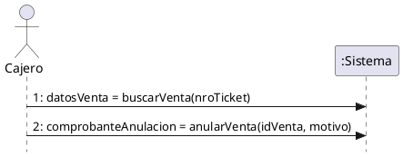

---

### 3.2.6 DSS UC-10: Visualizar Comandas de Producción (KDS)

*Análisis de eventos:*
*   **Entrada:** Consulta inicial de pedidos y selección de comanda para cambio de estado (`idComanda`).
*   **Salida:** Lista de órdenes activas ordenadas por horario, confirmación de cocción y confirmación de plato listo.
*   **Operaciones:** `consultarComandasPendientes()`, `iniciarPreparacion(idComanda)`, `marcarOrdenLista(idComanda)`.

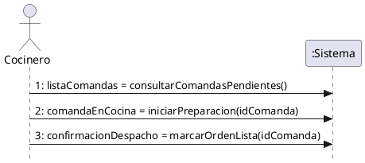

---

### 3.2.7 DSS UC-15: Asignar Receta a Producto

*Análisis de eventos:*
*   **Entrada:** Identificador del producto terminado (`idProducto`), insumos y cantidades requeridas (`idInsumo, cantidad`).
*   **Salida:** Ficha técnica del producto, item agregado y receta final consolidada.
*   **Operaciones:** `seleccionarProducto(idProducto)`, `agregarIngrediente(idInsumo, cantidad)`, `confirmarReceta()`.

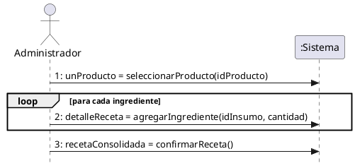

---

### 3.2.8 DSS UC-16: Registrar Producción Interna

*Análisis de eventos:*
*   **Entrada:** Identificador de receta a elaborar (`idReceta`), cantidad de lotes o unidades a producir (`cantidadProducir`).
*   **Salida:** Disponibilidad de materias primas requeridas y comprobante de producción con stock actualizado.
*   **Operaciones:** `seleccionarRecetaElaboracion(idReceta)`, `registrarLoteProduccion(idReceta, cantidadProducir)`.

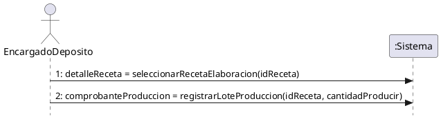

---

### 3.2.9 DSS UC-17: Ajustar Inventario Manualmente

*Análisis de eventos:*
*   **Entrada:** Insumo a auditar (`idInsumo`), conteo físico real, motivo tipificado y observación (`conteoFisico, motivo, observacion`).
*   **Salida:** Stock registrado previo y comprobante de ajuste con nuevo saldo de almacén.
*   **Operaciones:** `buscarInsumo(idInsumo)`, `registrarAjusteInventario(idInsumo, conteoFisico, motivo, observacion)`.

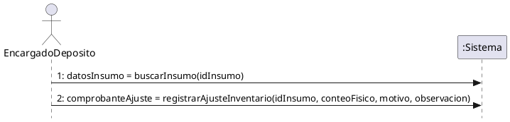

---

### 3.2.10 DSS UC-21: Registrar Ingreso de Mercadería

*Análisis de eventos:*
*   **Entrada:** Datos del proveedor y número de remito/factura (`idProveedor, nroComprobante`), insumos recibidos con cantidad y precio (`idInsumo, cantidad, precioUnitario`).
*   **Salida:** Recepción en curso, item añadido al detalle y comprobante final de ingreso de mercadería.
*   **Operaciones:** `iniciarRecepcionMercaderia(idProveedor, nroComprobante)`, `agregarInsumoRecepcion(idInsumo, cantidad, precioUnitario)`, `confirmarIngresoMercaderia()`.

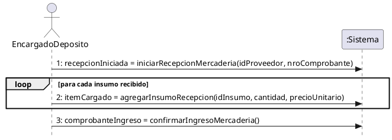

---

### 3.2.11 DSS UC-29: Consultar Historial de Sesiones de Caja

*Análisis de eventos:*
*   **Entrada:** Filtros de búsqueda temporal y cajero (`fechaDesde, fechaHasta, idUsuario`), identificador de sesión seleccionada (`idSesion`).
*   **Salida:** Lista de sesiones de caja coincidentes y detalle completo del arqueo y desvíos.
*   **Operaciones:** `buscarSesionesCaja(fechaDesde, fechaHasta, idUsuario)`, `consultarDetalleSesion(idSesion)`.

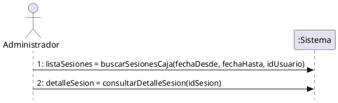

---

### 3.2.12 DSS UC-36: Autenticar Usuario

*Análisis de eventos:*
*   **Entrada:** Credenciales de acceso del usuario (`identificador, contrasena`).
*   **Salida:** Token de sesión activa con el perfil y permisos habilitados (`sesionActiva`).
*   **Operación:** `autenticarUsuario(identificador, contrasena)`.

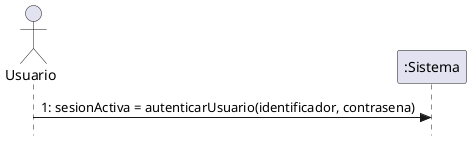

---

### 3.2.13 DSS UC-41: Consultar Pistas de Auditoría

*Análisis de eventos:*
*   **Entrada:** Criterios de búsqueda analítica (`fechaDesde, fechaHasta, idUsuario, modulo, tipoAccion`), identificador de registro a auditar (`idRegistro`).
*   **Salida:** Listado de eventos registrados y detalle comparativo de valores previos frente a nuevos valores.
*   **Operaciones:** `buscarRegistrosAuditoria(fechaDesde, fechaHasta, idUsuario, modulo, tipoAccion)`, `consultarDetalleAuditoria(idRegistro)`.

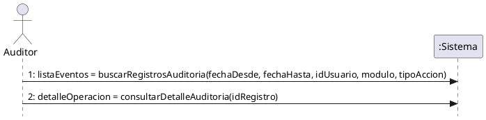

---

### 3.2.14 DSS UC-42: Ejecutar Copia de Seguridad

*Análisis de eventos:*
*   **Entrada:** Detección de ventana horaria de resguardo programada o solicitud manual del Administrador.
*   **Salida:** Constancia de resguardo exitoso con fecha, tamaño del archivo y confirmación del almacenamiento externo (`resultadoResguardo`).
*   **Operación:** `ejecutarCopiaSeguridad()`.

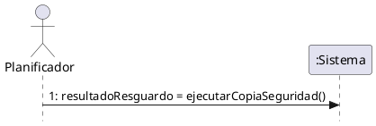

---

### 3.2.15 DSS UC-46: Generar Solicitud de Cotización (RFQ)

*Análisis de eventos:*
*   **Entrada:** Activación de rutina de abastecimiento preventivo, despacho de pliego de cotización con insumos requeridos (`idProveedor, listaInsumos`).
*   **Salida:** Lista de materias primas bajo punto de pedido y constancia de envío de cotizaciones a proveedores.
*   **Operaciones:** `detectarInsumosBajoPuntoPedido()`, `despacharSolicitudCotizacion(idProveedor, listaInsumos)`.

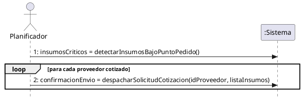

---

### 3.2.16 DSS UC-47: Validar Comprobante (Facturación AFIP)

*Análisis de eventos:*
*   **Entrada:** Identificador de la venta a facturar ante el ente recaudador (`idVenta`).
*   **Salida:** Comprobante con CAE (Código de Autorización Electrónico) y vencimiento otorgado por AFIP (`comprobanteValidado`).
*   **Operación:** `solicitarEmisionComprobante(idVenta)`.

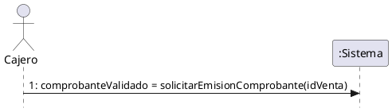

---

### 3.2.17 DSS UC-48: Fidelización por Inactividad

*Análisis de eventos:*
*   **Entrada:** Días de inactividad configurados (`diasInactividad`), cupón generado y datos promocionales (`idCliente, porcentajeDescuento, diasVigencia`).
*   **Salida:** Listado de comensales inactivos calificados y estado de entrega confirmado por la plataforma de mensajería externa.
*   **Operaciones:** `detectarClientesInactivos(diasInactividad)`, `despacharCuponDescuento(idCliente, porcentajeDescuento, diasVigencia)`.

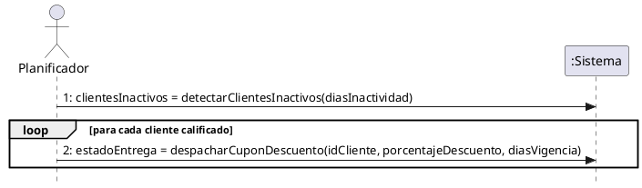

---

### 3.2.18 DSS UC-49: Generar Pedido Digital

*Análisis de eventos:*
*   **Entrada:** Consulta del catálogo de autoservicio, selección de productos y opciones (`idProducto, cantidad, opciones`), datos de contacto y entrega (`datosContacto, metodoEntrega, metodoPago`).
*   **Salida:** Menú comercial disponible, carrito actualizado y pedido confirmado encolado directamente en cocina.
*   **Operaciones:** `consultarMenuDigital()`, `agregarProductoPedido(idProducto, cantidad, opciones)`, `confirmarPedidoDigital(datosContacto, metodoEntrega, metodoPago)`.

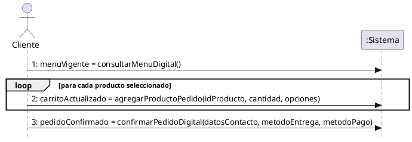

