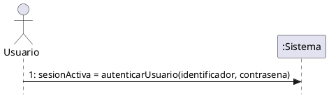
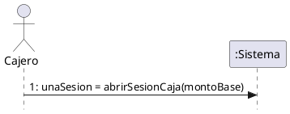
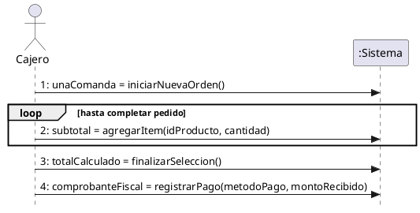
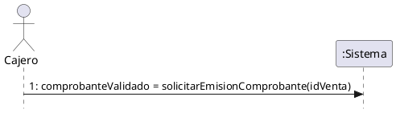
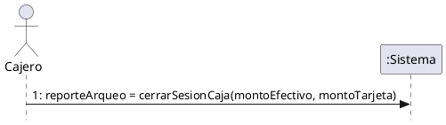
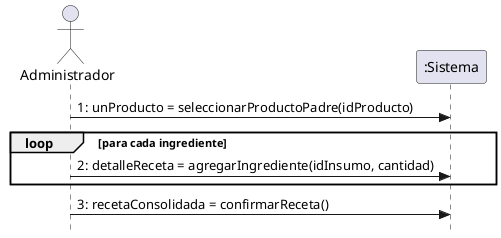

# 2.5 Diagramas de Secuencia del Sistema (DSS)

En esta sección se presentan los Diagramas de Secuencia del Sistema (DSS) correspondientes a los **Casos de Uso Críticos**. 

Estos diagramas fueron diseñados siguiendo estrictamente las normativas de la cátedra (basadas en la Guía de Consulta Práctica TP 08). Se omite el ingreso pasivo de datos por parte del actor y se documentan exclusivamente los **eventos significativos** (mensajes de envío o confirmación) utilizando la notación de asignación para los retornos: `[nro]: [salida] = [operacion]([entradas])`. El sistema es tratado como una "caja negra" funcional.

---

### DSS UC-36: Autenticar Usuario

*Análisis de eventos:*
*   El usuario ingresa datos en el formulario (acción interna, se ignora).
*   El usuario confirma el acceso enviando credenciales (Evento significativo).

---

### DSS UC-01: Abrir Sesión de Caja

*Análisis de eventos:*
*   El cajero ingresa el dinero físico en pantalla (acción interna, se ignora).
*   El cajero confirma la apertura enviando el monto base al sistema (Evento significativo).

---

### DSS UC-02: Registrar Venta

*Análisis de eventos:*
*   El cajero solicita una comanda nueva (Evento).
*   El cajero ingresa productos repetidas veces (Evento repetitivo).
*   El cajero finaliza la selección para obtener el total (Evento).
*   El cajero asienta el cobro enviando el medio de pago (Evento). *Nota: La validación fiscal (AFIP) ocurre como proceso interno de la operación de registro de pago.*

---

### DSS UC-47: Validar Comprobante (Facturación AFIP)

*Análisis de eventos:*
*   Si bien suele dispararse por la operación `registrarPago()`, si se ejecuta manualmente por un fallo previo, el cajero envía la petición de facturación explícita de un ticket pendiente.

---

### DSS UC-03: Cerrar Sesión de Caja

*Análisis de eventos:*
*   El cajero completa el formulario de recuento físico (acción interna, se ignora).
*   El cajero envía los datos para ejecutar el arqueo de caja (Evento significativo).

---

### DSS UC-15: Asignar Receta a Producto

*Análisis de eventos:*
*   Seleccionar producto base (Evento).
*   Agregar ingredientes a la matriz (Evento repetitivo con validación algorítmica).
*   Confirmar y consolidar la receta final (Evento).

