# 3.2 Diagramas de Secuencia del Sistema (DSS)

En esta sección se presentan los Diagramas de Secuencia del Sistema (DSS) correspondientes a los **62 Casos de Uso** del Sistema Owens, divididos en dos partes:
*   **Parte I: Casos de Uso Críticos y Extendidos (18 DSS):** Corresponden a los casos de uso arquitectónicamente significativos detallados en el Capítulo 3.
*   **Parte II: Casos de Uso del Catálogo General (44 DSS):** Corresponden a las operaciones complementarias, de administración de entidades simples (ABM), reportes y búsquedas.

Todos los diagramas siguen estrictamente las normativas de la cátedra (basadas en la Guía de Consulta Práctica TP 08 y los lineamientos de Craig Larman):
1. **Enfoque de Caja Negra:** El sistema se modela como un único objeto (`:Sistema`), prescindiendo de detalles internos de controladores o base de datos.
2. **Eventos Significativos:** Se omiten las acciones internas del actor (como escribir o tipear datos pasivamente en pantalla) y se modelan exclusivamente las operaciones con impacto operativo enviadas hacia el sistema.
3. **Notación de Asignación:** Se utiliza la notación estándar de asignación sobre la misma flecha de invocación: `[nro]: [salida] = [operacion]([entradas])`, prescindiendo de retornos punteados redundantes.
4. **Trazabilidad 1 a 1:** Cobertura integral del catálogo de casos de uso (UC-01 al UC-62).

---

## Parte I: Casos de Uso Críticos y Extendidos (18 DSS)

### 3.2.1 DSS UC-01: Abrir Sesión de Caja

*Análisis de eventos:*
*   **Entrada:** Monto base en efectivo para fondo de cambio (`montoBase`).
*   **Salida:** Confirmación de la sesión abierta y asignada al usuario (`unaSesion`).
*   **Operación:** `abrirSesionCaja(montoBase)`.

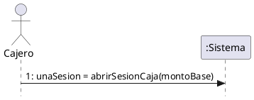

---

### 3.2.2 DSS UC-02: Registrar Venta

*Análisis de eventos:*
*   **Entrada:** Solicitud de orden, producto y cantidad (`idProducto, cantidad`), medio de pago e importe recibido (`metodoPago, montoRecibido`).
*   **Salida:** Comanda en preparación, subtotal acumulado, total general y comprobante fiscal emitido.
*   **Operaciones:** `iniciarNuevaOrden()`, `agregarItem(idProducto, cantidad)`, `finalizarSeleccion()`, `registrarPago(metodoPago, montoRecibido)`.

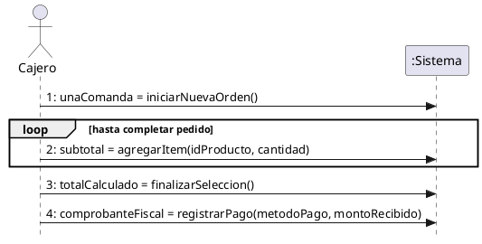

---

### 3.2.3 DSS UC-03: Cerrar Sesión de Caja

*Análisis de eventos:*
*   **Entrada:** Conteo físico final de efectivo declarado por el cajero (`montoFisicoEfectivo`).
*   **Salida:** Reporte de arqueo de caja con desglose de diferencias calculadas (`reporteArqueo`).
*   **Operación:** `cerrarSesionCaja(montoFisicoEfectivo)`.

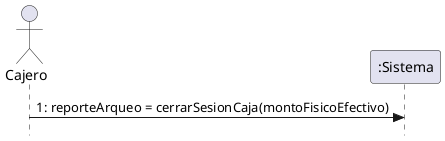

---

### 3.2.4 DSS UC-04: Registrar Movimiento Manual de Caja

*Análisis de eventos:*
*   **Entrada:** Tipo de flujo (Ingreso o Retiro), importe monetario y motivo descriptivo (`tipoMovimiento, monto, motivo`).
*   **Salida:** Comprobante digital del movimiento y nuevo saldo teórico (`comprobanteMovimiento`).
*   **Operación:** `registrarMovimientoCaja(tipoMovimiento, monto, motivo)`.

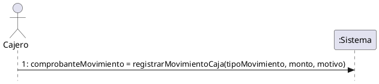

---

### 3.2.5 DSS UC-05: Anular Venta

*Análisis de eventos:*
*   **Entrada:** Número de comprobante a buscar (`nroTicket`), identificador de la venta y justificación de anulación (`idVenta, motivo`).
*   **Salida:** Datos de la venta original y constancia de anulación con nota de crédito (`comprobanteAnulacion`).
*   **Operaciones:** `buscarVenta(nroTicket)`, `anularVenta(idVenta, motivo)`.

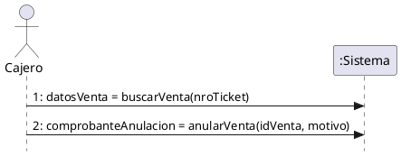

---

### 3.2.6 DSS UC-10: Visualizar Comandas de Producción (KDS)

*Análisis de eventos:*
*   **Entrada:** Consulta inicial de pedidos y selección de comanda para cambio de estado (`idComanda`).
*   **Salida:** Lista de órdenes activas ordenadas por horario, confirmación de cocción y confirmación de plato listo.
*   **Operaciones:** `consultarComandasPendientes()`, `iniciarPreparacion(idComanda)`, `marcarOrdenLista(idComanda)`.

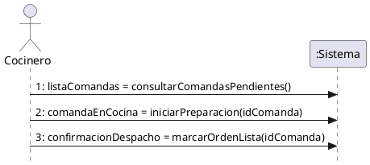

---

### 3.2.7 DSS UC-15: Asignar Receta a Producto

*Análisis de eventos:*
*   **Entrada:** Identificador del producto terminado (`idProducto`), insumos y cantidades requeridas (`idInsumo, cantidad`).
*   **Salida:** Ficha técnica del producto, item agregado y receta final consolidada.
*   **Operaciones:** `seleccionarProducto(idProducto)`, `agregarIngrediente(idInsumo, cantidad)`, `confirmarReceta()`.

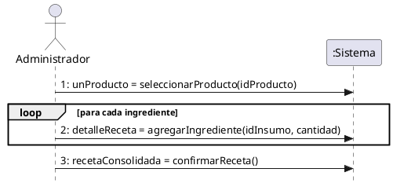

---

### 3.2.8 DSS UC-16: Registrar Producción Interna

*Análisis de eventos:*
*   **Entrada:** Identificador de receta a elaborar (`idReceta`), cantidad de lotes o unidades a producir (`cantidadProducir`).
*   **Salida:** Disponibilidad de materias primas requeridas y comprobante de producción con stock actualizado.
*   **Operaciones:** `seleccionarRecetaElaboracion(idReceta)`, `registrarLoteProduccion(idReceta, cantidadProducir)`.

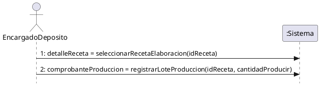

---

### 3.2.9 DSS UC-17: Ajustar Inventario Manualmente

*Análisis de eventos:*
*   **Entrada:** Insumo a auditar (`idInsumo`), conteo físico real, motivo tipificado y observación (`conteoFisico, motivo, observacion`).
*   **Salida:** Stock registrado previo y comprobante de ajuste con nuevo saldo de almacén.
*   **Operaciones:** `buscarInsumo(idInsumo)`, `registrarAjusteInventario(idInsumo, conteoFisico, motivo, observacion)`.

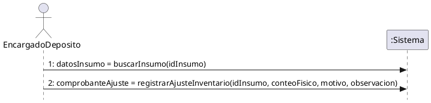

---

### 3.2.10 DSS UC-21: Registrar Ingreso de Mercadería

*Análisis de eventos:*
*   **Entrada:** Datos del proveedor y número de remito/factura (`idProveedor, nroComprobante`), insumos recibidos con cantidad y precio (`idInsumo, cantidad, precioUnitario`).
*   **Salida:** Recepción en curso, item añadido al detalle y comprobante final de ingreso de mercadería.
*   **Operaciones:** `iniciarRecepcionMercaderia(idProveedor, nroComprobante)`, `agregarInsumoRecepcion(idInsumo, cantidad, precioUnitario)`, `confirmarIngresoMercaderia()`.

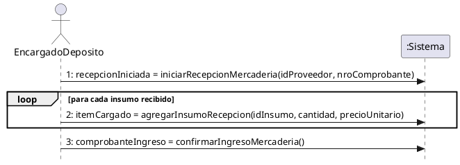

---

### 3.2.11 DSS UC-29: Consultar Historial de Sesiones de Caja

*Análisis de eventos:*
*   **Entrada:** Filtros de búsqueda temporal y cajero (`fechaDesde, fechaHasta, idUsuario`), identificador de sesión seleccionada (`idSesion`).
*   **Salida:** Lista de sesiones de caja coincidentes y detalle completo del arqueo y desvíos.
*   **Operaciones:** `buscarSesionesCaja(fechaDesde, fechaHasta, idUsuario)`, `consultarDetalleSesion(idSesion)`.

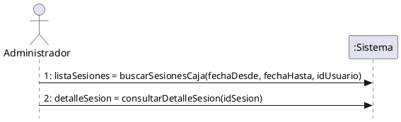

---

### 3.2.12 DSS UC-36: Autenticar Usuario

*Análisis de eventos:*
*   **Entrada:** Credenciales de acceso del usuario (`identificador, contrasena`).
*   **Salida:** Token de sesión activa con el perfil y permisos habilitados (`sesionActiva`).
*   **Operación:** `autenticarUsuario(identificador, contrasena)`.

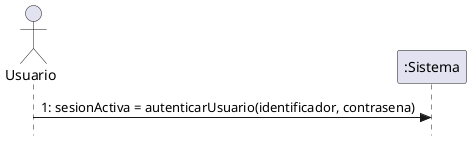

---

### 3.2.13 DSS UC-41: Consultar Pistas de Auditoría

*Análisis de eventos:*
*   **Entrada:** Criterios de búsqueda analítica (`fechaDesde, fechaHasta, idUsuario, modulo, tipoAccion`), identificador de registro a auditar (`idRegistro`).
*   **Salida:** Listado de eventos registrados y detalle comparativo de valores previos frente a nuevos valores.
*   **Operaciones:** `buscarRegistrosAuditoria(fechaDesde, fechaHasta, idUsuario, modulo, tipoAccion)`, `consultarDetalleAuditoria(idRegistro)`.

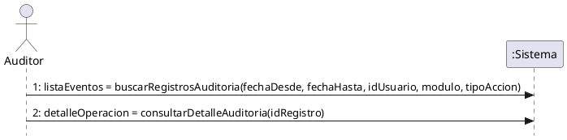

---

### 3.2.14 DSS UC-42: Ejecutar Copia de Seguridad

*Análisis de eventos:*
*   **Entrada:** Detección de ventana horaria de resguardo programada o solicitud manual del Administrador.
*   **Salida:** Constancia de resguardo exitoso con fecha, tamaño del archivo y confirmación del almacenamiento externo (`resultadoResguardo`).
*   **Operación:** `ejecutarCopiaSeguridad()`.

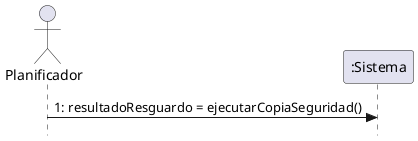

---

### 3.2.15 DSS UC-46: Generar Solicitud de Cotización (RFQ)

*Análisis de eventos:*
*   **Entrada:** Activación de rutina de abastecimiento preventivo, despacho de pliego de cotización con insumos requeridos (`idProveedor, listaInsumos`).
*   **Salida:** Lista de materias primas bajo punto de pedido y constancia de envío de cotizaciones a proveedores.
*   **Operaciones:** `detectarInsumosBajoPuntoPedido()`, `despacharSolicitudCotizacion(idProveedor, listaInsumos)`.

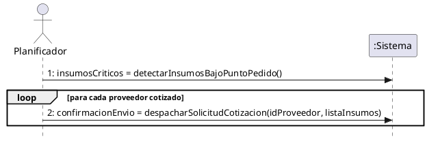

---

### 3.2.16 DSS UC-47: Validar Comprobante (Facturación AFIP)

*Análisis de eventos:*
*   **Entrada:** Identificador de la venta a facturar ante el ente recaudador (`idVenta`).
*   **Salida:** Comprobante con CAE (Código de Autorización Electrónico) y vencimiento otorgado por AFIP (`comprobanteValidado`).
*   **Operación:** `solicitarEmisionComprobante(idVenta)`.

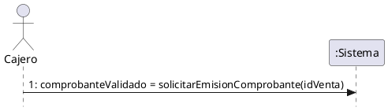

---

### 3.2.17 DSS UC-48: Fidelización por Inactividad

*Análisis de eventos:*
*   **Entrada:** Días de inactividad configurados (`diasInactividad`), cupón generado y datos promocionales (`idCliente, porcentajeDescuento, diasVigencia`).
*   **Salida:** Listado de comensales inactivos calificados y estado de entrega confirmado por la plataforma de mensajería externa.
*   **Operaciones:** `detectarClientesInactivos(diasInactividad)`, `despacharCuponDescuento(idCliente, porcentajeDescuento, diasVigencia)`.

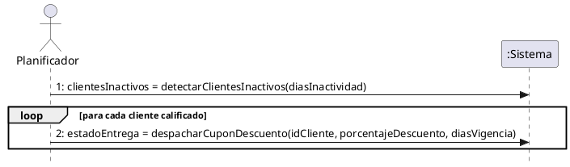

---

### 3.2.18 DSS UC-49: Generar Pedido Digital

*Análisis de eventos:*
*   **Entrada:** Consulta del catálogo de autoservicio, selección de productos y opciones (`idProducto, cantidad, opciones`), datos de contacto y entrega (`datosContacto, metodoEntrega, metodoPago`).
*   **Salida:** Menú comercial disponible, carrito actualizado y pedido confirmado encolado directamente en cocina.
*   **Operaciones:** `consultarMenuDigital()`, `agregarProductoPedido(idProducto, cantidad, opciones)`, `confirmarPedidoDigital(datosContacto, metodoEntrega, metodoPago)`.

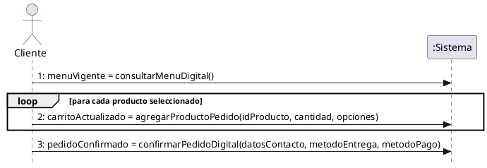

---

## Parte II: Casos de Uso del Catálogo General (44 DSS)

### Sub-sistema 1: Operaciones de Venta y Clientes

#### 3.2.19 DSS UC-06: Dar de Alta Cliente
*Análisis de eventos:*
*   **Entrada:** `nombre, cuit, correo, telefono, direccion`.
*   **Salida:** Instancia de cliente registrado (`unCliente`).
*   **Operación:** `registrarCliente(nombre, cuit, correo, telefono, direccion)`.

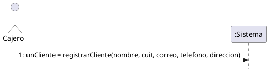

#### 3.2.20 DSS UC-07: Modificar Cliente
*Análisis de eventos:*
*   **Entrada:** `idCliente, datosActualizados`.
*   **Salida:** Ficha actualizada del cliente (`clienteModificado`).
*   **Operación:** `modificarCliente(idCliente, datosActualizados)`.


#### 3.2.21 DSS UC-08: Aplicar Descuento Especial en Venta
*Análisis de eventos:*
*   **Entrada:** `idVenta, porcentaje, motivo`.
*   **Salida:** Total recalculado de la comanda (`totalConDescuento`).
*   **Operación:** `aplicarDescuentoEspecial(idVenta, porcentaje, motivo)`.

```plantuml
@startuml
skinparam style strictuml
hide footbox

actor Administrador as A
participant ":Sistema" as S

A -> S : 1: totalConDescuento = aplicarDescuentoEspecial(idVenta, porcentaje, motivo)
@enduml
```

#### 3.2.22 DSS UC-09: Dar de Baja Cliente
*Análisis de eventos:*
*   **Entrada:** `idCliente`.
*   **Salida:** Notificación de baja lógica (`confirmacionBaja`).
*   **Operación:** `darDeBajaCliente(idCliente)`.

```plantuml
@startuml
skinparam style strictuml
hide footbox

actor Administrador as A
participant ":Sistema" as S

A -> S : 1: confirmacionBaja = darDeBajaCliente(idCliente)
@enduml
```

#### 3.2.23 DSS UC-11: Imprimir Ticket de Cambio
*Análisis de eventos:*
*   **Entrada:** `idVenta`.
*   **Salida:** Comprobante sin precios para cambio de producto (`ticketCambio`).
*   **Operación:** `imprimirTicketCambio(idVenta)`.

```plantuml
@startuml
skinparam style strictuml
hide footbox

actor Cajero as C
participant ":Sistema" as S

C -> S : 1: ticketCambio = imprimirTicketCambio(idVenta)
@enduml
```

---

### Sub-sistema 2: Stock, Insumos y Proveedores

#### 3.2.24 DSS UC-12: Dar de Alta Insumo
*Análisis de eventos:*
*   **Entrada:** `nombre, costo, stockMinimo, categoria, idAlicuotaIva`.
*   **Salida:** Insumo incorporado al catálogo (`nuevoInsumo`).
*   **Operación:** `darDeAltaInsumo(nombre, costo, stockMinimo, categoria, idAlicuotaIva)`.

```plantuml
@startuml
skinparam style strictuml
hide footbox

actor EncargadoDeposito as E
participant ":Sistema" as S

E -> S : 1: nuevoInsumo = darDeAltaInsumo(nombre, costo, stockMinimo, categoria, idAlicuotaIva)
@enduml
```

#### 3.2.25 DSS UC-13: Dar de Baja Insumo
*Análisis de eventos:*
*   **Entrada:** `idInsumo`.
*   **Salida:** Confirmación de baja del insumo (`confirmacionBaja`).
*   **Operación:** `darDeBajaInsumo(idInsumo)`.

```plantuml
@startuml
skinparam style strictuml
hide footbox

actor EncargadoDeposito as E
participant ":Sistema" as S

E -> S : 1: confirmacionBaja = darDeBajaInsumo(idInsumo)
@enduml
```

#### 3.2.26 DSS UC-14: Modificar Insumo
*Análisis de eventos:*
*   **Entrada:** `idInsumo, datosInsumo`.
*   **Salida:** Insumo actualizado (`insumoModificado`).
*   **Operación:** `modificarInsumo(idInsumo, datosInsumo)`.

```plantuml
@startuml
skinparam style strictuml
hide footbox

actor EncargadoDeposito as E
participant ":Sistema" as S

E -> S : 1: insumoModificado = modificarInsumo(idInsumo, datosInsumo)
@enduml
```

#### 3.2.27 DSS UC-18: Dar de Alta Proveedor
*Análisis de eventos:*
*   **Entrada:** `cuit, razonSocial, contacto, telefono`.
*   **Salida:** Ficha de proveedor creada (`nuevoProveedor`).
*   **Operación:** `darDeAltaProveedor(cuit, razonSocial, contacto, telefono)`.

```plantuml
@startuml
skinparam style strictuml
hide footbox

actor EncargadoDeposito as E
participant ":Sistema" as S

E -> S : 1: nuevoProveedor = darDeAltaProveedor(cuit, razonSocial, contacto, telefono)
@enduml
```

#### 3.2.28 DSS UC-19: Modificar Proveedor
*Análisis de eventos:*
*   **Entrada:** `idProveedor, datosProveedor`.
*   **Salida:** Datos de proveedor actualizados (`proveedorModificado`).
*   **Operación:** `modificarProveedor(idProveedor, datosProveedor)`.

```plantuml
@startuml
skinparam style strictuml
hide footbox

actor EncargadoDeposito as E
participant ":Sistema" as S

E -> S : 1: proveedorModificado = modificarProveedor(idProveedor, datosProveedor)
@enduml
```

#### 3.2.29 DSS UC-20: Dar de Baja Proveedor
*Análisis de eventos:*
*   **Entrada:** `idProveedor`.
*   **Salida:** Confirmación de baja (`confirmacionBaja`).
*   **Operación:** `darDeBajaProveedor(idProveedor)`.

```plantuml
@startuml
skinparam style strictuml
hide footbox

actor EncargadoDeposito as E
participant ":Sistema" as S

E -> S : 1: confirmacionBaja = darDeBajaProveedor(idProveedor)
@enduml
```

#### 3.2.30 DSS UC-22: Anular Ingreso de Mercadería
*Análisis de eventos:*
*   **Entrada:** `idIngreso, motivo`.
*   **Salida:** Comprobante de anulación y reversión de stock (`comprobanteAnulacion`).
*   **Operación:** `anularIngresoMercaderia(idIngreso, motivo)`.

```plantuml
@startuml
skinparam style strictuml
hide footbox

actor Administrador as A
participant ":Sistema" as S

A -> S : 1: comprobanteAnulacion = anularIngresoMercaderia(idIngreso, motivo)
@enduml
```

#### 3.2.31 DSS UC-23: Anular Producción Interna
*Análisis de eventos:*
*   **Entrada:** `idProduccion, motivo`.
*   **Salida:** Comprobante de anulación con restitución de materias primas (`comprobanteAnulacion`).
*   **Operación:** `anularProduccionInterna(idProduccion, motivo)`.

```plantuml
@startuml
skinparam style strictuml
hide footbox

actor Administrador as A
participant ":Sistema" as S

A -> S : 1: comprobanteAnulacion = anularProduccionInterna(idProduccion, motivo)
@enduml
```

#### 3.2.32 DSS UC-24: Modificar Receta
*Análisis de eventos:*
*   **Entrada:** `idReceta, nuevosIngredientes`.
*   **Salida:** Receta actualizada (`recetaModificada`).
*   **Operación:** `modificarReceta(idReceta, nuevosIngredientes)`.

```plantuml
@startuml
skinparam style strictuml
hide footbox

actor Administrador as A
participant ":Sistema" as S

A -> S : 1: recetaModificada = modificarReceta(idReceta, nuevosIngredientes)
@enduml
```

#### 3.2.33 DSS UC-25: Dar de Baja Receta
*Análisis de eventos:*
*   **Entrada:** `idReceta`.
*   **Salida:** Confirmación de baja de la receta (`confirmacionBaja`).
*   **Operación:** `darDeBajaReceta(idReceta)`.

```plantuml
@startuml
skinparam style strictuml
hide footbox

actor Administrador as A
participant ":Sistema" as S

A -> S : 1: confirmacionBaja = darDeBajaReceta(idReceta)
@enduml
```

---

### Sub-sistema 3: Finanzas y Métricas

#### 3.2.34 DSS UC-26: Consultar Tablero de Métricas
*Análisis de eventos:*
*   **Entrada:** `periodo`.
*   **Salida:** Indicadores de facturación, ticket promedio y rentabilidad (`resumenMetricas`).
*   **Operación:** `consultarTableroMetricas(periodo)`.

```plantuml
@startuml
skinparam style strictuml
hide footbox

actor Administrador as A
participant ":Sistema" as S

A -> S : 1: resumenMetricas = consultarTableroMetricas(periodo)
@enduml
```

#### 3.2.35 DSS UC-27: Emitir Reporte de Ventas
*Análisis de eventos:*
*   **Entrada:** `fechaDesde, fechaHasta, idCajero`.
*   **Salida:** Documento consolidado de ventas del período (`reporteVentas`).
*   **Operación:** `emitirReporteVentas(fechaDesde, fechaHasta, idCajero)`.

```plantuml
@startuml
skinparam style strictuml
hide footbox

actor Administrador as A
participant ":Sistema" as S

A -> S : 1: reporteVentas = emitirReporteVentas(fechaDesde, fechaHasta, idCajero)
@enduml
```

#### 3.2.36 DSS UC-28: Registrar Gasto Operativo
*Análisis de eventos:*
*   **Entrada:** `idCategoria, monto, concepto, metodoPago`.
*   **Salida:** Comprobante de egreso asentado (`comprobanteGasto`).
*   **Operación:** `registrarGastoOperativo(idCategoria, monto, concepto, metodoPago)`.

```plantuml
@startuml
skinparam style strictuml
hide footbox

actor Administrador as A
participant ":Sistema" as S

A -> S : 1: comprobanteGasto = registrarGastoOperativo(idCategoria, monto, concepto, metodoPago)
@enduml
```

#### 3.2.37 DSS UC-30: Anular Gasto Operativo
*Análisis de eventos:*
*   **Entrada:** `idGasto, motivo`.
*   **Salida:** Constancia de anulación del gasto (`comprobanteAnulacion`).
*   **Operación:** `anularGastoOperativo(idGasto, motivo)`.

```plantuml
@startuml
skinparam style strictuml
hide footbox

actor Administrador as A
participant ":Sistema" as S

A -> S : 1: comprobanteAnulacion = anularGastoOperativo(idGasto, motivo)
@enduml
```

---

### Sub-sistema 4: Configuración y Reglas del Negocio

#### 3.2.38 DSS UC-31: Actualizar Parámetros Generales del Negocio
*Análisis de eventos:*
*   **Entrada:** `nombreFantasia, direccion, cuit, telefono`.
*   **Salida:** Constancia de configuración guardada (`parametrosActualizados`).
*   **Operación:** `actualizarParametrosNegocio(nombreFantasia, direccion, cuit, telefono)`.

```plantuml
@startuml
skinparam style strictuml
hide footbox

actor Administrador as A
participant ":Sistema" as S

A -> S : 1: parametrosActualizados = actualizarParametrosNegocio(nombreFantasia, direccion, cuit, telefono)
@enduml
```

#### 3.2.39 DSS UC-32: Configurar Reglas de Negocio y Fidelización
*Análisis de eventos:*
*   **Entrada:** `diasInactividad, porcentajeDescuento, topeDiario`.
*   **Salida:** Confirmación de reglas comerciales aplicadas (`reglasActualizadas`).
*   **Operación:** `configurarReglasFidelizacion(diasInactividad, porcentajeDescuento, topeDiario)`.

```plantuml
@startuml
skinparam style strictuml
hide footbox

actor Administrador as A
participant ":Sistema" as S

A -> S : 1: reglasActualizadas = configurarReglasFidelizacion(diasInactividad, porcentajeDescuento, topeDiario)
@enduml
```

#### 3.2.40 DSS UC-33: Dar de Alta Categoría de Gasto
*Análisis de eventos:*
*   **Entrada:** `nombre, descripcion`.
*   **Salida:** Categoría creada (`nuevaCategoria`).
*   **Operación:** `darDeAltaCategoriaGasto(nombre, descripcion)`.

```plantuml
@startuml
skinparam style strictuml
hide footbox

actor Administrador as A
participant ":Sistema" as S

A -> S : 1: nuevaCategoria = darDeAltaCategoriaGasto(nombre, descripcion)
@enduml
```

#### 3.2.41 DSS UC-34: Modificar Categoría de Gasto
*Análisis de eventos:*
*   **Entrada:** `idCategoria, datosCategoria`.
*   **Salida:** Categoría modificada (`categoriaModificada`).
*   **Operación:** `modificarCategoriaGasto(idCategoria, datosCategoria)`.

```plantuml
@startuml
skinparam style strictuml
hide footbox

actor Administrador as A
participant ":Sistema" as S

A -> S : 1: categoriaModificada = modificarCategoriaGasto(idCategoria, datosCategoria)
@enduml
```

#### 3.2.42 DSS UC-35: Dar de Baja Categoría de Gasto
*Análisis de eventos:*
*   **Entrada:** `idCategoria`.
*   **Salida:** Confirmación de baja (`confirmacionBaja`).
*   **Operación:** `darDeBajaCategoriaGasto(idCategoria)`.

```plantuml
@startuml
skinparam style strictuml
hide footbox

actor Administrador as A
participant ":Sistema" as S

A -> S : 1: confirmacionBaja = darDeBajaCategoriaGasto(idCategoria)
@enduml
```

---

### Sub-sistema 5: Seguridad, Roles y Personal

#### 3.2.43 DSS UC-37: Dar de Alta Empleado
*Análisis de eventos:*
*   **Entrada:** `nombre, correo, idRol, cuit`.
*   **Salida:** Cuenta de empleado registrada (`nuevoEmpleado`).
*   **Operación:** `darDeAltaEmpleado(nombre, correo, idRol, cuit)`.

```plantuml
@startuml
skinparam style strictuml
hide footbox

actor Administrador as A
participant ":Sistema" as S

A -> S : 1: nuevoEmpleado = darDeAltaEmpleado(nombre, correo, idRol, cuit)
@enduml
```

#### 3.2.44 DSS UC-38: Dar de Baja Empleado
*Análisis de eventos:*
*   **Entrada:** `idEmpleado`.
*   **Salida:** Desactivación de cuenta confirmada (`confirmacionBaja`).
*   **Operación:** `darDeBajaEmpleado(idEmpleado)`.

```plantuml
@startuml
skinparam style strictuml
hide footbox

actor Administrador as A
participant ":Sistema" as S

A -> S : 1: confirmacionBaja = darDeBajaEmpleado(idEmpleado)
@enduml
```

#### 3.2.45 DSS UC-39: Dar de Alta Rol
*Análisis de eventos:*
*   **Entrada:** `nombre, listaPermisos`.
*   **Salida:** Rol de usuario creado (`nuevoRol`).
*   **Operación:** `darDeAltaRol(nombre, listaPermisos)`.

```plantuml
@startuml
skinparam style strictuml
hide footbox

actor Administrador as A
participant ":Sistema" as S

A -> S : 1: nuevoRol = darDeAltaRol(nombre, listaPermisos)
@enduml
```

#### 3.2.46 DSS UC-40: Modificar Rol
*Análisis de eventos:*
*   **Entrada:** `idRol, nuevaListaPermisos`.
*   **Salida:** Permisos de rol actualizados (`rolModificado`).
*   **Operación:** `modificarRol(idRol, nuevaListaPermisos)`.

```plantuml
@startuml
skinparam style strictuml
hide footbox

actor Administrador as A
participant ":Sistema" as S

A -> S : 1: rolModificado = modificarRol(idRol, nuevaListaPermisos)
@enduml
```

#### 3.2.47 DSS UC-45: Modificar Empleado
*Análisis de eventos:*
*   **Entrada:** `idEmpleado, datosEmpleado`.
*   **Salida:** Información de empleado modificada (`empleadoModificado`).
*   **Operación:** `modificarEmpleado(idEmpleado, datosEmpleado)`.

```plantuml
@startuml
skinparam style strictuml
hide footbox

actor Administrador as A
participant ":Sistema" as S

A -> S : 1: empleadoModificado = modificarEmpleado(idEmpleado, datosEmpleado)
@enduml
```

---

### Sub-sistema 6: Integraciones Externas

#### 3.2.48 DSS UC-43: Configurar Integraciones Externas
*Análisis de eventos:*
*   **Entrada:** `tipoServicio, credenciales, entorno`.
*   **Salida:** Estado de enlace con API externa (`confirmacionIntegracion`).
*   **Operación:** `configurarIntegracionExterna(tipoServicio, credenciales, entorno)`.

```plantuml
@startuml
skinparam style strictuml
hide footbox

actor Administrador as A
participant ":Sistema" as S

A -> S : 1: confirmacionIntegracion = configurarIntegracionExterna(tipoServicio, credenciales, entorno)
@enduml
```

#### 3.2.49 DSS UC-44: Forzar Sincronización Manual
*Análisis de eventos:*
*   **Entrada:** Disparo manual sin parámetros.
*   **Salida:** Resumen de comprobantes fiscales y datos encolados transmitidos (`resultadoSincronizacion`).
*   **Operación:** `forzarSincronizacionManual()`.

```plantuml
@startuml
skinparam style strictuml
hide footbox

actor Administrador as A
participant ":Sistema" as S

A -> S : 1: resultadoSincronizacion = forzarSincronizacionManual()
@enduml
```

---

### Sub-sistema 7: Compras y Reabastecimiento

#### 3.2.50 DSS UC-50: Registrar Orden de Compra
*Análisis de eventos:*
*   **Entrada:** `idProveedor, listaItems`.
*   **Salida:** Orden de compra oficial generada (`ordenCompraGenerada`).
*   **Operación:** `registrarOrdenCompra(idProveedor, listaItems)`.

```plantuml
@startuml
skinparam style strictuml
hide footbox

actor EncargadoDeposito as E
participant ":Sistema" as S

E -> S : 1: ordenCompraGenerada = registrarOrdenCompra(idProveedor, listaItems)
@enduml
```

---

### Sub-sistema 8: Búsquedas y Consultas Auxiliares

#### 3.2.51 DSS UC-51: Buscar Cliente
*Análisis de eventos:*
*   **Entrada:** `terminoBusqueda`.
*   **Salida:** Coincidencias en el directorio (`listaClientes`).
*   **Operación:** `buscarCliente(terminoBusqueda)`.

```plantuml
@startuml
skinparam style strictuml
hide footbox

actor Cajero as C
participant ":Sistema" as S

C -> S : 1: listaClientes = buscarCliente(terminoBusqueda)
@enduml
```

#### 3.2.52 DSS UC-52: Buscar Venta
*Análisis de eventos:*
*   **Entrada:** `criterioBusqueda`.
*   **Salida:** Lista de comprobantes coincidentes (`listaVentas`).
*   **Operación:** `buscarVenta(criterioBusqueda)`.

```plantuml
@startuml
skinparam style strictuml
hide footbox

actor Cajero as C
participant ":Sistema" as S

C -> S : 1: listaVentas = buscarVenta(criterioBusqueda)
@enduml
```

#### 3.2.53 DSS UC-53: Buscar Producto
*Análisis de eventos:*
*   **Entrada:** `terminoBusqueda`.
*   **Salida:** Productos disponibles (`listaProductos`).
*   **Operación:** `buscarProducto(terminoBusqueda)`.

```plantuml
@startuml
skinparam style strictuml
hide footbox

actor Cajero as C
participant ":Sistema" as S

C -> S : 1: listaProductos = buscarProducto(terminoBusqueda)
@enduml
```

#### 3.2.54 DSS UC-54: Buscar Proveedor
*Análisis de eventos:*
*   **Entrada:** `terminoBusqueda`.
*   **Salida:** Proveedores hallados (`listaProveedores`).
*   **Operación:** `buscarProveedor(terminoBusqueda)`.

```plantuml
@startuml
skinparam style strictuml
hide footbox

actor EncargadoDeposito as E
participant ":Sistema" as S

E -> S : 1: listaProveedores = buscarProveedor(terminoBusqueda)
@enduml
```

#### 3.2.55 DSS UC-55: Buscar Receta
*Análisis de eventos:*
*   **Entrada:** `terminoBusqueda`.
*   **Salida:** Recetas coincidentes (`listaRecetas`).
*   **Operación:** `buscarReceta(terminoBusqueda)`.

```plantuml
@startuml
skinparam style strictuml
hide footbox

actor EncargadoDeposito as E
participant ":Sistema" as S

E -> S : 1: listaRecetas = buscarReceta(terminoBusqueda)
@enduml
```

#### 3.2.56 DSS UC-56: Buscar Movimiento de Inventario
*Análisis de eventos:*
*   **Entrada:** `criterioFiltro`.
*   **Salida:** Registro de movimientos de almacén (`listaMovimientos`).
*   **Operación:** `buscarMovimientoInventario(criterioFiltro)`.

```plantuml
@startuml
skinparam style strictuml
hide footbox

actor EncargadoDeposito as E
participant ":Sistema" as S

E -> S : 1: listaMovimientos = buscarMovimientoInventario(criterioFiltro)
@enduml
```

#### 3.2.57 DSS UC-57: Buscar Gasto Operativo
*Análisis de eventos:*
*   **Entrada:** `criterioFiltro`.
*   **Salida:** Asientos de gastos coincidentes (`listaGastos`).
*   **Operación:** `buscarGastoOperativo(criterioFiltro)`.

```plantuml
@startuml
skinparam style strictuml
hide footbox

actor Administrador as A
participant ":Sistema" as S

A -> S : 1: listaGastos = buscarGastoOperativo(criterioFiltro)
@enduml
```

#### 3.2.58 DSS UC-58: Buscar Categoría de Gasto
*Análisis de eventos:*
*   **Entrada:** `terminoBusqueda`.
*   **Salida:** Categorías de egresos coincidentes (`listaCategorias`).
*   **Operación:** `buscarCategoriaGasto(terminoBusqueda)`.

```plantuml
@startuml
skinparam style strictuml
hide footbox

actor Administrador as A
participant ":Sistema" as S

A -> S : 1: listaCategorias = buscarCategoriaGasto(terminoBusqueda)
@enduml
```

#### 3.2.59 DSS UC-59: Buscar Empleado
*Análisis de eventos:*
*   **Entrada:** `terminoBusqueda`.
*   **Salida:** Nómina de personal coincidente (`listaEmpleados`).
*   **Operación:** `buscarEmpleado(terminoBusqueda)`.

```plantuml
@startuml
skinparam style strictuml
hide footbox

actor Administrador as A
participant ":Sistema" as S

A -> S : 1: listaEmpleados = buscarEmpleado(terminoBusqueda)
@enduml
```

---

### Sub-sistema 9: Catálogo de Productos y Menú

#### 3.2.60 DSS UC-60: Dar de Alta Producto
*Análisis de eventos:*
*   **Entrada:** `nombre, precio, descripcion, categoria, idAlicuotaIva`.
*   **Salida:** Producto agregado a la carta (`nuevoProducto`).
*   **Operación:** `darDeAltaProducto(nombre, precio, descripcion, categoria, idAlicuotaIva)`.

```plantuml
@startuml
skinparam style strictuml
hide footbox

actor Administrador as A
participant ":Sistema" as S

A -> S : 1: nuevoProducto = darDeAltaProducto(nombre, precio, descripcion, categoria, idAlicuotaIva)
@enduml
```

#### 3.2.61 DSS UC-61: Dar de Baja Producto
*Análisis de eventos:*
*   **Entrada:** `idProducto`.
*   **Salida:** Confirmación de baja de la carta (`confirmacionBaja`).
*   **Operación:** `darDeBajaProducto(idProducto)`.

```plantuml
@startuml
skinparam style strictuml
hide footbox

actor Administrador as A
participant ":Sistema" as S

A -> S : 1: confirmacionBaja = darDeBajaProducto(idProducto)
@enduml
```

#### 3.2.62 DSS UC-62: Modificar Producto
*Análisis de eventos:*
*   **Entrada:** `idProducto, datosProducto`.
*   **Salida:** Datos de producto actualizados en la carta (`productoModificado`).
*   **Operación:** `modificarProducto(idProducto, datosProducto)`.

```plantuml
@startuml
skinparam style strictuml
hide footbox

actor Administrador as A
participant ":Sistema" as S

A -> S : 1: productoModificado = modificarProducto(idProducto, datosProducto)
@enduml
```
