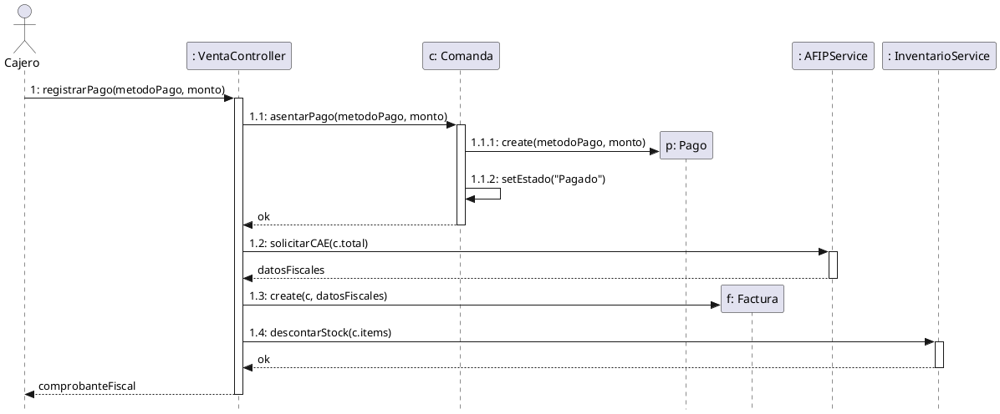
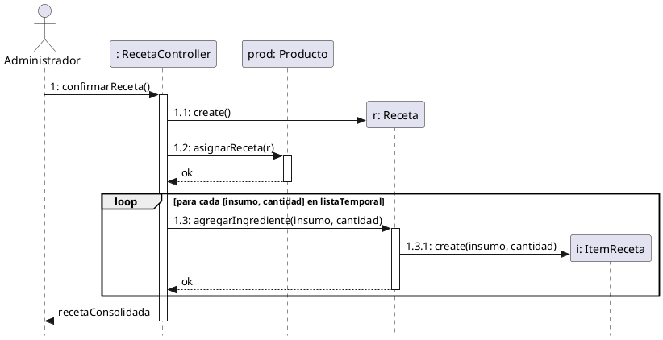
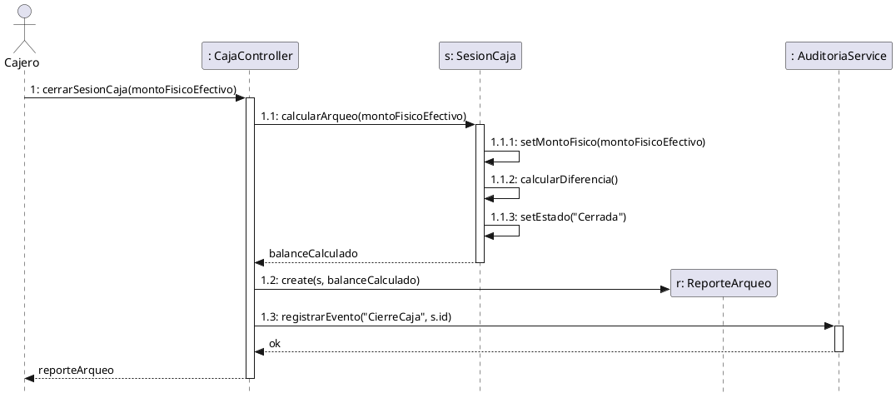
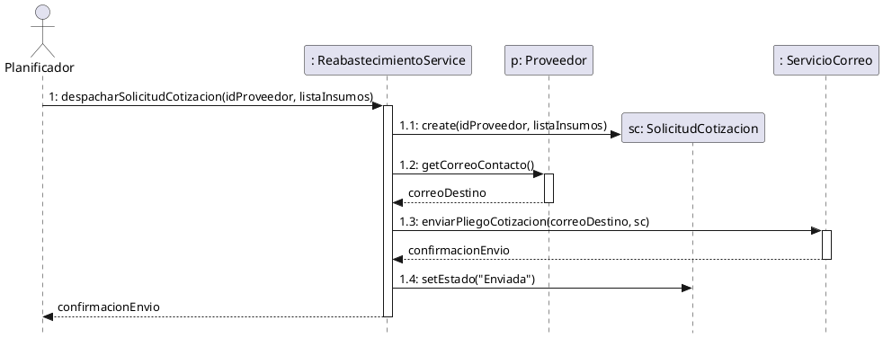
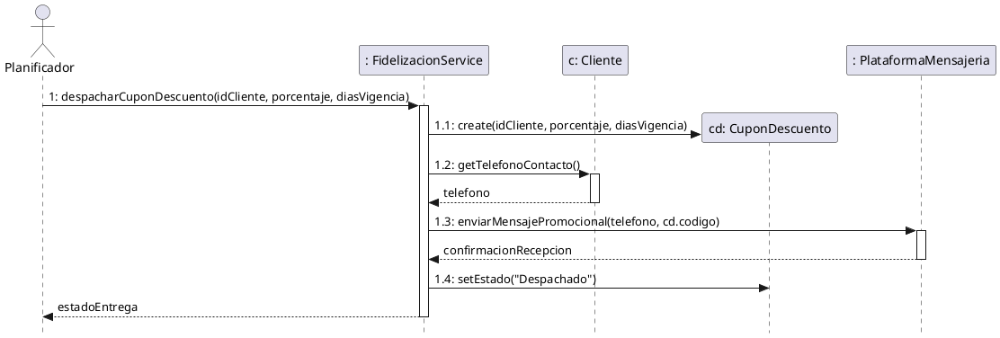

# 3.3 Diseño de Casos de Uso (Realizaciones)

En esta sección se presentan las realizaciones de los eventos de sistema más complejos, mostrando cómo los objetos de software colaboran para cumplir con los requerimientos (Caja Blanca). 

Dado el enfoque metodológico ágil adoptado, se documentan los **Diagramas de Secuencia de Diseño (DSD)** de los procesos críticos y módulos inteligentes. Para cada evento, se define formalmente su **Contrato de Operación** (que establece el puente conceptual entre el DSS y el Modelo de Dominio) y su respectivo diagrama mostrando la asignación de responsabilidades mediante patrones GRASP (Controlador, Creador, Experto en Información).

---

## 3.3.1 Diseño de `registrarPago()` (UC-02 / UC-47)

Este evento representa el momento crítico donde el sistema asienta el cobro de una comanda, se comunica de manera síncrona con el servicio fiscal para obtener autorización y actualiza las existencias de insumos por receta.

### Contrato de Operación

*   **Operación:** `registrarPago(metodoPago, montoRecibido)`
*   **Referencias:** Casos de Uso UC-02 y UC-47.
*   **Precondiciones:**
    *   Existe una instancia `c:Comanda` en estado "Pendiente de Pago".
    *   El `montoRecibido` es mayor o igual al total de la `Comanda`.
    *   El sistema tiene conexión activa con el servicio fiscal (AFIP).
*   **Postcondiciones:**
    *   Se creó una instancia `p:Pago` (Creación de instancia).
    *   `p` fue asociado con `c` (Formación de asociación).
    *   Los atributos de `p` fueron inicializados con los parámetros (Modificación de atributo).
    *   El estado de `c` pasó a "Pagado" (Modificación de atributo).
    *   Se creó una instancia `f:Factura` con el CAE validado por la entidad fiscal (Creación de instancia).
    *   El inventario fue descontado según los insumos de la receta de los productos (Modificación de atributo).

### Diagrama de Secuencia de Diseño (DSD)

---

## 3.3.2 Diseño de `confirmarReceta()` (UC-15)

Este evento modela el algoritmo de explosión de materiales, donde un producto comercializable queda atado a la matriz de insumos necesarios para su producción.

### Contrato de Operación

*   **Operación:** `confirmarReceta()`
*   **Referencias:** Caso de Uso UC-15.
*   **Precondiciones:**
    *   Existe un `Producto` seleccionado en memoria.
    *   Existe una lista temporal de insumos y cantidades válida.
*   **Postcondiciones:**
    *   Se creó una instancia `r:Receta` (Creación de instancia).
    *   `r` fue asociada al `Producto` base (Formación de asociación).
    *   Se crearon múltiples instancias de `i:ItemReceta` correspondientes a la lista (Creación de instancia).
    *   Cada `i:ItemReceta` fue asociada a la `r:Receta` y a su respectivo `Insumo` del catálogo (Formación de asociación).

### Diagrama de Secuencia de Diseño (DSD)

---

## 3.3.3 Diseño de `cerrarSesionCaja()` (UC-03)

Este evento materializa el Arqueo con Cierre Ciego, donde se contrasta el efectivo físico declarado por el cajero contra los registros acumulados en el sistema sin anticipar el saldo teórico esperado.

### Contrato de Operación

*   **Operación:** `cerrarSesionCaja(montoFisicoEfectivo)`
*   **Referencias:** Caso de Uso UC-03.
*   **Precondiciones:**
    *   Existe una instancia `s:SesionCaja` en estado "Abierta" asignada al usuario actual.
    *   El parámetro `montoFisicoEfectivo` es numérico y mayor o igual a cero.
*   **Postcondiciones:**
    *   `s` calculó el total teórico de ingresos y egresos de la jornada (`calcularArqueo()`).
    *   `s` registró el monto físico ingresado y calculó la diferencia (faltante o sobrante).
    *   El estado de `s` cambió a "Cerrada" y se registró la fecha y hora de cierre.
    *   Se creó una instancia `r:ReporteArqueo` asociada a `s`.
    *   Se generó un registro en la bitácora de auditoría.

### Diagrama de Secuencia de Diseño (DSD)

---

## 3.3.4 Diseño de `despacharSolicitudCotizacion()` (UC-46 - Módulo Inteligente de Reabastecimiento)

Este evento modela la licitación preventiva de compras, donde el sistema detecta materias primas bajo punto de pedido y despacha pliegos de cotización por correo electrónico a proveedores seleccionados.

### Contrato de Operación

*   **Operación:** `despacharSolicitudCotizacion(idProveedor, listaInsumos)`
*   **Referencias:** Caso de Uso UC-46.
*   **Precondiciones:**
    *   Existen insumos en el almacén con existencias menores o iguales a su punto de pedido.
    *   Existe un `Proveedor` activo en el catálogo con correo de contacto válido.
*   **Postcondiciones:**
    *   Se creó una instancia `sc:SolicitudCotizacion` (Creación de instancia).
    *   `sc` fue asociada al `Proveedor` y a la lista de `Insumo` (Formación de asociación).
    *   Se invocó al `ServicioCorreo` para enviar la solicitud al proveedor en segundo plano.
    *   El estado de `sc` pasó a "Enviada" (Modificación de atributo).

### Diagrama de Secuencia de Diseño (DSD)

---

## 3.3.5 Diseño de `despacharCuponDescuento()` (UC-48 - Módulo Inteligente de Marketing)

Este evento modela el flujo autónomo de fidelización, donde el sistema detecta clientes habituales que llevan un período prolongado sin compras y les envía un cupón promocional a través de la plataforma de mensajería externa.

### Contrato de Operación

*   **Operación:** `despacharCuponDescuento(idCliente, porcentajeDescuento, diasVigencia)`
*   **Referencias:** Caso de Uso UC-48.
*   **Precondiciones:**
    *   Existe una instancia `c:Cliente` con días de inactividad mayores al umbral configurado.
    *   Existe al menos una sesión de caja abierta que confirma que el local está operando.
*   **Postcondiciones:**
    *   Se creó una instancia `cd:CuponDescuento` con código único y fecha de expiración (Creación de instancia).
    *   `cd` fue asociada al `Cliente` (Formación de asociación).
    *   Se invocó a la `PlataformaMensajeria` para enviar el mensaje al teléfono del comensal.
    *   El estado de `cd` pasó a "Despachado" (Modificación de atributo).

### Diagrama de Secuencia de Diseño (DSD)

