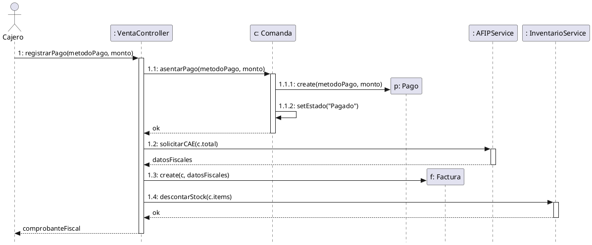
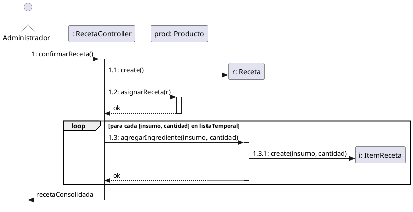

# 3.3 Diseño de Casos de Uso (Realizaciones)

En esta sección se presentan las realizaciones de los eventos de sistema más complejos, mostrando cómo los objetos de software colaboran para cumplir con los requerimientos (Caja Blanca). 

Dado el enfoque metodológico ágil adoptado, se documentan exclusivamente los **Diagramas de Secuencia de Diseño (DSD)** de los módulos inteligentes críticos. Para cada evento, se define formalmente su **Contrato de Operación** (que establece el puente conceptual entre el DSS y el Modelo de Dominio) y su respectivo diagrama mostrando la asignación de responsabilidades mediante patrones GRASP (Controlador, Creador, Experto).

---

## 3.3.1 Diseño de `registrarPago()` (UC-02 / UC-47)

Este evento representa el momento crítico donde el sistema asienta el pago de una comanda y se comunica de manera síncrona con el servicio fiscal para obtener validación.

### Contrato de Operación

*   **Operación:** `registrarPago(metodoPago, montoRecibido)`
*   **Referencias:** Casos de Uso UC-02 y UC-47.
*   **Precondiciones:**
    *   Existe una instancia `c:Comanda` en estado "Pendiente de Pago".
    *   El `montoRecibido` es mayor o igual al total de la `Comanda`.
    *   El sistema tiene conexión activa con el web service de AFIP.
*   **Postcondiciones:**
    *   Se creó una instancia `p:Pago` (Creación de instancia).
    *   `p` fue asociado con `c` (Formación de asociación).
    *   Los atributos de `p` fueron inicializados con los parámetros (Modificación de atributo).
    *   El estado de `c` pasó a "Pagado" (Modificación de atributo).
    *   Se creó una instancia `f:Factura` con el CAE validado por la entidad fiscal (Creación de instancia).
    *   El inventario fue descontado según los productos de la comanda (Modificación de atributo).

### Diagrama de Secuencia de Diseño (DSD)

---

## 3.3.2 Diseño de `confirmarReceta()` (UC-15)

Este evento modela el algoritmo de explosión de materiales, donde un producto comercializable queda atado a la matriz de insumos necesarios para su producción.

### Contrato de Operación

*   **Operación:** `confirmarReceta()`
*   **Referencias:** Caso de Uso UC-15.
*   **Precondiciones:**
    *   Existe un `Producto` seleccionado en memoria.
    *   Existe una lista temporal de insumos y cantidades válida.
*   **Postcondiciones:**
    *   Se creó una instancia `r:Receta` (Creación de instancia).
    *   `r` fue asociada al `Producto` base (Formación de asociación).
    *   Se crearon múltiples instancias de `i:ItemReceta` correspondientes a la lista (Creación de instancia).
    *   Cada `i:ItemReceta` fue asociada a la `r:Receta` y a su respectivo `Insumo` del catálogo (Formación de asociación).

### Diagrama de Secuencia de Diseño (DSD)

