# 3.4. Diagrama de Secuencia de Diseño

---

### 3.4.1. DSD del CU-01 Abrir Sesión de Caja
[Link al DSS](3.2_diagramas_secuencia_sistema.md#321-dss-uc-01-abrir-sesión-de-caja)

#### DSD - abrirSesionCaja(montoBase)
[Link al contrato](3.3_contratos_de_operacion.md#contrato-abrirsesioncajamontobase)

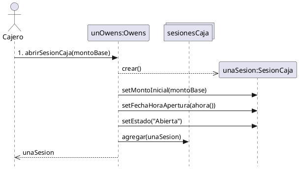
Figura N° 3.4.1.1

---

### 3.4.2. DSD del CU-02 Registrar Venta
[Link al DSS](3.2_diagramas_secuencia_sistema.md#322-dss-uc-02-registrar-venta)

#### DSD - iniciarNuevaOrden()
[Link al contrato](3.3_contratos_de_operacion.md#contrato-iniciarnuevaorden)

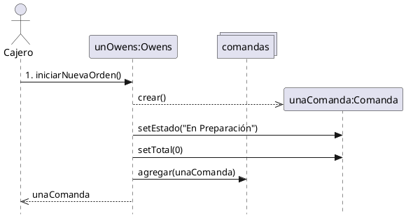
Figura N° 3.4.2.1

#### DSD - agregarItem(idProducto, cantidad)
[Link al contrato](3.3_contratos_de_operacion.md#contrato-agregaritemidproducto-cantidad)

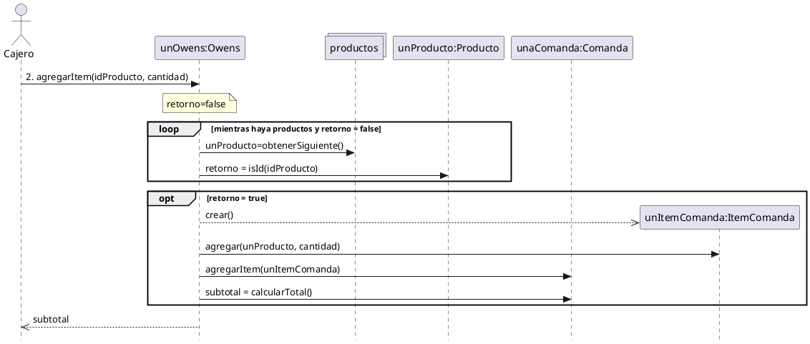
Figura N° 3.4.2.2

#### DSD - registrarPago(metodoPago, montoRecibido)
[Link al contrato](3.3_contratos_de_operacion.md#331-módulo-de-ventas-y-caja-pos)

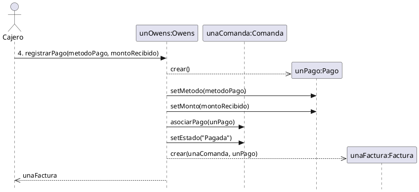
Figura N° 3.4.2.3

---

### 3.4.3. DSD del CU-03 Cerrar Sesión de Caja
[Link al DSS](3.2_diagramas_secuencia_sistema.md#323-dss-uc-03-cerrar-sesión-de-caja)

#### DSD - cerrarSesionCaja(montoFisicoEfectivo)
[Link al contrato](3.3_contratos_de_operacion.md#contrato-cerrarsesioncajamontofisicoefectivo)

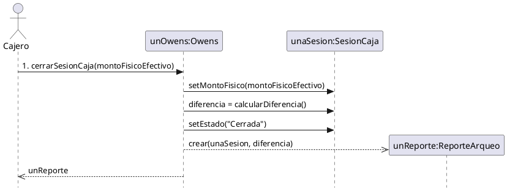
Figura N° 3.4.3.1

---

### 3.4.4. DSD del CU-05 Anular Venta
[Link al DSS](3.2_diagramas_secuencia_sistema.md#325-dss-uc-05-anular-venta)

#### DSD - buscarVenta(nroTicket)
[Link al contrato](3.3_contratos_de_operacion.md#contrato-buscarventanroticket-operación-de-consulta)

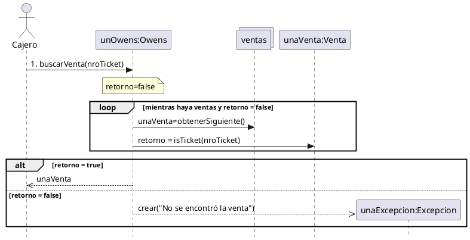
Figura N° 3.4.4.1

#### DSD - anularVenta(idVenta, motivo)
[Link al contrato](3.3_contratos_de_operacion.md#contrato-anularventaidventa-motivo)

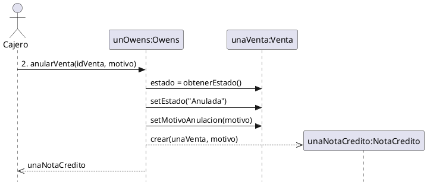
Figura N° 3.4.4.2

---

### 3.4.5. DSD del CU-15 Asignar Receta a Producto
[Link al DSS](3.2_diagramas_secuencia_sistema.md#327-dss-uc-15-asignar-receta-a-producto)

#### DSD - seleccionarProducto(idProducto)
[Link al contrato](3.3_contratos_de_operacion.md#contrato-confirmarreceta)

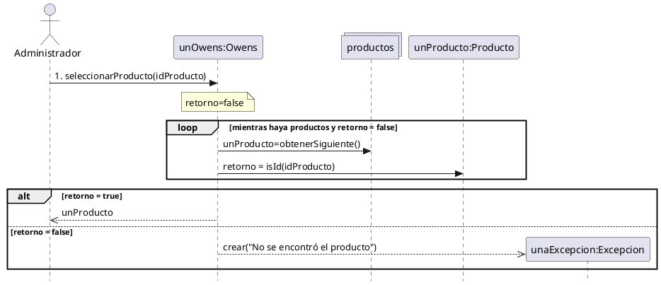
Figura N° 3.4.5.1

#### DSD - confirmarReceta(unProducto, insumosSeleccionados[])
[Link al contrato](3.3_contratos_de_operacion.md#contrato-confirmarreceta)

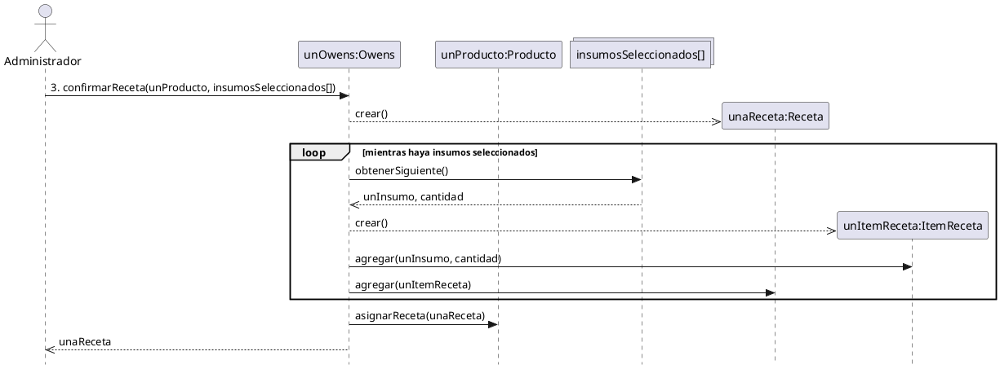
Figura N° 3.4.5.2

---

### 3.4.6. DSD del CU-49 Realizar Pedido Digital
[Link al DSS](3.2_diagramas_secuencia_sistema.md#3218-dss-uc-49-generar-pedido-digital)

#### DSD - seleccionarProducto(idProducto, cantidad)
[Link al contrato](3.3_contratos_de_operacion.md#contrato-confirmarpedidodigitaldatoscontacto-metodoentrega-metodopago)

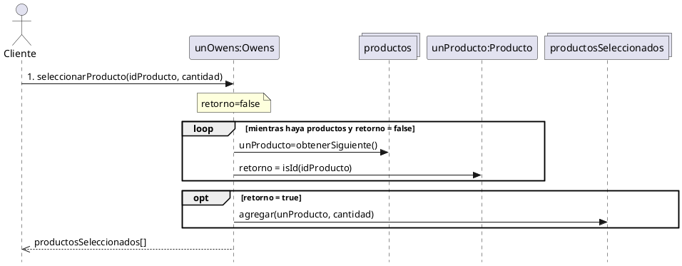
Figura N° 3.4.6.1

#### DSD - confirmarPedido(productosSeleccionados[])
[Link al contrato](3.3_contratos_de_operacion.md#contrato-confirmarpedidodigitaldatoscontacto-metodoentrega-metodopago)

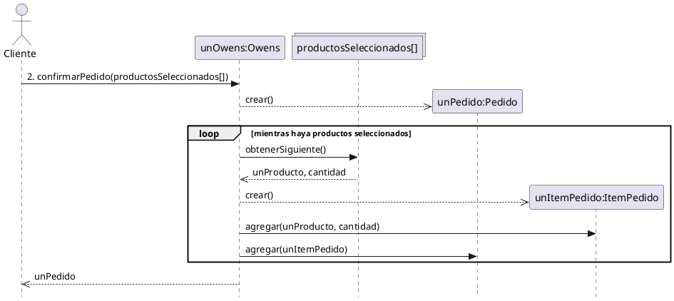
Figura N° 3.4.6.2
