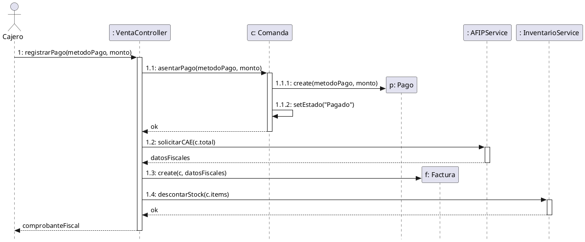
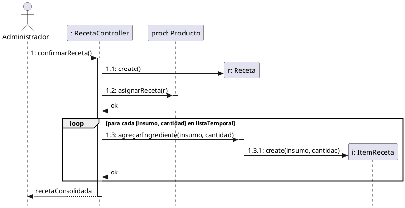
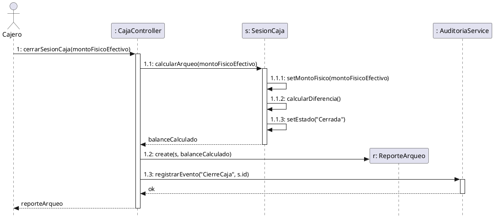
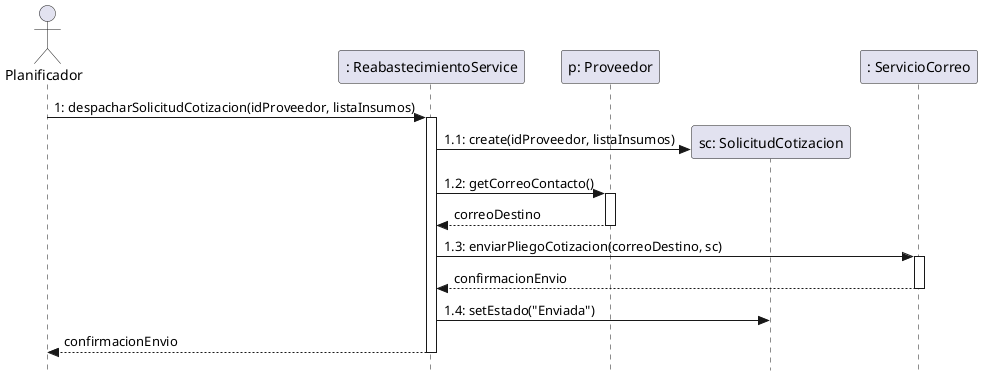
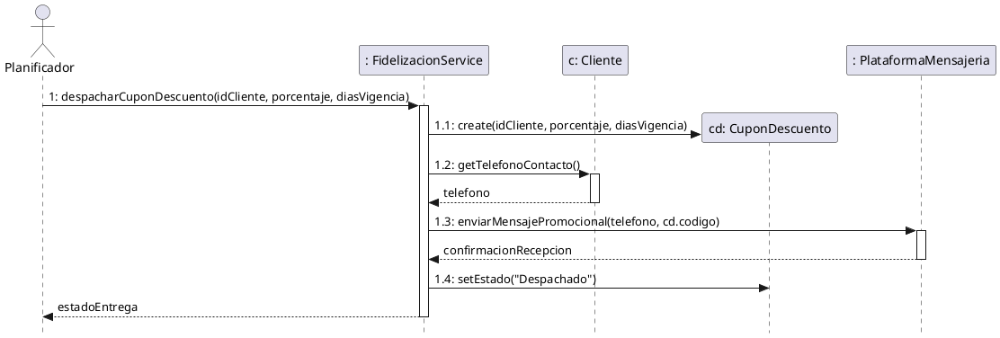

# 3.4 Realizaciones de Casos de Uso (Diagramas de Secuencia de Diseño - DSD)

En esta sección se modela la realización de los casos de uso arquitectónicamente significativos y procesos inteligentes, ilustrando la colaboración de los objetos de software (Caja Blanca) para satisfacer los contratos de operación definidos en la sección 3.3.

---

## 3.4.0 Fundamentación Metodológica y Patrones GRASP (Craig Larman)

Siguiendo los lineamientos de Craig Larman en el Proceso Unificado (Larman, 2004), el diseño orientado a objetos distribuye responsabilidades mediante la aplicación formal de los patrones **GRASP** (*General Responsibility Assignment Software Patterns*):

1. **Controlador (Controller):** El primer objeto detrás de la capa de interfaz que recibe y coordina la operación del sistema (`VentaController`, `CajaController`, `RecetaController`, etc.).
2. **Creador (Creator):** Se asigna la responsabilidad de instanciar clases a aquellos objetos que agregan, contienen o registran íntimamente dicha entidad (ej. `Comanda` crea `Pago`, `Receta` crea `ItemReceta`).
3. **Experto en Información (Information Expert):** La responsabilidad de calcular saldos o procesar reglas se delega al objeto que posee la información requerida (ej. `SesionCaja` calcula su propio balance y diferencias de arqueo).
4. **Bajo Acoplamiento y Alta Cohesión:** Se introducen servicios especializados del dominio (`AFIPService`, `InventarioService`, `AuditoriaService`, `ServicioCorreo`) para aislar complejidades técnicas y dependencias de terceros, manteniendo las clases del modelo limpias y mantenibles.

---

## 3.4.1 Realización de `registrarPago()` (UC-02 / UC-47)

Este evento representa el momento crítico donde el sistema asienta el cobro de una comanda, se comunica de manera síncrona con el servicio fiscal para obtener autorización (CAE) y actualiza atómicamente las existencias de materias primas por receta.

*   **Patrón Controlador:** Delegado a `VentaController`.
*   **Patrón Creador:** `Comanda` crea `Pago`; `VentaController` crea `Factura`.
*   **Servicios Especializados:** `AFIPService` (autorización fiscal síncrona) e `InventarioService` (descuento de materias primas).

---

## 3.4.2 Realización de `confirmarReceta()` (UC-15)

Este evento modela la asignación de la matriz de materias primas (BOM) a un producto comercializable.

*   **Patrón Controlador:** Delegado a `RecetaController`.
*   **Patrón Creador:** `RecetaController` crea `Receta`; `Receta` crea múltiples instancias de `ItemReceta`.
*   **Patrón Experto:** `Receta` conoce sus insumos y gestiona la composición de ingredientes.

---

## 3.4.3 Realización de `cerrarSesionCaja()` (UC-03)

Este evento materializa el Arqueo con Cierre Ciego, donde se contrasta el efectivo físico declarado por el cajero contra los registros acumulados en el sistema sin anticipar el saldo teórico esperado.

*   **Patrón Controlador:** Delegado a `CajaController`.
*   **Patrón Experto:** `SesionCaja` calcula su balance, asienta el conteo declarado y calcula la diferencia de caja.
*   **Patrón Bajo Acoplamiento:** Delegación del registro de eventos sensibles a `AuditoriaService`.

---

## 3.4.4 Realización de `despacharSolicitudCotizacion()` (UC-46 - Módulo Inteligente de Reabastecimiento)

Este evento modela la licitación preventiva de compras, donde el sistema detecta materias primas bajo punto de pedido y despacha pliegos de cotización por correo electrónico a proveedores seleccionados.

*   **Patrón Controlador / Servicio:** Delegado a `ReabastecimientoService`.
*   **Patrón Creador:** `ReabastecimientoService` crea la instancia `SolicitudCotizacion` (RFQ).
*   **Servicio Externo:** `ServicioCorreo` encapsula el despacho asíncrono hacia los proveedores.

---

## 3.4.5 Realización de `despacharCuponDescuento()` (UC-48 - Módulo Inteligente de Marketing)

Este evento modela el flujo autónomo de fidelización, donde el sistema detecta clientes habituales con inactividad prolongada y despacha un cupón promocional a través de la plataforma de mensajería externa.

*   **Patrón Controlador / Servicio:** Delegado a `FidelizacionService`.
*   **Patrón Creador:** `FidelizacionService` crea la instancia `CuponDescuento`.
*   **Servicio Externo:** `PlataformaMensajeria` encapsula la comunicación con la API de mensajería al teléfono del cliente.

