# 4.2. Diseño de Entrada

El diseño de entrada especifica la estructura visual, la ergonomía interactiva y los controles de captura de datos de las interfaces del sistema, implementando la arquitectura de **Pantallas Maestras Unificadas** correspondiente a los subsistemas y áreas funcionales del sistema.

Conforme a las directivas metodológicas de la cátedra, los componentes visuales interactivos se catalogan localmente mediante números entre corchetes `[1]..[N]` asociados al mockup de cada Pantalla Maestra, mientras que debajo de la explicación de componentes de cada pantalla se especifican y exhiben las **Pantallas de retroalimentación (`[Pantalla A]` a `[Pantalla F]`)** parametrizadas específicamente para cada Caso de Uso Real.

---

### Pantalla Maestra 1: Gestión de Catálogo de Menú y Recetas BOM

Esta interfaz centraliza la parametrización de la oferta comercial de productos (Hamburguesas, Extras y Combos) y la definición de su matriz de ingeniería de materias primas (BOM).

#### 4.2.1. CU-15: Asignar Receta a Producto (Alta de Ficha Técnica)
[ir al CU real](4.3_casos_uso_reales.md#431-cu-15-asignar-receta-a-producto-alta-de-ficha-tecnica)

#### 4.2.2. CU-24: Modificar Receta (Actualización de Fórmula y Metadatos)
[ir al CU real](4.3_casos_uso_reales.md#432-cu-24-modificar-receta-actualizacion-de-formula-y-metadatos)

#### 4.2.3. CU-25: Dar de Baja Receta (Inactivación de Catálogo)
[ir al CU real](4.3_casos_uso_reales.md#433-cu-25-dar-de-baja-receta-inactivacion-de-catalogo)

> [!NOTE]
> **Trazabilidad con el Catálogo de Casos de Uso:** En el subsistema de producción ([1.5.4](file:///Users/diego/Documents/builds/owens-system/docs/1_Planificacion/1.5.4_catalogo_casos_uso.md)), los casos de uso que gobiernan las fórmulas de cocina son **CU-15 (Asignar Receta)**, **CU-24 (Modificar Receta)** y **CU-25 (Dar de Baja Receta)**, vinculados comercialmente con **CU-60 (Alta Producto)**, **CU-61 (Baja Producto)** y **CU-62 (Modificar Producto)**.

#### Descripción del flujo de la pantalla:
*   **Encabezado de Operación (Sección Superior):** Muestra la ruta de navegación jerárquica (*Administración > Menú y Recetas*), selector de categoría comercial (Hamburguesas, Extras, Combos) y la barra de búsqueda rápida.
*   **Sección "Catálogo Histórico" (Vista Principal):** Tabla estructurada que exhibe los productos activos, su categoría, precio de venta, costo teórico acumulado por receta, paginación y controles contextuales de edición y baja lógica.
*   **Sección "Drawer / Área de Trabajo" (Panel Desplegable):** Se abre lateralmente mediante el botón de alta o el lápiz de edición. Permite cargar nombre, precio, categoría y agregar dinámicamente filas de insumos componentes (materia prima, cantidad y unidad de medida) que conforman la receta estándar, con cálculo en vivo del costo acumulado.

#### Explicación de los componentes visuales:
*   `[1]` **Opción "Menú":** Enlace en la barra lateral de navegación principal que carga la vista de recetas.
*   `[2]` **Barra de Búsqueda:** Input para filtrar productos por denominación en tiempo real.
*   `[3]` **Selector de Pestañas de Categoría:** Tabs para conmutar entre Hamburguesas, Extras y Combos.
*   `[4]` **Botón "Limpiar Búsqueda / Filtros":** Restablece el campo de búsqueda rápida y el selector de categorías a su estado original.
*   `[5]` **Botón "+ Alta de Producto":** Acciona el despliegue del Drawer con campos vacíos.
*   `[6]` **Tabla Principal de Catálogo:** Grilla estructurada con los registros consolidados.
*   `[7]` **Ícono de Edición (Lápiz):** Carga los componentes del producto en el Drawer para su recalibración.
*   `[8]` **Ícono de Eliminación (Papelera):** Dispara el modal de inactivación lógica.
*   `[9]` **Controles de Paginación de Tabla:** Botones interactivos para navegar entre páginas de registros.
*   `[10]` **Drawer Lateral de Ficha Técnica:** Contenedor desplegable con el formulario de metadatos y componentes BOM.
*   `[11]` **Input "Nombre del Producto":** Denominación comercial del ítem.
*   `[12]` **Selector de Categoría:** Combobox para clasificar el ítem (`Hamburguesas`, `Extras`, `Combos`).
*   `[13]` **Input "Precio de Venta":** Campo monetario con el valor de venta al público.
*   `[14]` **Selector de Insumo Componente:** Dropdown para asociar materias primas del inventario a la receta.
*   `[15]` **Input "Cantidad Consumida":** Proporción física unitaria de insumo por porción elaborada.
*   `[16]` **Botón "+ Agregar Insumo a Receta":** Añade una nueva fila de materia prima a la matriz BOM.
*   `[17]` **Botón "Eliminar Fila de Insumo":** Quita un componente de la receta en edición.
*   `[18]` **Display "Costo Teórico Total":** Sumatoria automática ponderada de los costos de materias primas.
*   `[19]` **Botón de Persistencia ("Guardar" / "Modificar"):** Confirma la transacción en base de datos.
*   `[20]` **Botón "Cancelar":** Cierra el Drawer descartando cambios.

#### Pantallas de retroalimentación:

##### a) Retroalimentación de CU-15: Asignar Receta a Producto (Alta de Ficha Técnica)
*   `[Pantalla A]` **Alerta de Éxito Transaccional:** Notificación verde que confirma el alta y publicación del producto con su matriz BOM en el menú activo.
*   `[Pantalla B]` **Alerta de Validación de Campos:** Advertencia ante campos obligatorios incompletos, precio de venta nulo/negativo o cantidades de insumo menores o iguales a cero.
*   `[Pantalla C]` **Alerta de Inconsistencia de Receta:** Bloqueo por regla de negocio cuando se intenta registrar una ficha técnica con la matriz BOM vacía (sin materias primas).
*   `[Pantalla D]` **Alerta de Registro Duplicado:** Advertencia cuando la denominación del producto ya existe en el catálogo o se intenta repetir un insumo dentro de la misma receta.
*   `[Pantalla E]` **Modal de Confirmación de Operación:** Diálogo modal (`PUBLICAR RECETA` / `CANCELAR`) previo a persistir atómicamente la receta.

| Identificador y Función | Captura de Retroalimentación (CU-15) |
| :--- | :--- |
| **`[Pantalla A]` Éxito Transaccional** |  |
| **`[Pantalla B]` Validación de Campos** |  |
| **`[Pantalla C]` Inconsistencia de Receta** |  |
| **`[Pantalla D]` Registro Duplicado** |  |
| **`[Pantalla E]` Confirmación de Operación** | 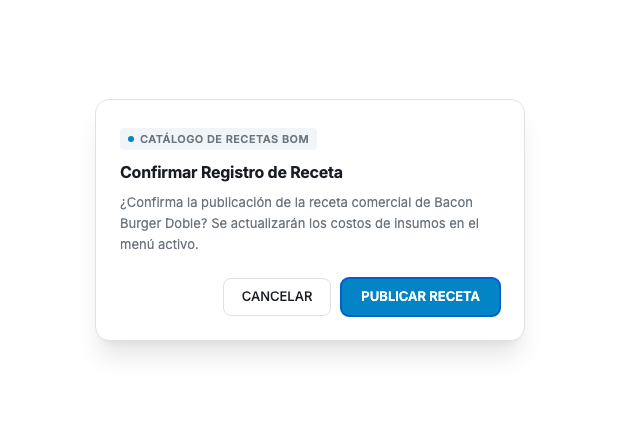 |

##### b) Retroalimentación de CU-24: Modificar Receta (Actualización de Fórmula y Metadatos)
*   `[Pantalla A]` **Alerta de Éxito Transaccional:** Notificación que confirma la actualización de la fórmula BOM y el recálculo del costo estándar del producto.
*   `[Pantalla B]` **Alerta de Validación de Campos:** Advertencia ante precios o proporciones unitarias menores o iguales a cero durante la edición.
*   `[Pantalla C]` **Alerta de Inconsistencia de Receta:** Bloqueo si el administrador elimina todos los ingredientes dejando la fórmula vacía o ante conflicto de edición concurrente.
*   `[Pantalla D]` **Alerta de Registro Duplicado:** Advertencia si el nuevo nombre comercial colisiona con otro producto activo del menú.
*   `[Pantalla E]` **Modal de Confirmación de Operación:** Diálogo modal (`ACTUALIZAR RECETA` / `CANCELAR`) para ratificar el cambio de fórmula y costos.

| Identificador y Función | Captura de Retroalimentación (CU-24) |
| :--- | :--- |
| **`[Pantalla A]` Éxito Transaccional** |  |
| **`[Pantalla B]` Validación de Campos** |  |
| **`[Pantalla C]` Inconsistencia de Receta** |  |
| **`[Pantalla D]` Registro Duplicado** |  |
| **`[Pantalla E]` Confirmación de Operación** | 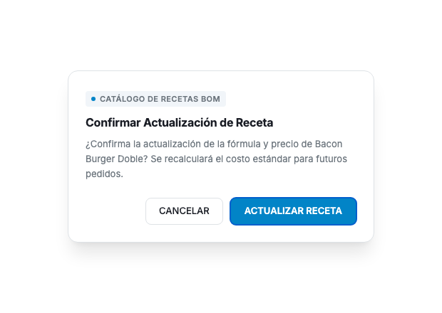 |

##### c) Retroalimentación de CU-25: Dar de Baja Receta (Inactivación de Catálogo)
*   `[Pantalla A]` **Alerta de Éxito Transaccional:** Confirmación de que el producto y su receta fueron inactivados lógicamente del menú comercial.
*   `[Pantalla C]` **Alerta de Inconsistencia Operativa:** Bloqueo si el producto forma parte obligatoria de un Combo promocional activo vigente.
*   `[Pantalla F]` **Modal de Confirmación de Inactivación:** Diálogo modal de seguridad (`INACTIVAR` / `CANCELAR`) que advierte el retiro del producto de mostrador y cocina.

| Identificador y Función | Captura de Retroalimentación (CU-25) |
| :--- | :--- |
| **`[Pantalla A]` Éxito Transaccional** |  |
| **`[Pantalla C]` Inconsistencia Operativa** |  |
| **`[Pantalla F]` Confirmación de Inactivación** | 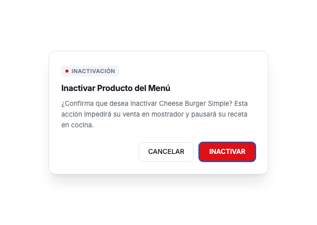 |

Figura N° 4.2.1.1: Mockup de Pantalla Maestra de Gestión de Menú y Recetas BOM (Componentes [1] al [20])

---

### Pantalla Maestra 2: Inventario de Insumos y Materias Primas

Esta interfaz controla las materias primas y provisiones del almacén (carne, pan, quesos, aderezos, papas, bebidas envasadas).

#### 4.2.4. CU-12: Dar de Alta Insumo
[ir al CU real](4.3_casos_uso_reales.md#434-cu-12-dar-de-alta-insumo)

#### 4.2.5. CU-14: Modificar Insumo
[ir al CU real](4.3_casos_uso_reales.md#435-cu-14-modificar-insumo)

#### 4.2.6. CU-13: Dar de Baja Insumo
[ir al CU real](4.3_casos_uso_reales.md#436-cu-13-dar-de-baja-insumo)

#### Descripción del flujo de la pantalla:
Permite al encargado de depósito auditar las existencias físicas de materias primas. Cuenta con una tabla principal con el stock actual de cada ingrediente, filtros por rubro, costo unitario de compra y botones para desplegar el Drawer de alta/modificación o disparar la baja de insumos obsoletos.

#### Explicación de los componentes visuales:
*   `[1]` **Opción "Inventario":** Control de acceso en la barra lateral de navegación principal.
*   `[2]` **Barra de Búsqueda de Insumos:** Filtrado por denominación de materia prima.
*   `[3]` **Filtro de Rubro / Tipo de Insumo:** Selector para filtrar ingredientes por categoría (Carnes, Panificados, Lácteos, Vegetales, Descartables).
*   `[4]` **Botón "Limpiar Filtros de Inventario":** Restablece la barra de búsqueda y el filtro de rubro a sus valores predeterminados.
*   `[5]` **Botón "+ Alta de Insumo":** Despliega el formulario para incorporar una nueva materia prima.
*   `[6]` **Tabla de Insumos de Almacén:** Matriz estructurada con nombre, stock físico, unidad y costo.
*   `[7]` **Ícono de Edición de Insumo (Lápiz):** Precarga el insumo en el Drawer para ajustar costo o existencias.
*   `[8]` **Ícono de Baja de Insumo (Papelera):** Dispara el modal de baja lógica en almacén.
*   `[9]` **Controles de Paginación de Tabla:** Botones de cambio de página en el catálogo de almacén.
*   `[10]` **Drawer de Carga / Modificación:** Formulario lateral para parametrizar insumos.
*   `[11]` **Input "Denominación del Insumo":** Nombre de la materia prima.
*   `[12]` **Selector "Unidad de Medida":** Dropdown con unidades físicas estándar (`kg`, `g`, `l`, `ml`, `unidad`).
*   `[13]` **Input "Costo Unitario de Compra":** Precio de reposición pactado con proveedores.
*   `[14]` **Input "Stock Inicial / Umbral de Seguridad":** Existencias físicas iniciales y nivel mínimo de reposición.
*   `[15]` **Botón "Guardar Insumo":** Control de persistencia en catálogo de existencias.
*   `[16]` **Botón "Cancelar":** Cierra el Drawer sin alterar el inventario.

#### Pantallas de retroalimentación:

##### a) Retroalimentación de CU-12: Dar de Alta Insumo
*   `[Pantalla A]` **Alerta de Éxito Transaccional:** Confirmación de incorporación de la nueva materia prima al depósito de almacén.
*   `[Pantalla B]` **Alerta de Validación de Campos:** Advertencia ante campos requeridos vacíos, falta de unidad de medida o costo unitario menor o igual a cero.
*   `[Pantalla C]` **Alerta de Inconsistencia Operativa:** Notificación ante fallo transaccional o de integridad al intentar registrar el insumo.
*   `[Pantalla D]` **Alerta de Registro Duplicado:** Advertencia cuando la denominación de la materia prima ya se encuentra dada de alta en el inventario.
*   `[Pantalla E]` **Modal de Confirmación de Operación:** Diálogo modal (`REGISTRAR INSUMO` / `CANCELAR`) previo a asentar el alta en el depósito.

| Identificador y Función | Captura de Retroalimentación (CU-12) |
| :--- | :--- |
| **`[Pantalla A]` Éxito Transaccional** |  |
| **`[Pantalla B]` Validación de Campos** |  |
| **`[Pantalla C]` Inconsistencia Operativa** |  |
| **`[Pantalla D]` Registro Duplicado** |  |
| **`[Pantalla E]` Confirmación de Operación** | 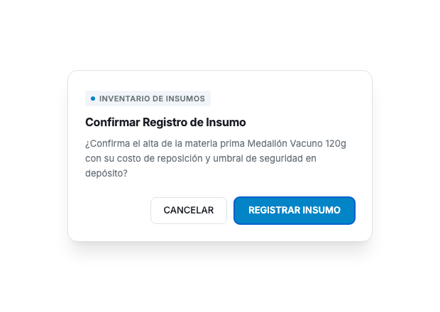 |

##### b) Retroalimentación de CU-14: Modificar Insumo
*   `[Pantalla A]` **Alerta de Éxito Transaccional:** Confirmación de actualización del costo unitario de reposición y umbral de seguridad del insumo.
*   `[Pantalla B]` **Alerta de Validación de Campos:** Advertencia cuando el costo unitario es menor o igual a cero o el stock de seguridad es negativo.
*   `[Pantalla C]` **Alerta de Inconsistencia Operativa:** Bloqueo por conflicto dimensional cuando se intenta cambiar la unidad de medida de un insumo que ya integra recetas BOM activas.
*   `[Pantalla D]` **Alerta de Registro Duplicado:** Advertencia si la denominación modificada colisiona con otro insumo existente en el depósito.
*   `[Pantalla E]` **Modal de Confirmación de Operación:** Diálogo modal (`ACEPTAR` / `CANCELAR`) que advierte el recálculo automático de las recetas asociadas.

| Identificador y Función | Captura de Retroalimentación (CU-14) |
| :--- | :--- |
| **`[Pantalla A]` Éxito Transaccional** |  |
| **`[Pantalla B]` Validación de Campos** |  |
| **`[Pantalla C]` Inconsistencia Operativa** |  |
| **`[Pantalla D]` Registro Duplicado** |  |
| **`[Pantalla E]` Confirmación de Operación** | 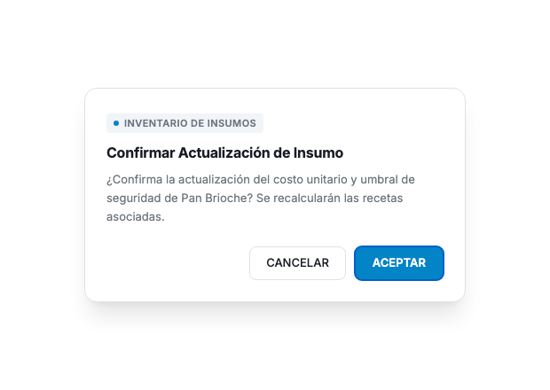 |

##### c) Retroalimentación de CU-13: Dar de Baja Insumo
*   `[Pantalla A]` **Alerta de Éxito Transaccional:** Confirmación de baja lógica de la materia prima en el catálogo de almacén.
*   `[Pantalla C]` **Alerta de Inconsistencia de Baja:** Bloqueo cuando el insumo forma parte de recetas activas vigentes, posee stock físico mayor a cero o registra órdenes de compra pendientes.
*   `[Pantalla F]` **Modal de Confirmación de Inactivación:** Diálogo modal de seguridad (`INACTIVAR` / `CANCELAR`) para ratificar el retiro del insumo.

| Identificador y Función | Captura de Retroalimentación (CU-13) |
| :--- | :--- |
| **`[Pantalla A]` Éxito Transaccional** |  |
| **`[Pantalla C]` Inconsistencia de Baja** |  |
| **`[Pantalla F]` Confirmación de Inactivación** | 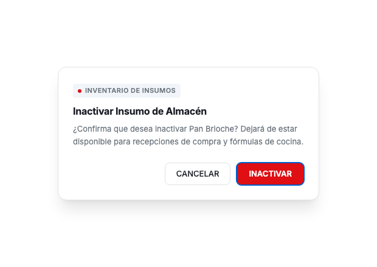 |

Figura N° 4.2.2.1: Mockup de Pantalla Maestra de Inventario de Insumos (Componentes [1] al [16])

---

### Pantalla Maestra 3: Terminal de Punto de Venta Mostrador (POS)

Esta interfaz constituye el puesto de trabajo táctil para la facturación, cobro y despacho rápido en salón y mostrador.

#### 4.2.7. CU-02: Registrar Venta en Punto de Venta (POS)
[ir al CU real](4.3_casos_uso_reales.md#437-cu-02-registrar-venta-en-punto-de-venta-pos)

#### 4.2.8. CU-05: Anular Venta y Emitir Nota de Crédito AFIP
[ir al CU real](4.3_casos_uso_reales.md#438-cu-05-anular-venta-y-emitir-nota-de-credito-afip)

#### Descripción del flujo de la pantalla:
Dispone a la izquierda una cuadrícula táctil de productos por categoría y a la derecha el ticket activo con subtotal e impuestos. Al pulsar "COBRAR", se despliega el modal de cobro con soporte para pagos únicos o divididos (*Split Payments* en efectivo, débito, crédito, transferencias y QR) y facturación electrónica con AFIP CAE.

#### Explicación de los componentes visuales:
*   `[1]` **Opción "Ventas":** Control de acceso en la barra lateral de navegación principal.
*   `[2]` **Botón "Buscar / Anular Ticket":** Abre el cuadro de localización de ventas pasadas para su cancelación o Nota de Crédito.
*   `[3]` **Botón "Reimprimir Último Comprobante Fiscal":** Dispara la reemisión del ticket fiscal térmico ante fallas mecánicas o recarga de rollo de papel.
*   `[4]` **Pestañas de Categoría Rápida:** Filtros táctiles superiores (Hamburguesas, Papas, Bebidas, Combos).
*   `[5]` **Botonera Táctil de Productos:** Tarjetas interactivas de productos con imagen y precio.
*   `[6]` **Panel de Ticket en Vivo:** Detalle vertical con ítems, cantidades y subtotales acumulados.
*   `[7]` **Controles de Cantidad (+ / -):** Modificadores de unidades por línea.
*   `[8]` **Botón "Eliminar Ítem del Ticket":** Quita una línea específica de la orden activa.
*   `[9]` **Botón "Limpiar Ticket":** Vacía el pedido en curso descartando todos los artículos cargados.
*   `[10]` **Display de Total a Cobrar:** Visualizador numérico destacado.
*   `[11]` **Botón "COBRAR [F12]":** Despliega el modal de liquidación y cobro.
*   `[12]` **Selector de Medios de Pago:** Botones para Efectivo, Tarjeta de Débito, Crédito, Transferencia y QR.
*   `[13]` **Botón "+ Pago Dividido":** Permite combinar múltiples formas de pago para liquidar el pedido (*Split Payments*).
*   `[14]` **Input "Monto Recibido":** Campo numérico donde se ingresa el dinero entregado por el cliente.
*   `[15]` **Display "Vuelto":** Cálculo automático del cambio en pesos.
*   `[16]` **Selector de Tipo de Comprobante Fiscal:** Combobox para alternar entre Factura B, Factura A o Ticket C.
*   `[17]` **Input "CUIT / Identificación Tributaria del Cliente":** Campo fiscal obligatorio al seleccionar Factura A para validación en padrón AFIP.
*   `[18]` **Input "Razón Social / Nombre Comercial del Cliente":** Razón social registrada requerida para la discriminación de IVA en Factura A.
*   `[19]` **Botón "Confirmar Pago y Facturar":** Asienta la venta y despacha la solicitud fiscal a AFIP con obtención de CAE.
*   `[20]` **Botón "Cancelar Cobro":** Cierra el modal de cobro retornando a la edición del ticket.
*   `[21]` **Input "Nro. de Comprobante":** Campo de localización de la venta a anular en el modal de anulación.
*   `[22]` **Input "Motivo de Anulación":** Justificación requerida para la Nota de Crédito fiscal.
*   `[23]` **Input "Clave de Autorización de Supervisor":** Campo de autenticación con privilegios gerenciales.
*   `[24]` **Botón "Confirmar Anulación":** Ejecuta la anulación fiscal, Nota de Crédito y restitución de stock.
*   `[25]` **Botón "Cancelar Anulación":** Cierra el cuadro de anulación sin alterar el comprobante.

#### Pantallas de retroalimentación:

##### a) Retroalimentación de CU-02: Registrar Venta en Punto de Venta (POS)
*   `[Pantalla A]` **Alerta de Éxito Transaccional:** Notificación de venta cobrada, factura emitida con CAE autorizado por AFIP y comanda despachada al monitor de cocina KDS.
*   `[Pantalla B]` **Alerta de Validación de Pago / Campos:** Advertencia ante ticket vacío, monto recibido inferior al total adeudado, desbalance en pago dividido o CUIT inválido para Factura A.
*   `[Pantalla C]` **Alerta de Inconsistencia de Stock / Operativa:** Bloqueo ante quiebre de stock de materias primas para elaborar el producto o rechazo en la pasarela electrónica de pago.
*   `[Pantalla E]` **Modal de Liquidación y Cobro:** Diálogo interactivo (`CONFIRMAR PAGO Y FACTURAR` / `CANCELAR COBRO`) para procesar el cobro y emitir el comprobante fiscal.

| Identificador y Función | Captura de Retroalimentación (CU-02) |
| :--- | :--- |
| **`[Pantalla A]` Éxito Transaccional** |  |
| **`[Pantalla B]` Validación de Pago / Campos** |  |
| **`[Pantalla C]` Inconsistencia de Stock** | 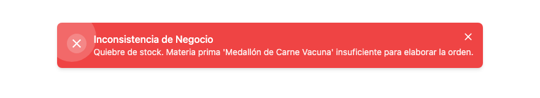 |
| **`[Pantalla E]` Modal de Liquidación y Cobro** | 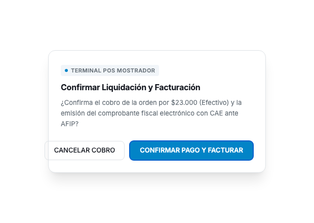 |

##### b) Retroalimentación de CU-05: Anular Venta y Emitir Nota de Crédito AFIP
*   `[Pantalla A]` **Alerta de Éxito Transaccional:** Confirmación de emisión electrónica de la Nota de Crédito en AFIP y restitución atómica de los insumos al inventario.
*   `[Pantalla B]` **Alerta de Validación de Campos:** Advertencia cuando el número de comprobante es inexistente/vacío o se omite redactar el motivo de anulación.
*   `[Pantalla C]` **Alerta de Inconsistencia Operativa:** Bloqueo cuando el comprobante ya fue anulado previamente, la clave de supervisor es inválida o el Web Service de AFIP rechaza la operación.
*   `[Pantalla F]` **Modal de Confirmación de Anulación:** Diálogo de seguridad (`CONFIRMAR ANULACIÓN` / `CANCELAR ANULACIÓN`) que exige ratificar la emisión irreversible de la Nota de Crédito.

| Identificador y Función | Captura de Retroalimentación (CU-05) |
| :--- | :--- |
| **`[Pantalla A]` Éxito Transaccional** |  |
| **`[Pantalla B]` Validación de Campos** |  |
| **`[Pantalla C]` Inconsistencia Operativa** |  |
| **`[Pantalla F]` Confirmación de Anulación** | 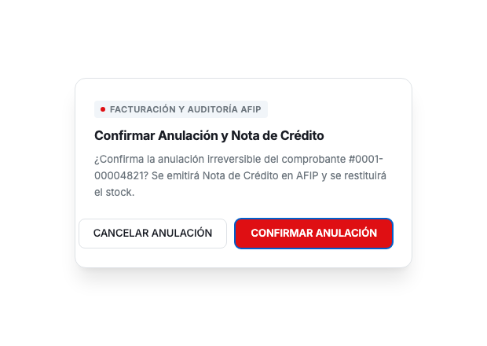 |

Figura N° 4.2.3.1: Mockup de Terminal POS Mostrador y Modal de Facturación (Componentes [1] al [25])

---

### Pantalla Maestra 4: Módulo de Turno y Control de Caja

Esta interfaz gestiona el ciclo operativo de tesorería del puesto: apertura de gaveta, arqueo con cierre ciego y movimientos extraordinarios de efectivo.

#### 4.2.9. CU-01: Abrir Sesión de Caja
[ir al CU real](4.3_casos_uso_reales.md#439-cu-01-iniciar-turno-y-apertura-de-caja)

#### 4.2.10. CU-03: Cerrar Sesión de Caja (Arqueo con Cierre Ciego)
[ir al CU real](4.3_casos_uso_reales.md#4310-cu-03-cierre-de-turno-y-arqueo-ciego-de-caja)

#### 4.2.11. CU-04: Registrar Movimiento Manual de Caja (Ingreso / Egreso)
[ir al CU real](4.3_casos_uso_reales.md#4311-cu-04-registrar-movimiento-manual-de-caja-ingreso--egreso)

#### Descripción del flujo de la pantalla:
Al iniciar turno, exige tipear el monto del fondo inicial de cambio. Al finalizar la jornada, implementa el **Cierre Ciego**: el cajero ingresa el monto físico contado en gaveta sin conocer el saldo teórico calculado por el sistema. Tras confirmar, el sistema contrasta los montos y emite el balance de arqueo con opción de exportación a PDF.

#### Explicación de los componentes visuales:
*   `[1]` **Opción "Caja":** Control de acceso en la barra lateral de navegación principal.
*   `[2]` **Badge Indicador de Estado de Caja:** Etiqueta visual de estado (`Caja Abierta` / `Caja Cerrada`).
*   `[3]` **Tarjetas KPI de Saldo:** Indicadores en vivo (Fondo Inicial, Cobranzas en Efectivo, Egresos y Saldo Teórico).
*   `[4]` **Input "Fondo Inicial de Caja":** Efectivo base para cambio al abrir el turno.
*   `[5]` **Botón "Abrir Caja":** Habilita la sesión en base de datos y desbloquea el Punto de Venta.
*   `[6]` **Botón "Cancelar Apertura":** Desiste de la apertura de caja.
*   `[7]` **Botón "Cerrar Turno de Caja":** Despliega el formulario de cierre y arqueo ciego.
*   `[8]` **Input "Monto Físico de Cierre":** Declaración de efectivo contado a ciegas por el cajero en gaveta.
*   `[9]` **Botón "Confirmar Cierre de Caja":** Clausura la sesión, asienta arqueo y calcula diferencias.
*   `[10]` **Botón "Cancelar Cierre":** Cierra el formulario de arqueo permitiendo continuar la operación.
*   `[11]` **Botón "Descargar Reporte de Arqueo (PDF)":** Descarga el comprobante oficial auditado del turno.
*   `[12]` **Botón "+ Movimiento Manual":** Abre el modal para asentar ingresos o retiros extraordinarios.
*   `[13]` **Selector de Flujo de Caja:** Botones para alternar entre `Ingreso Extraordinario` y `Egreso Operativo`.
*   `[14]` **Input "Importe":** Monto monetario del movimiento manual.
*   `[15]` **Input "Motivo / Justificación":** Explicación requerida del movimiento para auditoría.
*   `[16]` **Botón "Guardar Movimiento":** Confirma la transacción en la sesión de caja activa.
*   `[17]` **Botón "Cancelar Movimiento":** Cierra el formulario descartando el movimiento.
*   `[18]` **Selector de Filtro de Movimientos:** Control para segmentar la grilla histórica entre `Todos`, `Ingresos` y `Egresos`.
*   `[19]` **Tabla Histórica de Movimientos del Turno:** Grilla cronológica con hora, tipo, motivo e importe.

#### Pantallas de retroalimentación:

##### a) Retroalimentación de CU-01: Iniciar Turno y Apertura de Caja
*   `[Pantalla A]` **Alerta de Éxito Transaccional:** Confirmación de inicio de turno con el fondo inicial declarado y habilitación operativa del TPV.
*   `[Pantalla B]` **Alerta de Validación de Fondos:** Advertencia ante montos de fondo inicial negativos, vacíos o no numéricos.
*   `[Pantalla C]` **Alerta de Inconsistencia Operativa:** Bloqueo cuando ya existe una sesión de caja abierta en el puesto o el usuario carece de permisos de tesorería.
*   `[Pantalla E]` **Modal de Confirmación de Apertura:** Diálogo modal (`ABRIR CAJA` / `CANCELAR`) para ratificar el fondo inicial declarado antes de abrir el turno.

| Identificador y Función | Captura de Retroalimentación (CU-01) |
| :--- | :--- |
| **`[Pantalla A]` Éxito Transaccional** |  |
| **`[Pantalla B]` Validación de Fondos** |  |
| **`[Pantalla C]` Inconsistencia Operativa** |  |
| **`[Pantalla E]` Confirmación de Apertura** | 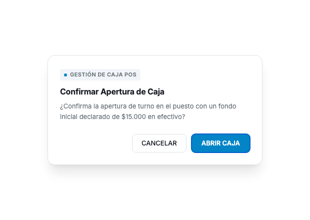 |

##### b) Retroalimentación de CU-03: Cierre de Turno y Arqueo Ciego de Caja
*   `[Pantalla A]` **Alerta de Éxito Transaccional:** Confirmación de clausura inmutable del turno y disponibilidad del reporte PDF de arqueo.
*   `[Pantalla B]` **Alerta de Validación de Fondos:** Advertencia ante conteo físico inválido o falta de justificación obligatoria cuando existe desvío mayor al umbral.
*   `[Pantalla C]` **Alerta de Inconsistencia Operativa:** Bloqueo del cierre si existen comandas activas pendientes de cobro en el salón o fallo al compilar el PDF.
*   `[Pantalla E]` **Modal de Resultado de Arqueo Ciego:** Diálogo comparativo (`CONFIRMAR CIERRE DE CAJA` / `CANCELAR CIERRE`) que exhibe Saldo Teórico, Efectivo Contado y Diferencia (Exacto, Sobrante o Faltante).

| Identificador y Función | Captura de Retroalimentación (CU-03) |
| :--- | :--- |
| **`[Pantalla A]` Éxito Transaccional** |  |
| **`[Pantalla B]` Validación de Fondos** |  |
| **`[Pantalla C]` Inconsistencia Operativa** |  |
| **`[Pantalla E]` Resultado de Arqueo Ciego** | 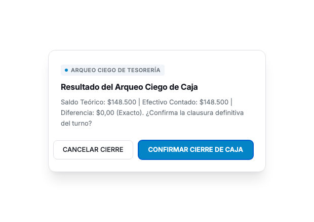 |

##### c) Retroalimentación de CU-04: Registrar Movimiento Manual de Caja (Ingreso / Egreso)
*   `[Pantalla A]` **Alerta de Éxito Transaccional:** Confirmación del asiento del ingreso extraordinario o egreso operativo en la sesión activa.
*   `[Pantalla B]` **Alerta de Validación de Fondos:** Advertencia cuando el importe es menor o igual a cero o se omite redactar el motivo de auditoría.
*   `[Pantalla C]` **Alerta de Inconsistencia Operativa:** Bloqueo cuando la caja se encuentra cerrada, el egreso supera el efectivo disponible en gaveta o excede el tope sin autorización de supervisor.
*   `[Pantalla E]` **Modal de Confirmación de Movimiento:** Diálogo modal (`GUARDAR MOVIMIENTO` / `CANCELAR`) para ratificar la imputación contable en el turno.

| Identificador y Función | Captura de Retroalimentación (CU-04) |
| :--- | :--- |
| **`[Pantalla A]` Éxito Transaccional** |  |
| **`[Pantalla B]` Validación de Fondos** |  |
| **`[Pantalla C]` Inconsistencia Operativa** |  |
| **`[Pantalla E]` Confirmación de Movimiento** | 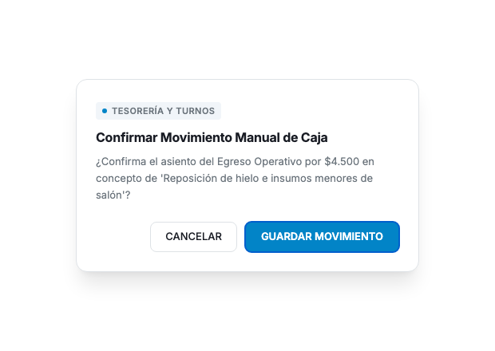 |

Figura N° 4.2.4.1: Mockup de Pantalla Maestra de Control de Caja y Arqueo Ciego (Componentes [1] al [19])

---

### Pantalla Maestra 5: Monitor de Cocina en Tiempo Real (KDS)

Diseñada para terminales táctiles en la zona de cocción. Opera reactivamente sincronizada con el mostrador y los pedidos de autoservicio digital.

#### 4.2.12. CU-10: Visualizar y Despachar Comandas en Cocina (KDS)
[ir al CU real](4.3_casos_uso_reales.md#4312-cu-10-visualizar-y-despachar-comandas-en-cocina-kds)

#### Descripción del flujo de la pantalla:
Expone tarjetas dinámicas de comandas que cambian de color según el tiempo de espera. El cocinero presiona "INICIAR PREPARACIÓN" para pasar a estado "En Cocción" y "ORDEN LISTA" para despachar y notificar al cliente.

#### Explicación de los componentes visuales:
*   `[1]` **Header KDS:** Contador de pedidos pendientes y reloj en tiempo real.
*   `[2]` **Selector de Filtros de Estado:** Pestañas de filtrado (`Pendientes`, `En Cocción`, `Listas`, `Histórico`).
*   `[3]` **Botón "Silenciar / Activar Alerta Sonora":** Interruptor para silenciar o reactivar el timbre acústico de comanda entrante.
*   `[4]` **Botón "Notificar / Timbre de Retiro":** Emite una señal acústica y visual hacia la zona de entrega para convocar al cliente o repartidor.
*   `[5]` **Tarjeta de Comanda:** Bloque con número de pedido, hora de ingreso y canal (Mostrador o Web).
*   `[6]` **Temporizador Semafórico Reactivo:** Cronómetro visual (Verde: < 5 min; Amarillo: 5-10 min; Rojo: > 10 min).
*   `[7]` **Detalle de Productos y Modificaciones:** Lista de hamburguesas, ingredientes extra y notas especiales de cocción.
*   `[8]` **Botón "INICIAR PREPARACIÓN":** Transiciona la comanda a elaboración activa ('En Cocción').
*   `[9]` **Botón "ORDEN LISTA":** Finaliza la preparación de la orden y notifica para su despacho.
*   `[10]` **Botón "Revertir Estado":** Permite desandar la transición en caso de pulsación involuntaria.
*   `[11]` **Botón "Descartar Comanda Anulada":** Permite al cocinero remover de la pantalla una orden que fue anulada desde el mostrador.

#### Pantallas de retroalimentación:

##### a) Retroalimentación de CU-10: Visualizar y Despachar Comandas en Cocina (KDS)
*   `[Pantalla A]` **Alerta Sonora y Visual de Pedido Entrante:** Notificación reactiva con destello y aviso acústico cuando ingresa una nueva comanda desde Mostrador POS o Canal Web.
*   `[Pantalla C]` **Alerta de Comanda Anulada / Interrupción Operativa:** Banner crítico en rojo con señal acústica cuando una orden en curso es anulada desde caja para detener de inmediato su cocción.

| Identificador y Función | Captura de Retroalimentación (CU-10) |
| :--- | :--- |
| **`[Pantalla A]` Alerta de Pedido Entrante** |  |
| **`[Pantalla C]` Alerta de Comanda Anulada** | 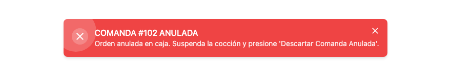 |

Figura N° 4.2.5.1: Mockup de Monitor KDS de Cocina en Tiempo Real (Componentes [1] al [11])

---

### Pantalla Maestra 6: Menú Digital y Carrito de Autoservicio

Esta interfaz pública permite a los clientes interactuar directamente con el menú digital desde sus teléfonos móviles o terminales de autoservicio.

#### 4.2.13. CU-49: Generar Pedido Digital
[ir al CU real](4.3_casos_uso_reales.md#4313-cu-49-generar-pedido-digital)

#### Descripción del flujo de la pantalla:
El cliente accede al menú digital interactivo. Visualiza el carrusel de hamburguesas artesanales (Cheese Burger, Bacon Burger, Bacon Crispy, American Burger), selecciona el tamaño (Simple, Doble, Triple), personaliza con ingredientes extra (Papas, Bacon, Cheddar, Bebida, Salsas), visualiza el subtotal acumulado y confirma su pedido despachándolo directamente a la cocina KDS.

#### Explicación de los componentes visuales:
*   `[1]` **Carrusel Interactivo de Hamburguesas:** Selector visual con animación de los productos principales.
*   `[2]` **Selector de Pestaña "Combos Promocionales":** Pestaña con las opciones de combos configurados (Combo 1 al 5).
*   `[3]` **Selector de Tamaño de Medallones:** Botones para alternar entre medallón Simple, Doble o Triple.
*   `[4]` **Botonera de Adicionales y Extras:** Controles incrementales para añadir papas, bacon, cheddar y bebidas.
*   `[5]` **Botón "+ Añadir al Carrito":** Agrega el producto personalizado al pedido actual.
*   `[6]` **Carrito Flotante de Compra:** Panel inferior desplegable que exhibe los ítems seleccionados y el subtotal acumulado.
*   `[7]` **Botón "Eliminar Ítem del Carrito":** Quita una línea específica del pedido.
*   `[8]` **Botón "Vaciar Carrito":** Descarta todos los artículos seleccionados.
*   `[9]` **Input "Nombre y Apellido del Cliente":** Identificación nominal de quien retira o recibe el pedido.
*   `[10]` **Selector de Modalidad de Entrega:** Botones para alternar entre `Retiro en Mostrador` y `Envío a Domicilio`.
*   `[11]` **Input "Dirección de Entrega":** Campo de texto para la dirección del cliente (habilitado en Delivery).
*   `[12]` **Input "Teléfono / WhatsApp de Contacto":** Número telefónico requerido para la logística y avisos de entrega.
*   `[13]` **Input "Notas y Aclaraciones para Cocina":** Campo de texto para especificaciones de cocción (ej. "sin cebolla").
*   `[14]` **Selector de Medio de Pago del Cliente:** Botones para seleccionar `Efectivo al Retirar` o `Transferencia / QR`.
*   `[15]` **Botón "Seguir Comprando / Minimizar Carrito":** Repliega el panel flotante para continuar explorando la carta.
*   `[16]` **Botón de Checkout ("HACER PEDIDO"):** Dispara la confirmación y el envío del pedido a cocina.

#### Pantallas de retroalimentación:

##### a) Retroalimentación de CU-49: Generar Pedido Digital
*   `[Pantalla A]` **Notificación de Confirmación de Pedido Digital:** Alerta de éxito que informa al cliente su número de orden asignado y el tiempo estimado de preparación en cocina.
*   `[Pantalla B]` **Alerta de Selección Incompleta:** Advertencia cuando el carrito se encuentra vacío o faltan completar datos obligatorios de identificación, dirección o teléfono de entrega.
*   `[Pantalla C]` **Alerta de Inconsistencia Operativa / Producto Agotado:** Notificación cuando un producto o ingrediente extra se queda sin disponibilidad de stock en cocina o falla el enlace de red.
*   `[Pantalla E]` **Modal de Confirmación de Pedido Digital:** Diálogo de confirmación de checkout (`HACER PEDIDO` / `SEGUIR COMPRANDO`) previo a remitir la comanda al KDS de cocina.

| Identificador y Función | Captura de Retroalimentación (CU-49) |
| :--- | :--- |
| **`[Pantalla A]` Confirmación de Pedido Digital** |  |
| **`[Pantalla B]` Selección o Datos Incompletos** |  |
| **`[Pantalla C]` Producto Temporalmente Agotado** |  |
| **`[Pantalla E]` Modal de Checkout Digital** | 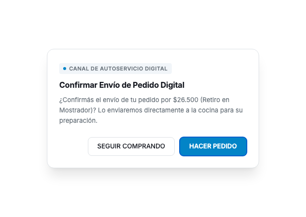 |

Figura N° 4.2.6.1: Mockup de Menú Digital y Carrito de Autoservicio (Componentes [1] al [16])
