# 4.4. Diagrama de Secuencia de Diseño (DSD)

---

### 4.4.1. DSD del CU-01 Abrir Sesión de Caja
[Link al DSS](../3_Especificacion_y_Diseno/3.2_diagramas_secuencia_sistema.md#321-dss-uc-01-abrir-sesión-de-caja)

#### DSD - abrirSesionCaja(montoBase)
[Link al contrato](../3_Especificacion_y_Diseno/3.3_contratos_de_operacion.md#contrato-abrirsesioncajamontobase)

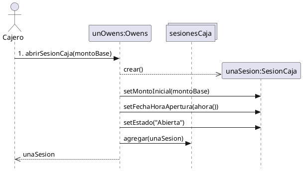
Figura N° 4.4.1.1

---

### 4.4.2. DSD del CU-02 Registrar Venta
[Link al DSS](../3_Especificacion_y_Diseno/3.2_diagramas_secuencia_sistema.md#322-dss-uc-02-registrar-venta)

#### DSD - iniciarNuevaOrden()
[Link al contrato](../3_Especificacion_y_Diseno/3.3_contratos_de_operacion.md#contrato-iniciarnuevaorden)

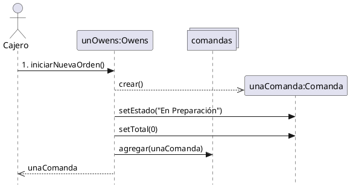
Figura N° 4.4.2.1

#### DSD - agregarItem(idProducto, cantidad)
[Link al contrato](../3_Especificacion_y_Diseno/3.3_contratos_de_operacion.md#contrato-agregaritemidproducto-cantidad)

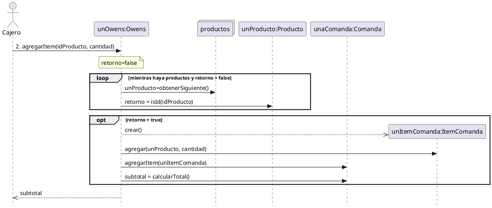
Figura N° 4.4.2.2

#### DSD - registrarPago(metodoPago, montoRecibido)
[Link al contrato](../3_Especificacion_y_Diseno/3.3_contratos_de_operacion.md#331-módulo-de-ventas-y-caja-pos)

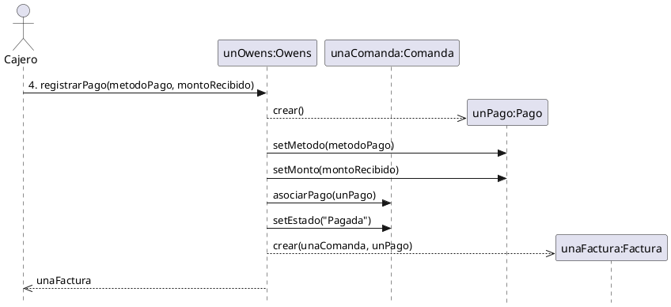
Figura N° 4.4.2.3

---

### 4.4.3. DSD del CU-03 Cerrar Sesión de Caja
[Link al DSS](../3_Especificacion_y_Diseno/3.2_diagramas_secuencia_sistema.md#323-dss-uc-03-cerrar-sesión-de-caja)

#### DSD - cerrarSesionCaja(montoFisicoEfectivo)
[Link al contrato](../3_Especificacion_y_Diseno/3.3_contratos_de_operacion.md#contrato-cerrarsesioncajamontofisicoefectivo)

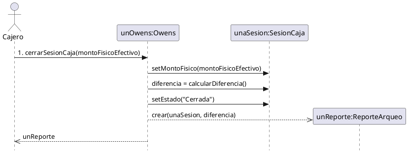
Figura N° 4.4.3.1

---

### 4.4.4. DSD del CU-04 Registrar Movimiento Manual de Caja
[Link al DSS](../3_Especificacion_y_Diseno/3.2_diagramas_secuencia_sistema.md#324-dss-uc-04-registrar-movimiento-manual-de-caja)

#### DSD - registrarMovimientoCaja(tipoMovimiento, monto, motivo)
[Link al contrato](../3_Especificacion_y_Diseno/3.3_contratos_de_operacion.md#contrato-registrarmovimientocajatipomovimiento-monto-motivo)

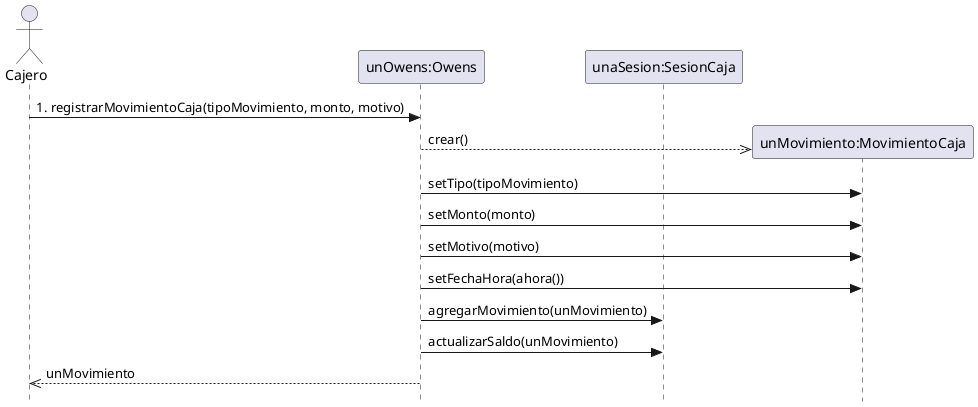
Figura N° 4.4.4.1

---

### 4.4.5. DSD del CU-05 Anular Venta
[Link al DSS](../3_Especificacion_y_Diseno/3.2_diagramas_secuencia_sistema.md#325-dss-uc-05-anular-venta)

#### DSD - buscarVenta(nroTicket)
[Link al contrato](../3_Especificacion_y_Diseno/3.3_contratos_de_operacion.md#contrato-buscarventanroticket-operación-de-consulta)

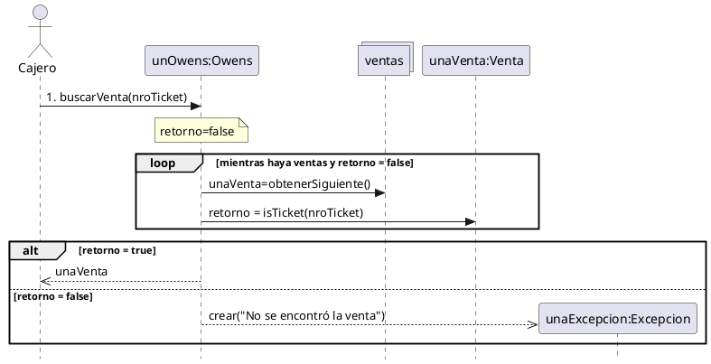
Figura N° 4.4.5.1

#### DSD - anularVenta(idVenta, motivo)
[Link al contrato](../3_Especificacion_y_Diseno/3.3_contratos_de_operacion.md#contrato-anularventaidventa-motivo)

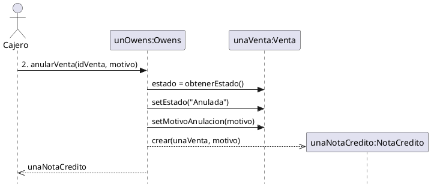
Figura N° 4.4.5.2

---

### 4.4.6. DSD del CU-15 Asignar Receta a Insumo
[Link al DSS](../3_Especificacion_y_Diseno/3.2_diagramas_secuencia_sistema.md#327-dss-uc-15-asignar-receta)

#### DSD - seleccionarInsumoComponer(idInsumo)
[Link al contrato](../3_Especificacion_y_Diseno/3.3_contratos_de_operacion.md#contrato-confirmarversionreceta)

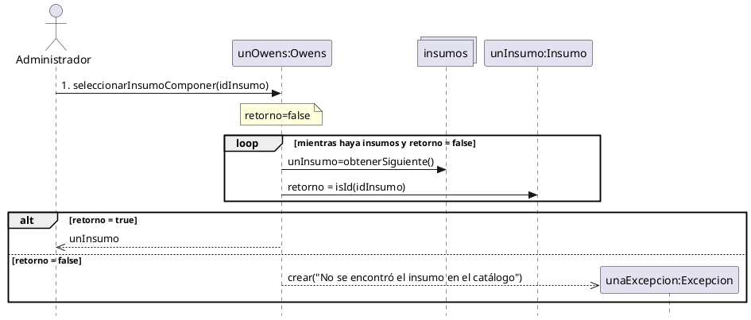
Figura N° 4.4.6.1

#### DSD - confirmarVersionReceta(unInsumo, fechaDesde, fechaHasta, componentes[])
[Link al contrato](../3_Especificacion_y_Diseno/3.3_contratos_de_operacion.md#contrato-confirmarversionreceta)

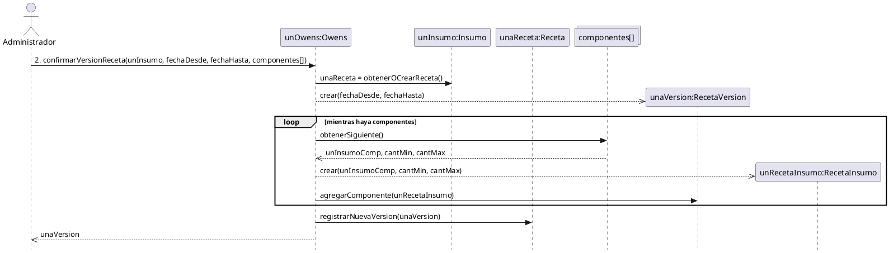
Figura N° 4.4.6.2

#### DSD - registrarLoteElaboracion(unInsumo, unaVersion, cantElaborar, lotesConsumidos[])
[Link al contrato](../3_Especificacion_y_Diseno/3.3_contratos_de_operacion.md#contrato-registrarloteelaboracioncantidadelaborar-fechaorigen-fechavencimiento)

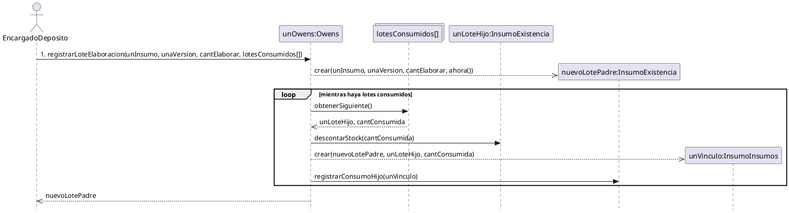
Figura N° 4.4.6.3

---

### 4.4.7. DSD del CU-10 Visualizar y Despachar Comandas de Producción (KDS)
[Link al DSS](../3_Especificacion_y_Diseno/3.2_diagramas_secuencia_sistema.md#326-dss-uc-10-visualizar-comandas-de-producción-kds)

#### DSD - consultarComandasPendientes()
[Link al contrato](../3_Especificacion_y_Diseno/3.3_contratos_de_operacion.md#contrato-consultarcomandaspendientes-operación-de-consulta)

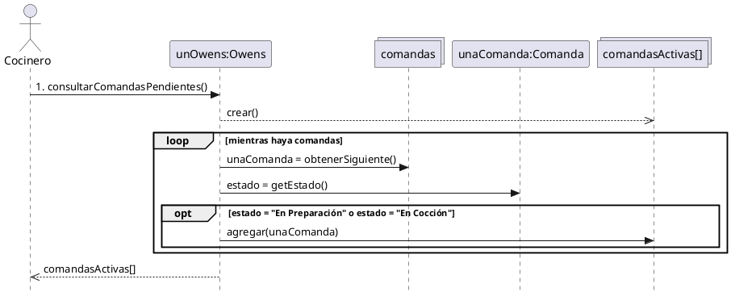
Figura N° 4.4.7.1

#### DSD - iniciarPreparacion(idComanda)
[Link al contrato](../3_Especificacion_y_Diseno/3.3_contratos_de_operacion.md#contrato-iniciarpreparacionidcomanda)

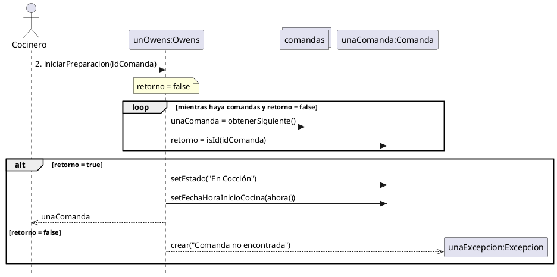
Figura N° 4.4.7.2

#### DSD - marcarOrdenLista(idComanda)
[Link al contrato](../3_Especificacion_y_Diseno/3.3_contratos_de_operacion.md#contrato-marcarordenlistaidcomanda)

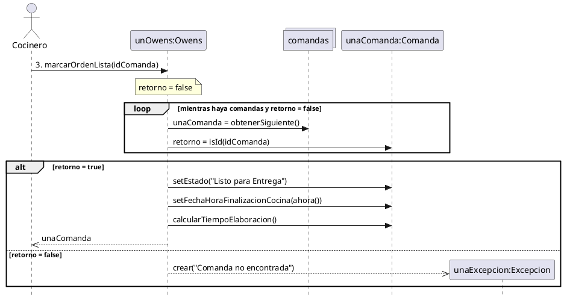
Figura N° 4.4.7.3

---

### 4.4.8. DSD del CU-29 Consultar Historial de Sesiones de Caja y Reportes
[Link al DSS](../3_Especificacion_y_Diseno/3.2_diagramas_secuencia_sistema.md#3211-dss-uc-29-consultar-historial-de-sesiones-de-caja)

#### DSD - buscarSesionesCaja(fechaDesde, fechaHasta, idUsuario)
[Link al contrato](../3_Especificacion_y_Diseno/3.3_contratos_de_operacion.md#331-módulo-de-ventas-y-caja-pos)

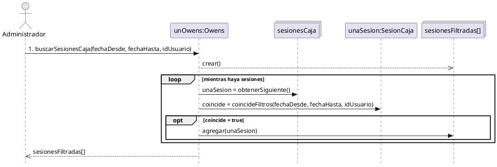
Figura N° 4.4.8.1

#### DSD - consultarDetalleSesion(idSesion)
[Link al contrato](../3_Especificacion_y_Diseno/3.3_contratos_de_operacion.md#contrato-cerrarsesioncajamontofisicoefectivo)

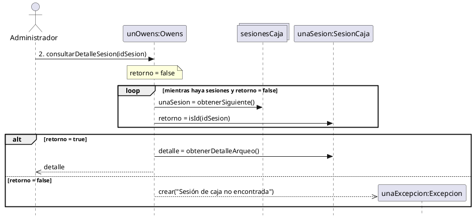
Figura N° 4.4.8.2

---

### 4.4.9. DSD del CU-49 Realizar Pedido Digital
[Link al DSS](../3_Especificacion_y_Diseno/3.2_diagramas_secuencia_sistema.md#3218-dss-uc-49-generar-pedido-digital)

#### DSD - seleccionarProducto(idProducto, cantidad)
[Link al contrato](../3_Especificacion_y_Diseno/3.3_contratos_de_operacion.md#contrato-confirmarpedidodigitaldatoscontacto-metodoentrega-metodopago)

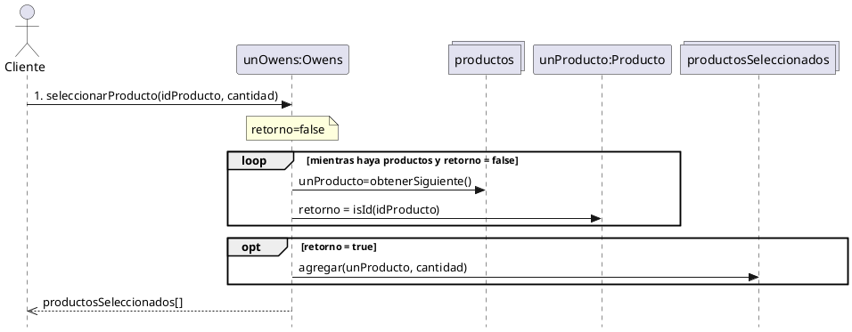
Figura N° 4.4.9.1

#### DSD - confirmarPedido(productosSeleccionados[])
[Link al contrato](../3_Especificacion_y_Diseno/3.3_contratos_de_operacion.md#contrato-confirmarpedidodigitaldatoscontacto-metodoentrega-metodopago)

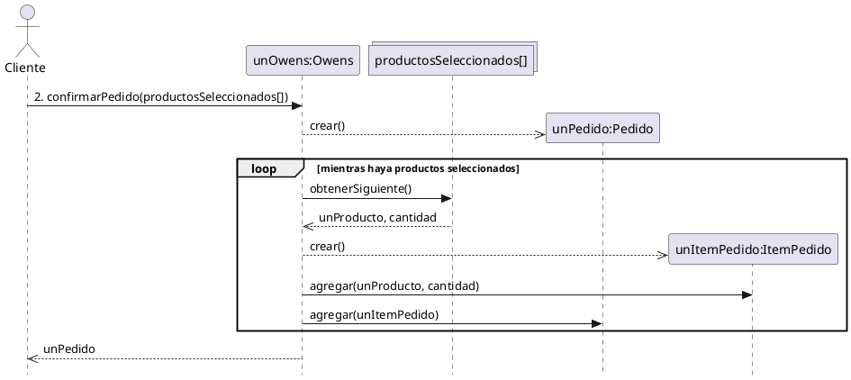
Figura N° 4.4.9.2

