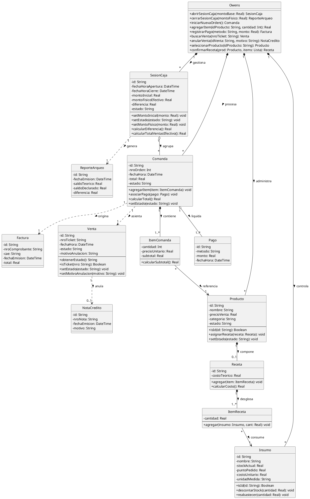

# 4.6. Diagrama de Clases

El Diagrama de Clases consolida la taxonomía, las asociaciones estructurales y las responsabilidades operativas asignadas a las entidades del dominio de negocio, reflejando fielmente los métodos y colaboraciones descubiertos durante la elaboración de los Diagramas de Secuencia de Diseño (DSD - Sección 4.4) y las invariantes OCL (Sección 4.5).

---

### Figura N° 4.6.1: Diagrama de Clases del Dominio de Negocio

### Justificación de Diseño y Trazabilidad
1. **Acoplamiento Cohesivo:** La clase fachada `Owens` encapsula la lógica de orquestación del negocio, delegando el comportamiento en los objetos expertos (`SesionCaja` calcula sus diferencias, `Comanda` calcula sus totales, `Receta` totaliza sus costos).
2. **Trazabilidad 1 a 1 con DSD:** Todos los métodos públicos presentes en el diagrama corresponden exactamente a las firmas de mensaje diagramadas en la Sección 4.4.
