# 4.6. Diagrama de Clases

A diferencia del Modelo de Datos (orientado a la persistencia), este diagrama expone la lógica de negocio mediante Programación Orientada a Objetos (POO). 

Aplicando los principios de Modelado Ágil y la arquitectura unificada requerida para el dominio gastronómico, el diseño se enfoca exclusivamente en el comportamiento y la taxonomía, omitiendo atributos de base de datos y métodos de acceso (*getters/setters*) para priorizar la lectura arquitectónica. Destacan los siguientes patrones:

*   **Unificación de Catálogo mediante Patrón Composite ("Todo es Insumo"):** La dicotomía entre `Producto` e `Insumo` se elimina a favor de una taxonomía unificada bajo la clase `Insumo`. Tanto los ingredientes básicos como las preparaciones intermedias y los menús para la venta son modelados como `Insumo`.
*   **Desacoplamiento entre Configuración Teórica y Lotes de Existencia Física:** La fórmula o composición se define mediante una plantilla abierta versionada (`Receta`, `RecetaVersion`, `RecetaInsumo`) con rangos de tolerancia (`cantidadMinima` y `cantidadMaxima`, donde min = 0 denota opcionalidad). La existencia física se modela en lotes con fecha de origen y vencimiento (`InsumoExistencia`), y el consumo de lotes hijos para fabricar lotes padres se registra en `InsumoInsumos`, garantizando trazabilidad bromatológica completa.
*   **Polimorfismo y Herencia:** Los roles (`Cajero`, `Administrador`, `EncargadoLogistica`) heredan de la clase abstracta `Usuario`.
*   **Asociaciones Directas:** Se omiten los rombos de agregación/composición por generar ambigüedad semántica (Fowler, 2003). Se utilizan asociaciones simples con flechas de navegabilidad y multiplicidad explícita.
*   **Desacoplamiento:** La `Venta` depende de una interfaz abstracta (`IServicioFiscal`), aislando al sistema de la tecnología interna de entes externos como AFIP.

---

### Figura N° 4.6.1: Diagrama de Clases del Dominio Orientado al Comportamiento (Catálogo Unificado y Trazabilidad Bromatológica)

```plantuml
@startuml
left to right direction
skinparam nodesep 50
skinparam ranksep 50
skinparam class {
    BackgroundColor white
    ArrowColor #2C3E50
    BorderColor #2C3E50
}

' --- TAXONOMÍA DE USUARIOS (HERENCIA) ---
abstract class Usuario {
  - nombre: String
  - correo: String
  - activo: Boolean
  --
  + autenticarCredenciales()
  + cerrarSesion()
}

class Rol {
  - nombre: String
  - permisos: Lista
  --
  + validarAcceso()
}

class Administrador {
  --
  + anularTransaccion()
  + auditarAcciones()
}

class Cajero {
  --
  + iniciarTurnoCaja()
  + generarCierreCaja()
}

class EncargadoLogistica {
  --
  + registrarIngresoStock()
  + dispararOrdenCompra()
  + registrarElaboracionLote()
}

Usuario <|-- Administrador
Usuario <|-- Cajero
Usuario <|-- EncargadoLogistica
Usuario --> "1" Rol : - rolAsignado

' --- INGENIERÍA DE INSUMOS Y RECETAS (COMPOSITE & TEMPLATE) ---
class Insumo {
  - nombre: String
  - descripcion: String
  - duracionCerrado: Entero
  - duracionAbierto: Entero
  - esComercializable: Boolean
  - precioVenta: Decimal
  - costoBase: Decimal
  --
  + consultarStockDisponible(): Decimal
  + obtenerRecetaVigente(fecha: Fecha): RecetaVersion
  + esElaborado(): Boolean
  + aplicarBajaLogica()
}

class UnidadMedida {
  - nombre: String
  - simbolo: String
  --
  + validarPrecision()
}

class Receta {
  - nombre: String
  - descripcion: String
  --
  + obtenerVersionParaFecha(fecha: Fecha): RecetaVersion
  + crearNuevaVersion(desde: Fecha, hasta: Fecha): RecetaVersion
}

class RecetaVersion {
  - fechaDesde: Fecha
  - fechaHasta: Fecha
  --
  + esVigente(fecha: Fecha): Boolean
  + calcularCostoTeorico(): Decimal
  + validarConsistencia()
}

class RecetaInsumo {
  - cantidadMinima: Decimal
  - cantidadMaxima: Decimal
  --
  + esOpcional(): Boolean
  + validarRango(cantidad: Decimal): Boolean
}

' --- TRAZABILIDAD FÍSICA Y BROMATOLÓGICA (LOTES) ---
class InsumoExistencia {
  - fechaOrigen: Fecha
  - cantidad: Decimal
  - fechaVencimiento: Fecha
  --
  + estaVencido(): Boolean
  + descontarStock(cantidad: Decimal)
  + obtenerGenealogiaConsumo(): Lista
}

class InsumoInsumos {
  - cantidad: Decimal
  --
  + registrarVinculoLote()
}

class MovimientoInventario {
  - cantidad: Decimal
  - tipoMovimiento: String
  - motivo: String
  - fechaHora: Fecha
  --
  + registrarAjuste()
}

Insumo --> "1" UnidadMedida : - unidadMedida
Insumo --> "0..1" Receta : - recetaElaboracion
Receta --> "1..*" RecetaVersion : - versiones
RecetaVersion --> "1..*" RecetaInsumo : - componentes
RecetaInsumo --> "1" Insumo : - insumoRequerido

Insumo --> "*" InsumoExistencia : - existenciasFisicas
InsumoExistencia --> "0..1" RecetaVersion : - versionUtilizada
InsumoExistencia --> "*" InsumoInsumos : - consumosHijo
InsumoInsumos --> "1" InsumoExistencia : - existenciaHijo
Insumo --> "*" MovimientoInventario : - movimientos

' --- OPERACIONES DE VENTA Y CAJA ---
class SesionCaja {
  - estado: String
  - montoApertura: Decimal
  --
  + abrirSesion()
  + cerrarSesion()
  + calcularArqueo()
}

class MovimientoCaja {
  - tipo: String
  - monto: Decimal
  - justificacion: String
  --
  + registrarMovimiento()
}

class Venta {
  - total: Decimal
  - estado: String
  --
  + agregarLineaPedido()
  + aplicarReglaDescuento()
  + emitirComprobanteFinal()
}

class LineaVenta {
  - cantidad: Entero
  - subtotal: Decimal
  --
  + calcularSubtotal()
}

Cajero --> "0..1" SesionCaja : - sesionActiva
SesionCaja --> "*" Venta : - transacciones
SesionCaja --> "*" MovimientoCaja : - movimientosManuales
Venta --> "*" LineaVenta : - lineas
LineaVenta --> "1" Insumo : - insumoComercializado

' --- LOGÍSTICA (COMPRAS) ---
class Proveedor {
  - cuit: String
  --
  + evaluarReputacion()
}

class OrdenCompra {
  - estado: String
  --
  + aprobarOrden()
  + registrarRecepcion()
}

EncargadoLogistica --> "*" OrdenCompra : - ordenesEmitidas
OrdenCompra --> "1" Proveedor : - proveedorDestino
OrdenCompra --> "*" Insumo : - insumosSolicitados

' --- FIDELIZACIÓN (PROCESO INTELIGENTE) ---
class Cliente {
  - ultimaFechaCompra: Fecha
  - telefonoContacto: String
  --
  + calcularDiasInactividad()
}

class CuponDescuento {
  - porcentaje: Decimal
  - fechaVencimiento: Fecha
  --
  + generarCodigoUnico()
  + dispararEnvioMensajeria()
}

Venta --> "0..1" Cliente : - clienteFidelizado
Cliente --> "*" CuponDescuento : - cuponesRecibidos

' --- GERENCIA Y REPORTES ---
class Reporte {
  - tipo: String
  --
  + exportarPDF()
}

Administrador --> "*" Reporte : - reportesGenerados

class GastoOperativo {
  - monto: Decimal
  - fechaHora: Fecha
  --
  + registrarEgreso()
  + anularEgreso()
}

class CategoriaGasto {
  - nombre: String
  --
  + modificarCategoria()
}

Administrador --> "*" GastoOperativo : - gastosRegistrados
GastoOperativo --> "1" CategoriaGasto : - categoria
SesionCaja --> "*" GastoOperativo : - retirosCaja

' --- AUDITORÍA Y SEGURIDAD ---
class RegistroAuditoria {
  - accion: String
  - entidadAfectada: String
  - fechaHora: Fecha
  --
  + registrarEvento()
}

Usuario --> "*" RegistroAuditoria : - eventosAuditados

' --- INTERFACES EXTERNAS ---
interface IServicioFiscal <<interface>> {
  + solicitarAutorizacion()
}

class ClienteAFIP {
  --
  + enviarLoteDatos()
  + recibirCAE()
}

IServicioFiscal <|.. ClienteAFIP
Venta ..> IServicioFiscal : usa >

@enduml
```

*Nota.* Elaboración propia. El modelo ilustra la estructura de la lógica de negocio orientada a objetos con catálogo unificado y trazabilidad bromatológica de lotes conforme a las prácticas de diseño de software (Fowler, 2003).
