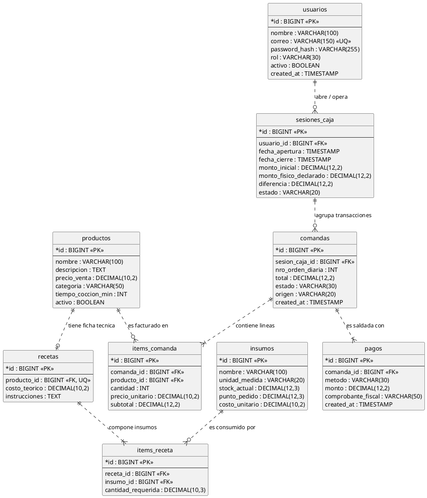

# 4.7. Diseño de Modelo de Datos (Modelo Relacional)

El modelo relacional define el esquema de persistencia física en el motor de base de datos **PostgreSQL 16**, estructurado rigurosamente bajo la **Tercera Forma Normal (3FN)** para evitar redundancias, anomalías de actualización y garantizar integridad transaccional ACID.

---

### 4.7.1. Diagrama Entidad-Relación (DER Físico Normalizado)

---

### 4.7.2. Cumplimiento de Formas Normales (3FN)
1. **Primera Forma Normal (1FN):** Todos los atributos son atómicos (sin arrays ni campos multivaluados). La composición de ingredientes se normalizó en la tabla intermedia `items_receta`.
2. **Segunda Forma Normal (2FN):** Toda tabla con clave primaria compuesta se encuentra descompuesta; cada atributo no clave depende enteramente de la clave primaria.
3. **Tercera Forma Normal (3FN):** No existen dependencias transitivas. El subtotal de los ítems de comanda y el costo teórico de la receta son atributos calculables o congelados para auditoría contable inmutable ante cambios futuros de listas de precios.
