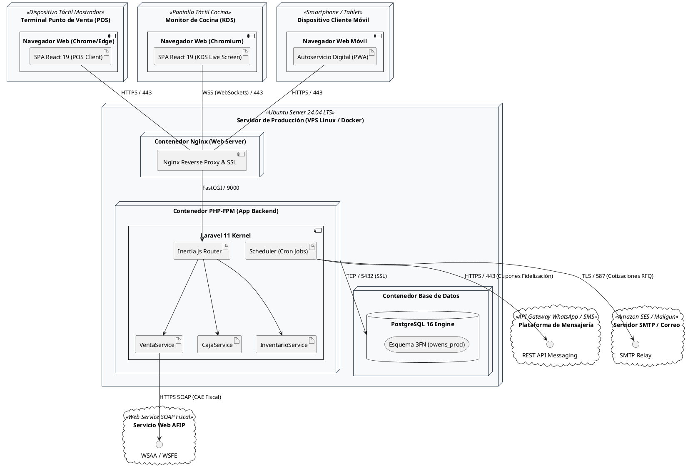

# 7. Implantación - Migración

## 7.1. Diagrama de componentes y despliegue

El diagrama de componentes y despliegue modela la topología física de la infraestructura donde residen y se ejecutan los artefactos de software del Sistema Owens en su entorno de producción.

---

### Figura N° 7.1.1: Diagrama de Despliegue Físico y Componentes

### Componentes de Infraestructura
1.  **Red Local del Local Gastronómico (LAN):** Los puestos de trabajo (POS de mostrador y pantalla KDS de despacho en cocina) se comunican mediante red Ethernet local cableada de baja latencia con respaldo Wi-Fi.
2.  **Servidor de Producción Contenerizado:** Todos los servicios (Nginx, PHP-FPM y PostgreSQL) se despliegan aislados en contenedores Docker gestionados mediante Docker Compose, facilitando réplicas y copias de seguridad inmediatas.
3.  **Seguridad Perimetral:** El tráfico entrante se cifra bajo protocolo TLS 1.3 con certificados SSL Let's Encrypt automatizados.
